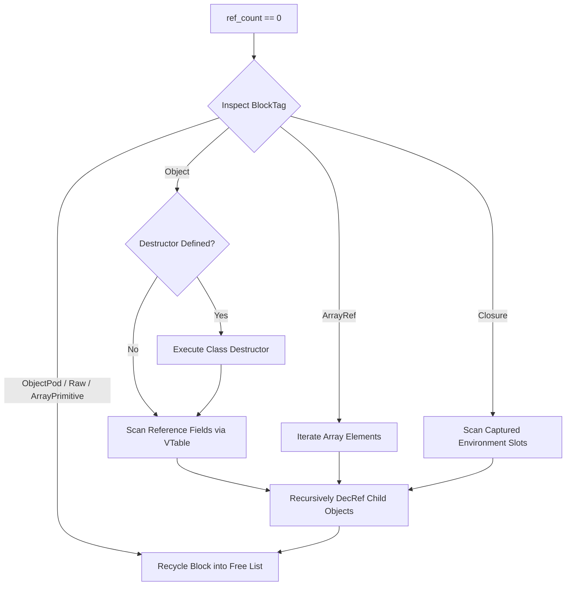

# Automatic Reference Counting (ARC) Internals

## 1. Overview

Solix achieves deterministic memory management without the latency spikes and non-deterministic pauses of tracing garbage collectors (such as Java or Go) through **Automatic Reference Counting (ARC)**.

Objects and dynamic collections are allocated on the byte-addressed heap with an 8-byte metadata header. The compiler analyzes lexical variable scopes and emits precise reference count increments and decrements. The instant an allocation's reference count drops to zero, its destructor executes and its memory is immediately recycled into segregated free lists.

---

## 2. Reference Count Lifecycle

Every dynamic heap block contains a 28-bit unsigned reference counter embedded in the lower bits of its header's second word:

```text
Address - 4: [ 4 bits BlockTag | 28 bits ref_count ]
```

### 2.1. Initialization
When an allocation instruction executes (`NewObject`, `NewArrayRef`, `NewClosure`, `AllocString`), the memory allocator sets `ref_count = 1`.

### 2.2. Retain (`IncRef`)
Whenever an object reference is duplicated:
- Storing a reference into a local register or variable slot.
- Passing a reference parameter into a function.
- Storing a reference into an instance field of another heap object.
- Appending a reference to a dynamic collection or array.

The VM increments the 28-bit counter via [`crates/solix-runtime/src/memory/layout.rs`](file:///home/jehud/Projects/solix-language/crates/solix-runtime/src/memory/layout.rs#L122):
```rust
pub fn inc_ref(&mut self) -> Result<u32, RuntimeError> {
    if self.ref_count == MAX_REF_COUNT {
        return Ok(MAX_REF_COUNT); // Immortal object
    }
    if self.ref_count >= MAX_REF_COUNT - 1 {
        return Err(RuntimeError::TypeMismatch {
            expected: "ref count < MAX_REF_COUNT".to_string(),
            found: format!("ref count overflowed {}", self.ref_count),
        });
    }
    self.ref_count += 1;
    Ok(self.ref_count)
}
```

### 2.3. Release (`DecRef`)
When a reference leaves scope:
- Exiting a block statement (`{ ... }`).
- Executing `return`, `break`, or `continue`.
- Unwinding call frames during an exception throw.
- Overwriting an existing field or array element containing a reference.

The VM decrements the counter:
```rust
pub fn dec_ref(&mut self) -> u32 {
    if self.ref_count == MAX_REF_COUNT {
        return MAX_REF_COUNT;
    }
    if self.ref_count > 0 {
        self.ref_count -= 1;
    }
    self.ref_count
}
```

---

## 3. Immediate Deallocation & Cascading Cleanups

When `dec_ref()` returns `0`, the deallocation engine immediately triggers teardown:



### 3.1. POD (Plain-Old-Data) Optimization
Classes marked as Plain-Old-Data containing only scalar values (`int32`, `float64`, `bool`, etc.) are tagged with `BlockTag::ObjectPod`. Their deallocation skips virtual table field offset inspection completely and recycles memory in $O(1)$ time.

### 3.2. Reference Array Mutation
When assigning an element into a reference array (`ArrayRef`):
1. The VM reads the existing reference stored at the target index.
2. If non-null, the existing reference is decremented (`DecRef`).
3. The new reference is written to the array slot and incremented (`IncRef`).

---

## 4. Cycle Breaking with `weak` References

Cyclic reference relationships (e.g. parent-child tree graphs, circular doubly linked lists) prevent reference counts from ever reaching zero. Solix resolves this with the `weak` modifier:

```solix
package solix.collections;

public class TreeNode {
    public String value;
    public List<TreeNode> children;
    public weak TreeNode parent; // Non-owning reference: does not increment ref_count

    public TreeNode(String initial_value) {
        this.value = initial_value;
        this.children = new List<TreeNode>();
        this.parent = null;
    }
}
```

### 4.1. Weak Reference Mechanics
1. Storing an object address into a `weak` field copies the address without invoking `IncRef`.
2. The runtime registers the weak field slot in the object's weak reference table.
3. When the owning object is deallocated at `ref_count == 0`, all registered weak references pointing to it are automatically nullified (`null`), preventing dangling pointer hazards.

### 4.2. Collection Destructors & Intrusive Lifecycle
1. Bidirectional data structures (such as `LinkedList` doubly-linked nodes and `TreeMap` parent/child nodes) define explicit destructors (`~LinkedList()`, `~TreeMap()`, `~TreeSet()`).
2. Upon collection deallocation, the destructor walks the structure to sever internal cyclical references (`previous_node = null`, `parent_node = null`), allowing standard ARC cascade drops to reclaim all nodes deterministically.
3. Primitive strings (`BlockTag::String`) allocated via runtime builtins (`__builtin_str_concat`) or FFI (`solix_vm_alloc_string`) are tracked in `interned_string_addrs`, ensuring complete heap reclamation during VM shutdown and zero-leak verification.
