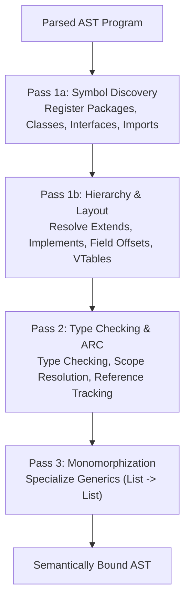

# Semantic Binder Passes

## 1. Overview

The `Binder` stage ([`crates/solix-compilation/src/phases/binder/binder.rs`](../../crates/solix-compilation/src/phases/binder/binder.rs)) is the semantic engine of the Solix compiler. Because Solix supports forward references, cyclic class relationships, virtual inheritance, method overloading, and template monomorphization, binding cannot occur in a single top-to-bottom AST traversal.

Instead, the `Binder` executes **four sequential passes**:

---

## 2. Pass 1a: Symbol Discovery & Package Registration
- **Source Module**: [`crates/solix-compilation/src/phases/binder/passes/pass1_symbol_discovery.rs`](../../crates/solix-compilation/src/phases/binder/passes/pass1_symbol_discovery.rs)
- **Goal**: Register the names of all top-level types across all compilation units before inspecting any bodies.
- **Operations**:
  - Traverses the `Program` AST across all parsed source files.
  - Records the active package declaration from `PackageStatement` (e.g. `package solix.io;`).
  - Registers all `ClassDeclaration`, `InterfaceDeclaration`, and `EnumDeclaration` identifiers in the global symbol table using their fully qualified names (`SymbolTable`).
  - Collects `alias` declarations and queues `import` / `extern import` statements for dependency resolution.
  - Validates that type names are globally unique within their declaring package namespace and enforces checked `u16` source ID bounds (`<= 65,536` sources).

---

## 3. Pass 1b: Type Hierarchy & Member Registration
- **Source Module**: [`crates/solix-compilation/src/phases/binder/passes/pass2_type_hierarchy.rs`](../../crates/solix-compilation/src/phases/binder/passes/pass2_type_hierarchy.rs)
- **Goal**: Establish inheritance relationships and calculate physical class memory layouts without type-checking method bodies.
- **Operations**:
  - Resolves `extends` base classes and `implements` interfaces against registered symbols.
  - Enforces single class inheritance while permitting multiple interface implementation.
  - Validates inheritance graphs and reports `BindingError::CyclicInheritance` on cycles (e.g. `class A extends B` and `class B extends A`).
  - Calculates field byte offsets adhering to natural alignment boundaries ([`crates/solix-compilation/src/phases/binder/layout.rs`](../../crates/solix-compilation/src/phases/binder/layout.rs)).
  - Assigns unique sequential `vtable_id` numbers to all classes and constructs virtual method tables.
  - Qualifies member symbols (methods, fields, constructors, destructors, operators) using effective fully qualified class names (`package::Class::member(...)`) in `fully_qualified_name`, preventing member collision across distinct namespaces sharing identical class names.
  - Runs type-aware call normalization ([`call_normalizer.rs`](../../crates/solix-compilation/src/phases/binder/call_normalizer.rs)) with lexical variable/parameter scopes, inheritance-hierarchy resolution, and field/return type lookup (injecting default arguments and variadic tuples strictly within matched class/function boundaries with zero cross-class fallback).

---

## 4. Pass 2: Type Checking, Scoping & ARC Insertion
- **Source Module**: [`crates/solix-compilation/src/phases/binder/passes/pass3_type_checking.rs`](../../crates/solix-compilation/src/phases/binder/passes/pass3_type_checking.rs)
- **Goal**: Full semantic validation of statements and expressions, call resolution, and insertion of memory management hooks.
- **Operations**:
  - Validates expression types, binary operations, method argument matching, and explicit type casts.
  - Manages lexical scopes (`Scope` stack) for local variables, tracking register lifetimes and variable shadowing rules.
  - Records inferred lambda expression types (`node_types`) for both variable declarations and assignments so member/array closure assignments emit balanced ARC cleanup.
  - Enforces `const` variable immutability.
  - Distinguishes instance method calls (`receiver.method()`) from static method invocations using scope resolution (`ClassName::method()`).
  - Analyzes control flow exits (`break`, `continue`, `return`, `throw`) and registers required reference count decrements (`DecRef`) for variables leaving scope.

---

## 5. Pass 3: Template Monomorphization
- **Source Module**: [`crates/solix-compilation/src/phases/binder/monomorphizer.rs`](../../crates/solix-compilation/src/phases/binder/monomorphizer.rs)
- **Goal**: Specialize generic class and interface blueprints into concrete AST declarations.
- **Operations**:
  - Scans AST expressions for generic type instantiations (e.g. `List<int32>`, `Map<String, int64>`).
  - Clones the AST template definition recorded during Pass 1a.
  - Keys blueprint registrations and monomorphization caches strictly on fully qualified names (`fully_qualified_name`, with dot and colon format variants) to guarantee that identical generic class names across distinct namespaces never collide or share instantiations.
  - Substitutes generic type parameters (e.g. `ItemType` $\to$ `int32`) with concrete type arguments.
  - Re-runs Passes 1b and 2 over the specialized class AST subtree to validate types, assign dedicated VTable IDs, and compute field layouts.
