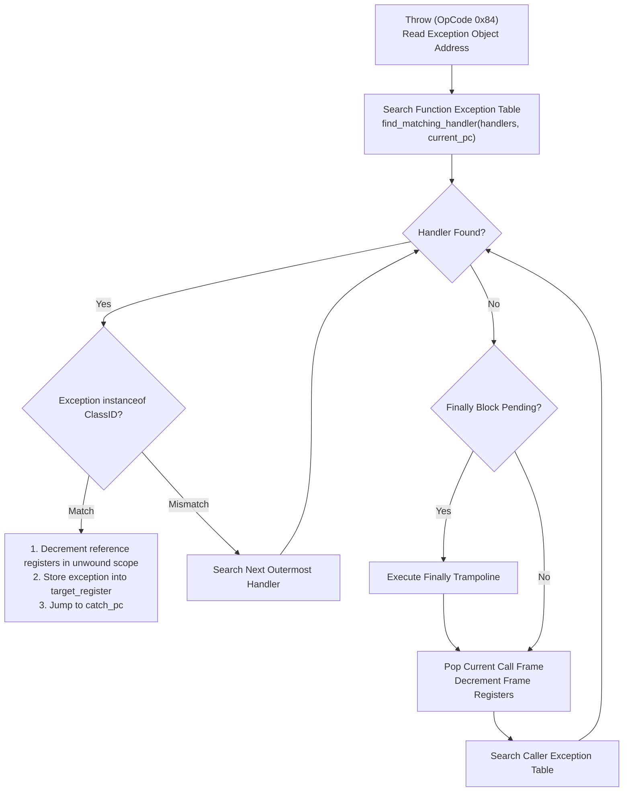

# Exception Handling & Zero-Cost Stack Unwinding

## 1. Overview

Solix provides structured exception handling through `try-catch-finally` blocks and `throw` statements. The exception system guarantees that active reference variables are deterministically decremented (`DecRef`) and `finally` blocks execute reliably, even when an exception propagates across deeply nested call frames.

Solix employs a **zero-cost exception model**: normal execution through a `try` block executes zero setup or teardown instructions. Exception handling overhead is incurred only when an exception is actually thrown.

---

## 2. Zero-Cost Exception Metadata Table

Rather than executing dynamic registration instructions at runtime entry to a `try` block, the Solix emitter generates static metadata tables embedded in each compiled function:

```rust
#[derive(Debug, Clone, PartialEq, Eq, Serialize, Deserialize)]
pub struct ExceptionHandlerEntry {
    /// Starting bytecode instruction offset (inclusive).
    pub try_start_pc: u32,
    /// Ending bytecode instruction offset (exclusive).
    pub try_end_pc: u32,
    /// Target bytecode offset of the catch handler block.
    pub catch_pc: u32,
    /// Expected exception Class ID (0 matches any Exception type).
    pub class_id: u32,
    /// Virtual register allocated to receive the exception instance reference.
    pub target_register: u16,
}
```

---

## 3. Unwinding & Dispatch Mechanics

When a `throw` statement executes:



### 3.1. Reverse Table Lookup
Exception handler search ([`crates/solix-runtime/src/exceptions/unwinder.rs`](file:///home/jehud/Projects/solix-language/crates/solix-runtime/src/exceptions/unwinder.rs)) searches the handler table in reverse order:
```rust
pub fn find_matching_handler(
    handlers: &[ExceptionHandlerEntry],
    program_counter: u32,
) -> Option<&ExceptionHandlerEntry> {
    handlers
        .iter()
        .rev()
        .find(|entry| program_counter >= entry.try_start_pc && program_counter < entry.try_end_pc)
}
```
Reverse lookup guarantees that innermost nested `try-catch` blocks take precedence over outer enclosing blocks.

### 3.2. Polymorphic Catch Matching
Catch blocks check type compatibility by traversing the class inheritance hierarchy via the object's virtual table ID. A handler matches if:
1. `class_id == 0` (untyped or root `solix.core.Exception` catch block).
2. The thrown instance's `class_id` equals `entry.class_id`.
3. The thrown instance's class inherits from `entry.class_id`.

### 3.3. Deterministic ARC Cleanup During Unwinding
When propagating out of a guarded scope, the virtual machine tracks reference registers allocated within that scope (`try_ref_regs`). Before entering the `catch` block or popping the call frame, the runtime invokes `dec_ref()` on all active reference registers, ensuring zero leaks during exception propagation.

---

## 4. Guaranteed `finally` Execution

`finally` blocks are compiled as inline trampolines:
- **Normal Flow**: The `try` body completes, falls through into the `finally` block, and continues to subsequent statements.
- **Return in Try**: Any `return` inside `try` jumps to a synthesized trampoline that executes the `finally` code before returning.
- **Exception Flow**: If an exception occurs, the unwinder executes the `finally` trampoline before re-throwing or transferring control to outer handlers.
