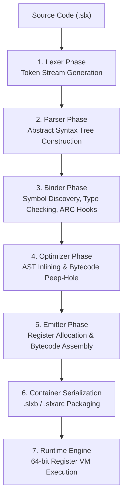

# Solix Compilation Pipeline Architecture

## 1. Overview

The Solix compilation pipeline transforms human-readable Solix source files (`.slx`) into compact, high-performance virtual machine bytecode containers (`.slxb` standalone binaries or `.slxarc` multi-module project archives). The emitted bytecode is executed directly by the Solix Register Virtual Machine.

The pipeline operates across discrete compiler phases with strict diagnostic halting boundaries:

If any phase encounters one or more diagnostic errors, subsequent phases halt immediately to prevent corrupted bytecode generation or unsafe execution.

---

## 2. Stage Breakdown

### 2.1. Lexical Analysis (`Lexer`)
- **Source Module**: [`crates/solix-compilation/src/phases/lexing/lexer.rs`](../../crates/solix-compilation/src/phases/lexing/lexer.rs)
- **Input**: UTF-8 source string buffer (`CompilationContext::sources`).
- **Output**: Linear stream of strongly typed tokens (`Vec<Token>`).
- **Responsibilities**:
  - Strips single-line (`//`) and multi-line (`/* ... */`) comments.
  - Recognizes language keywords (`class`, `interface`, `while`, `extern`, `weak`, etc.).
  - Distinguishes numeric literals with radices (`0x` hexadecimal, `0b` binary) and suffixes (`L` for `int64`, `f` for `float32`).
  - Distinguishes unicode character literals (`'a'`) from escaped double-quoted string literals (`"message\n"`).
  - Accurately tracks 1-based line and column spans for rich diagnostics.

### 2.2. Syntactic Analysis (`Parser`)
- **Input**: Token stream (`Vec<Token>`).
- **Source Module**: [`crates/solix-compilation/src/phases/parser/parser.rs`](../../crates/solix-compilation/src/phases/parser/parser.rs)
- **Output**: Typed Abstract Syntax Tree (`Program` structure containing top-level declarations).
- **Responsibilities**:
  - Employs recursive descent parsing with operator-precedence climbing for nested binary expressions.
  - Constructs discrete AST declaration nodes (classes, interfaces, enums, fields, constructors, methods).
  - Parses structured control flow statements (`while`, `for`, `if`, `switch`, `try-catch-finally`).
  - Supports module statements (`package`, `import`, `extern import`, `alias`).
  - Halts with diagnostic parsing errors (`Diagnostic::Parser`) if syntax is malformed.

### 2.3. Semantic Analysis & Type Binding (`Binder`)
- **Input**: Raw parsed AST.
- **Source Module**: [`crates/solix-compilation/src/phases/binder/binder.rs`](../../crates/solix-compilation/src/phases/binder/binder.rs)
- **Output**: Fully bound and validated AST with symbol tables, resolved types, and ARC hooks.
- **Responsibilities**:
  - Executes sequential semantic passes:
    - **Pass 1a**: Discovers packages, classes, interfaces, enums, and module imports across all source files.
    - **Pass 1b**: Establishes inheritance graphs, verifies cycle freedom, records field offsets, and builds class VTable slot tables.
    - **Pass 2**: Performs exhaustive type checking, validates variable scoping, resolves function overloads, and synthesizes ARC decrement hooks.
    - **Pass 3**: Monomorphizes generic class and interface blueprints into specialized concrete AST nodes.

### 2.4. Optimization Phase (`Optimizer`)
- **Input**: Semantically validated AST.
- **Source Module**: [`crates/solix-compilation/src/phases/optimizer/mod.rs`](../../crates/solix-compilation/src/phases/optimizer/mod.rs)
- **Output**: Optimized AST, pruned call graphs, escape-analyzed bytecode, and fused instruction streams.
- **Responsibilities**:
  - **AST Inlining & Simplification**: Performs AST-level small function inlining (`ast_inliner.rs`), dead code elimination after unconditionally terminating statements (`return`, `throw`), and compile-time constant folding.
  - **Escape Analysis & Loop-Scoped SRA**: Classifies heap allocations (`escape_analysis.rs`) and performs Scalar Replacement of Aggregates (SRA) for both function-local objects and loop-scoped allocations whose lifetime is bounded within a single loop iteration (while rejecting loop-carried aliases), forwards pure getter calls during SRA, and elides redundant `IncRef`/`DecRef` pairs (`apply_arc_elision`).
  - **Convergent Liveness Peephole & Constant Hoisting**: Runs fixed-point CFG-liveness-backed peephole passes (`bytecode_optimizer.rs`) using `is_dead_after_use` / `is_single_use_and_dead_after` to coalesce `Op + Mov` sequences and fuse `JumpIf*I32` / `AddI32Imm` / `SubI32Imm` superinstructions even across reused scratch registers, hoists loop-invariant constants (`LoadI32`, `LoadI64`, `LoadF64`, `LoadConst`) above loop headers (respecting call-argument windows and preserving live reference registers across potentially throwing instructions), and elides `DecRef` on immortal string constants (`elide_immortal_const_decref`).

### 2.5. Bytecode Emission (`Emitter`)
- **Input**: Bound and optimized AST.
- **Source Module**: [`crates/solix-compilation/src/phases/emitter/emitter.rs`](../../crates/solix-compilation/src/phases/emitter/emitter.rs)
- **Output**: `CompiledProgram` containing function bytecode streams, constant pool, and VTable definitions.
- **Responsibilities**:
  - Allocates virtual registers via liveness-aware scratch reuse and register allocation (`register_allocator.rs`).
  - Emits statement expressions and loop updates directly into target/discarded registers when values are unused (`control_flow.rs`), avoiding redundant trailing `Mov` instructions.
  - Devirtualizes non-overridden concrete instance method calls directly to `OpCode::CallDirect` via class hierarchy analysis, while keeping `CallVirtual` for `virtual` and `override` dispatch.
  - Generates 64-bit fixed-width register instructions (`Format A`, `Format B`, `Format C`, `Format Call`).
  - Generates zero-cost exception tables (`ExceptionHandlerEntry`) recording PC ranges and `try_ref_regs`.
  - Constructs constant tables for strings, 64-bit floats, and large integers.

### 2.6. Binary Packaging & Serialization
- **Input**: `CompiledProgram` and manifest configuration (`manifest.toml`).
- **Output**: Binary file on disk (`.slxb` or `.slxarc`).
- **Responsibilities**:
  - Serializes magic headers (`SLXB` / `SLXC`), schema versions, and dependency manifests.
  - Bundles compiled bytecode, metadata symbol exports, and native bridge declarations.

### 2.7. Runtime Engine Execution (`solix-vm`)
- **Input**: Serialized bytecode buffer.
- **Source Module**: [`crates/solix-runtime/src/vm/engine.rs`](../../crates/solix-runtime/src/vm/engine.rs)
- **Output**: Execution output, exit status, and memory telemetry.
- **Responsibilities**:
  - Dispatches register instructions via direct loop matching.
  - Manages call frame activation records with sliding register windows.
  - Operates byte-addressed heap memory with segregated free-list allocation.
  - Enforces deterministic ARC reclamation with zero memory leaks.

---

## 3. Strict Diagnostic Halting Boundaries

The Solix compilation pipeline enforces zero tolerance for cascading compiler failures:

| Boundary | Trigger Condition | Consequence |
|---|---|---|
| **Lexing $\to$ Parsing** | Unrecognized token, unterminated literal, or invalid escape | Compiler halts; parser never instantiated |
| **Parsing $\to$ Binding** | Syntax grammar violation, missing semicolon, unmatched bracket | Compiler halts; binder never instantiated |
| **Binding $\to$ Emitting** | Type mismatch, unknown identifier, cyclic inheritance, invalid cast | Compiler halts; emitter never instantiated |
| **Emitting $\to$ Packaging** | Register exhaustion (> 65,535 registers) or jump offset overflow | Packaging aborted; no binary emitted |

---

## 4. Verification & Testing

The compilation pipeline is verified via exhaustive automated test suites:
- End-to-end integration tests: [`crates/solix-tests/tests/`](../../crates/solix-tests/tests)
- Conformance test suites covering all compilation phases and runtime execution modes.
