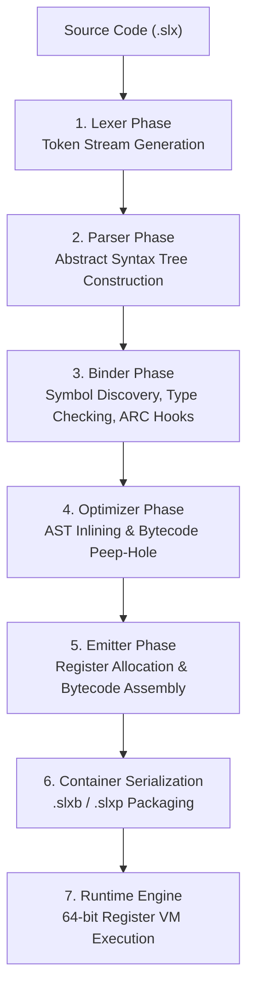

# Solix Compilation Pipeline Architecture

## 1. Overview

The Solix compilation pipeline transforms human-readable Solix source files (`.slx`) into compact, high-performance virtual machine bytecode containers (`.slxb` standalone binaries or `.slxp` multi-module packages). The emitted bytecode is executed directly by the Solix Register Virtual Machine.

The pipeline operates across discrete compiler phases with strict diagnostic halting boundaries:

If any phase encounters one or more diagnostic errors, subsequent phases halt immediately to prevent corrupted bytecode generation or unsafe execution.

---

## 2. Stage Breakdown

### 2.1. Lexical Analysis (`Lexer`)
- **Source Module**: [`crates/solix-compilation/src/phases/lexing/lexer.rs`](../../crates/solix-compilation/src/phases/lexing/lexer.rs)
- **Input**: UTF-8 source string buffer (`CompilationContext::sources`).
- **Output**: Linear stream of strongly typed tokens (`Vec<Token>`).
- **Responsibilities**:
  - Strips single-line (`//`) and multi-line (`/* ... */`) comments.
  - Recognizes language keywords (`class`, `interface`, `while`, `extern`, `weak`, etc.).
  - Distinguishes numeric literals with radices (`0x` hexadecimal, `0b` binary), underscore digit separators (rejecting leading, trailing, consecutive underscores and digitless exponents via `E0014`/`E0015`/`E0017`), and suffixes (`L` for `int64`, `f` for `float32`).
  - Distinguishes unicode character literals (`'a'`, `'\u{1F680}'`) from escaped double-quoted string literals (`"message\n"`).
  - Accurately tracks 1-based line and column spans and validates checked `u16` source ID limits (`E0018`).

### 2.2. Syntactic Analysis (`Parser`)
- **Input**: Token stream (`Vec<Token>`).
- **Source Module**: [`crates/solix-compilation/src/phases/parser/parser.rs`](../../crates/solix-compilation/src/phases/parser/parser.rs)
- **Output**: Typed Abstract Syntax Tree (`Program` structure containing top-level declarations).
- **Responsibilities**:
  - Employs recursive descent parsing with operator-precedence climbing for nested binary expressions.
  - Constructs discrete AST declaration nodes (classes, interfaces, enums, fields, constructors, methods), decoding `\xHH` and `\u{H...}` escapes uniformly.
  - Parses structured control flow statements (`while`, `for`, `if`, `switch`, `try-catch-finally`).
  - Supports module statements (`package`, `import`, `extern import`, `alias`).
  - Recovers across malformed class members and control-flow typos (`E0158`) with stack-allocated fuzzy matching invoked only after confirming a trailing block `{ ... }` (zero heap allocations on valid call statements), and halts with diagnostic parsing errors if syntax is malformed.

### 2.3. Semantic Analysis & Type Binding (`Binder`)
- **Input**: Raw parsed AST.
- **Source Module**: [`crates/solix-compilation/src/phases/binder/binder.rs`](../../crates/solix-compilation/src/phases/binder/binder.rs)
- **Output**: Fully bound and validated AST with symbol tables, resolved types, and ARC hooks.
- **Responsibilities**:
  - Executes sequential semantic passes:
    - **Pass 1a**: Discovers packages, classes, interfaces, enums, and module imports across all source files.
    - **Pass 1b**: Establishes inheritance graphs, verifies cycle freedom, records field offsets, and builds class VTable slot tables.
    - **Pass 2**: Performs exhaustive type checking, validates variable scoping, resolves function overloads, and synthesizes ARC decrement hooks.
    - **Pass 3**: Monomorphizes generic class and interface blueprints into specialized concrete AST nodes.

### 2.4. Optimization Phase (`Optimizer`)
- **Input**: Semantically validated AST.
- **Source Module**: [`crates/solix-compilation/src/phases/optimizer/mod.rs`](../../crates/solix-compilation/src/phases/optimizer/mod.rs)
- **Output**: Optimized AST, pruned call graphs, escape-analyzed bytecode, and fused instruction streams.
- **Responsibilities**:
  - **AST Inlining & Simplification**: Performs AST-level small function inlining (`ast_inliner.rs`) while preserving `binding_artifacts.node_types` across synthetic alpha-renamed identifier and declaration spans (including accurate enclosing class `Type::Class` annotations on synthetic `this` bindings and non-primitive class/array return types), consulting `resolved_symbols` before matching unqualified `Identifier` callees against free helpers, performing dead code elimination after unconditionally terminating statements (`return`, `throw`), and running compile-time constant folding. Disambiguates method inlining candidates by fully qualified class names and symbol identifiers, ensuring classes sharing identical simple names in distinct namespaces never inline conflicting bodies.
  - **Escape Analysis, SRA Pruning & ARC Elision**: Classifies heap allocations (`escape_analysis.rs`) via CFG-aware forward may-alias/must-alias dataflow across branches, loops, and exception handler edges (joining may-aliases by union and must-aliases/initialized fields by intersection so conditional alias overwrites never lose escaping aliases or miscompile field reads), tracks `UnpackCaptures` windows, performs Scalar Replacement of Aggregates (SRA) for function-local and single-iteration loop-scoped allocations, prunes non-escaping scalars and fixed-point `always_immortal_regs` (`LoadNull`/`LoadConst`/0-capture `PackClosure`) plus un-owned borrowed aliases from `function.reference_registers` and `handler.try_ref_regs` (while strictly preserving runtime-populated exception `catch_reg` entries from premature elision), forwards pure getters, and elides redundant `IncRef`/`DecRef` pairs (`apply_arc_elision`, `elide_borrowed_local_arc_ops`).
  - **Convergent Liveness Peephole, CSE, Specialization & Loop Rotation**: Runs fixed-point CFG-liveness-backed peephole passes (`bytecode_optimizer.rs`) in parallel across functions via `rayon` (`par_iter_mut`) using precomputed `EscapeFunctionSummaries`, lightweight `<= 8`-instruction `LeafInlineCandidate` snapshots instead of full `Vec<CompiledFunction>` clones, inline `SmallVec` PC tracking, reused `IntermediateInstruction` stream buffers, and dense `RegisterBitSet` / register-indexed tables instead of per-instruction heap vectors, performing extended-basic-block Local CSE (invalidated at sliding call windows), single-definition constant propagation into ALU/branch opcodes (`LoadI32` -> `JumpIfI32Imm`, `AddI32Imm`, `MulI32Imm`, `ModI32Imm`), constant-pool float arithmetic fusion (`AddF64Imm`, `SubF64Imm`, `MulF64Imm`), 64-bit integer immediate fusion (`AddI64Imm`), comparison branch fusion (`JumpIfLtF64`, `JumpIfLteF64`, `JumpIfLtI64`, `JumpIfLteI64`), predicate array branch fusion (`GetArrayJumpIfFalse`, `GetArrayJumpIfTrue`), primitive field access specialization (`GetFieldI32`, `GetFieldF64`, `SetFieldI32`, `SetFieldF64`), branch-diamond 0-capture `PackClosure` specialization (`CallDirect`), small leaf function inlining, dead `PackClosure + DecRef` elimination, loop-invariant expression/constant hoisting, post-hoist peephole convergence, tail-call lowering (`TailCallDirect`), `FLAG_MOVE` store fusion (`SetField`/`SetArray`), `ForLoopI32` (including tight array-fill loop tagging), `AddBandI32`, `MulAddF64`, bottom-tested loop rotation (`rotate_bottom_tested_loops`), checked signed `i16`/`i32` branch relocation (`relocate_jump_instruction` emitting `EmissionError::JumpOffsetOverflow` on range violation), and `u16::try_from` function-index guards in `transform_binary_additive_self_recursion`.

### 2.5. Bytecode Emission (`Emitter`)
- **Input**: Bound and optimized AST.
- **Source Module**: [`crates/solix-compilation/src/phases/emitter/emitter.rs`](../../crates/solix-compilation/src/phases/emitter/emitter.rs)
- **Output**: `CompiledProgram` containing function bytecode streams, constant pool, and VTable definitions.
- **Responsibilities**:
  - Allocates virtual registers via liveness-aware scratch reuse and register allocation (`register_allocator.rs`), strictly guarding parameter indices (`0..param_count`) against recycled temporary reuse to guarantee zero argument overlap under register pressure.
  - Emits statement expressions and loop updates directly into target/discarded registers when values are unused (`control_flow.rs`), avoiding redundant trailing `Mov` instructions.
  - Manages lexical finally stack unwinding and control flow routing (`control_flow.rs`, `emitter.rs`, `pipeline.rs`): pops one active `finally` frame at a time during recursive unwinding so early `return`/`break`/`continue` statements inside nested `finally` blocks still execute enclosing outer `finally` handlers, snapshots and retains local return variables before `finally` execution so `finally` mutations or nullifications cannot corrupt or free returned values, lowers grouped empty `switch` case labels cleanly, resolves inherited ancestor destructors when subclasses omit explicit destructors, and folds unary negated integer literals directly so boundary constants (`i32::MIN`, `i64::MIN`) match their target integer width.
  - Devirtualizes non-overridden concrete instance method calls directly to `OpCode::CallDirect` via class hierarchy analysis, while keeping `CallVirtual` for `virtual` and `override` dispatch.
  - Generates 64-bit fixed-width register instructions (`Format A`, `Format B`, `Format C`, `Format Call`).
  - Generates zero-cost exception tables (`ExceptionHandlerEntry`) recording PC ranges and `try_ref_regs`.
  - Constructs constant tables for strings, 64-bit floats, and large integers.
  - Performs whole-program reachability analysis and static linking (`--link static`): relocates constant pool references (`LoadConst`, `LoadF64`, `AddF64Imm`, `SubF64Imm`, `MulF64Imm`, `CallExtern`, `CallSymbol`, `AllocObjectExtern`, `GetStaticGlobal`, `SetStaticGlobal`), remaps `CallDirect` / `TailCallDirect` / `PackClosure`, imports dependency classes with collision-free vtable IDs and arity-matched constructor overloads, preserves all dependency class descriptors for runtime native FFI reflection (`solix_vm_get_class_vtable_id`), merges dependency static spaces and `@init` initializers, and preserves exported library functions when compiling library containers without an executable entrypoint.
  - Preserves namespace-qualified class identifiers during method and constructor emission: extracts enclosing class paths using reverse delimiter splitting (`rsplit_once("::")`) rather than truncating to root package segments, ensuring precise class layout resolution, field offset binding, and conflict-free overload registration.
  - Resolves overloaded static methods, constructors, and `super(...)` constructor calls accurately across polymorphic and `null`-literal arguments: `build_sym_to_func_map` matches spaced and compact `format_simple_type_name` signatures prior to unsuffixed fallbacks, `resolve_typed_function_id` queries binder-resolved call targets (`resolved_call_targets`) and arity-qualified keys (`/{arity}`) on concrete classes, and `resolve_method_dispatch` preserves nested generic parameters when selecting instance vtable slots.
  - Pre-evaluates enum declarations and collects variant values using signed 64-bit integer tracking with wrapping increments, safely accommodating negative explicit values and auto-increment sequences without arithmetic overflow.

### 2.6. Binary Packaging & Serialization
- **Input**: `CompiledProgram` and manifest configuration (`manifest.yaml`).
- **Output**: Binary file on disk (`.slxb` or `.slxp`).
- **Responsibilities**:
  - Serializes magic headers (`SLXB` / `SLXC`), schema versions, and dependency manifests, and provides `BinaryProgram::from_bytes_manifest_only` to decode Sections 6/7 without allocating Sections 2–5.
  - Bundles compiled bytecode, metadata symbol exports, and native bridge declarations, skipping redundant SHA-256 dependency hashing when `embed_hashes` is disabled or `LinkMode::Static` embeds dependencies directly.

### 2.7. Runtime Engine Execution (`solix-vm`)
- **Input**: Serialized bytecode buffer.
- **Source Module**: [`crates/solix-runtime/src/vm/engine.rs`](../../crates/solix-runtime/src/vm/engine.rs)
- **Output**: Execution output, exit status, and memory telemetry.
- **Responsibilities**:
  - Dispatches register instructions via direct loop matching with frame-cached constant pool pointers and flat `Vec` monomorphic inline-cache slots.
  - Manages call frame activation records with sliding register windows.
  - Operates byte-addressed heap memory with segregated free-list allocation.
  - Enforces deterministic ARC reclamation with zero memory leaks.

---

## 3. Strict Diagnostic Halting Boundaries

The Solix compilation pipeline enforces zero tolerance for cascading compiler failures:

| Boundary | Trigger Condition | Consequence |
|---|---|---|
| **Lexing $\to$ Parsing** | Unrecognized token, unterminated literal, or invalid escape | Compiler halts; parser never instantiated |
| **Parsing $\to$ Binding** | Syntax grammar violation, missing semicolon, unmatched bracket | Compiler halts; binder never instantiated |
| **Binding $\to$ Emitting** | Type mismatch, unknown identifier, cyclic inheritance, invalid cast, or final modifier violations | Compiler halts; emitter never instantiated |
| **Emitting $\to$ Packaging** | Register exhaustion (> 65,535 registers), jump offset overflow, or interface/tuple ID overflow after compaction | Packaging aborted; no binary emitted |

During static reachability linking (`apply_reachability_and_static_linking`), interface descriptors (`CallInterface` / `.itable` targets) and `TupleInstanceof` class targets are compacted deterministically to the lowest dense `vtable_id`s starting at `1` so 8-bit interface dispatch opcodes never wrap modulo `256` in large programs.

---

## 4. Verification & Testing

The compilation pipeline is verified via exhaustive automated test suites:
- End-to-end integration tests: [`crates/solix-tests/tests/`](../../crates/solix-tests/tests)
- Conformance test suites covering all compilation phases and runtime execution modes.
