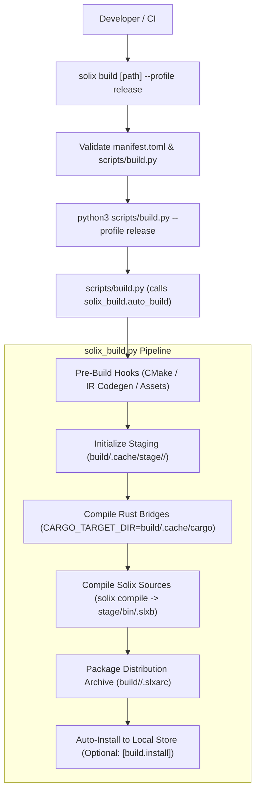

# Solix Build System Architecture & Tooling Engine

## Document Metadata
* **Document ID:** SPEC-BUILD-001
* **Scope:** Toolchain Build Orchestration, Python Build Engine (`solix_build.py`), Artifact Isolation, Diagnostics
* **Target Audience:** Systems Engineers, Tooling Developers, Package Maintainers
* **Related Specifications:**
  * [CLI Build Subcommand](../spec/tools/cli/build.md)
  * [Package Manifest Specification](../spec/tools/cli/manifest.md)
  * [Package Installation & Store](../spec/tools/cli/install.md)

---

## 1. Architectural Overview

The Solix build system bridges native platform compilation (C/C++ and Rust `cdylib` extension bridges) with the Solix high-level compiler (`solix compile`) and package distribution archiver (`.slxarc`).

Rather than enforcing rigid, monolithic build rules inside the core Rust toolchain binary, Solix adopts a two-tier architecture:
1. **Tier-1 Host CLI (`solix build`):** Validates project workspace prerequisites (`manifest.toml`), resolves build profiles and flags, sets up isolated execution environments, and delegates execution to the project's build automation runner.
2. **Tier-2 Project Automation Engine (`scripts/build.py` & `solix_build.py`):** An extensible Python-based build engine providing low-level build primitives, hermetic cache directory isolation under `build/.cache/`, structured error reporting (`BuildError`), cross-compilation support via Zig and Cargo, and high-level one-line orchestration (`auto_build()`).



---

## 2. Directory Layout & Artifact Isolation Rules

All intermediate compilation artifacts, external source downloads, object files, and temporary staging trees **MUST** reside strictly inside the project's `build/.cache/` directory.

### Standard Workspace Layout

```text
my_project/
├── manifest.toml
├── build.py                         # Root entrypoint delegating to scripts/build.py
├── scripts/
│   ├── build.py                     # Project build script
│   └── solix_build.py               # Reusable build engine library
├── src/
│   └── main.slx                     # Solix source files
├── natives/
│   └── my_native/                   # Optional native Rust cdylib or C library
│       ├── .cargo/
│       │   └── config.toml          # target-dir = "../../build/.cache/cargo"
│       ├── Cargo.toml
│       └── src/
│           └── lib.rs
└── build/                           # Generated build directory (gitignored)
    ├── .cache/                      # Isolated intermediate caches
    │   ├── cargo/                   # Rust compiler build artifacts (target-dir)
    │   ├── cmake/                   # CMake configuration and object files
    │   ├── api/                     # C header JSON schemas and parser outputs
    │   └── stage/                   # Staged container root prior to packaging
    │       └── <profile>/
    │           ├── manifest.toml
    │           ├── bin/<name>.slxb
    │           ├── lib/<platform>/<libname>.so
    │           └── resources/
    ├── debug/
    │   └── <name>.slxarc            # Final debug distribution archive
    └── release/
        └── <name>.slxarc            # Final release distribution archive
```

### Hermetic Cargo Isolation

To prevent Cargo or external language tools (`rust-analyzer`, IDE extensions) from populating `natives/<crate>/target/` inside source trees, native crates include `.cargo/config.toml`:

```toml
# natives/my_native/.cargo/config.toml
[build]
target-dir = "../../build/.cache/cargo"
```

Additionally, `solix_build.py` automatically injects `CARGO_TARGET_DIR = <project_root>/build/.cache/cargo` into the execution environment for all `cargo` and `cargo zigbuild` commands.

---

## 3. Python Build Engine Primitives (`solix_build.py`)

`solix_build.py` exposes both modular low-level primitives (Tier-1) and an automated high-level pipeline runner (Tier-2).

### Tier-1 Low-Level Primitives

| Function | Signature | Description |
|---|---|---|
| `parse_args` | `(argv: list[str] \| None) -> argparse.Namespace` | Parses `--profile`, `--link`, `--pkg-dir`, `--clean`, and `--install` flags. |
| `load_manifest` | `(project_root: Path) -> dict[str, Any]` | Parses `manifest.toml` into a typed dictionary. |
| `read_build_config` | `(manifest_data: dict[str, Any]) -> dict[str, Any]` | Extracts the `[build]` table with profile defaults and environment overrides. |
| `resolve_project_root` | `(current_file: Path \| str) -> Path` | Locates the nearest ancestor directory containing `manifest.toml`. |
| `prepare_staging_dirs` | `(project_root: Path, profile: str) -> Path` | Cleans and scaffolds `build/.cache/stage/<profile>/` (`bin/`, `lib/`, `resources/`). |
| `run_command` | `(command: list[str], *, cwd: Path, env: dict, phase: str, hint: str) -> None` | Executes a subprocess with phase tracking and structured `BuildError` diagnostics. |
| `compile_rust_project` | `(project_root: Path, stage_directory: Path, profile: str, manifest_data: dict) -> list[Path]` | Compiles native crates into `stage/lib/` across target platforms. |
| `stage_resources` | `(project_root: Path, stage_directory: Path) -> None` | Recursively stages files from `resources/` into `stage/resources/`. |
| `compile_solix_sources` | `(project_root: Path, stage_directory: Path, profile: str, link_mode: str, manifest_data: dict) -> Path` | Invokes `solix compile` to assemble `stage/bin/<name>.slxb`. |
| `package_slxarc` | `(project_root: Path, stage_directory: Path, profile: str, manifest_data: dict) -> Path` | Packs the staging tree into `build/<profile>/<name>.slxarc`. |
| `auto_install_package` | `(archive_path: Path, profile: str, build_config: dict) -> None` | Installs the generated archive into the local package store if enabled. |

### Tier-2 Automated Pipeline (`auto_build`)

For standard projects, the entire build lifecycle is executed in a single call:

```python
#!/usr/bin/env python3
# scripts/build.py
from pathlib import Path
from scripts.solix_build import auto_build, run_cli


def main() -> None:
    project_root = Path(__file__).resolve().parent.parent
    auto_build(project_root)


if __name__ == "__main__":
    run_cli(main)
```

`auto_build` performs the following steps deterministically:
1. Resolves CLI arguments and loads `manifest.toml`.
2. Reads `[build]` configuration and merges environment variables.
3. Initializes staging directories under `build/.cache/stage/<profile>/`.
4. Compiles native Rust companion crates (if present).
5. Stages static assets and resources from `resources/`.
6. Compiles Solix source code via `solix compile`.
7. Packs the archive container into `build/<profile>/<name>.slxarc`.
8. Automatically installs into the local package store if `install = true` in `manifest.toml`.
9. Prints a comprehensive phase timing breakdown.

---

## 4. Structured Error Reporting & Diagnostic UI

When a build step fails (such as a CMake compilation error, missing Rust target, or Solix syntax failure), the build engine intercepts the failure via `BuildError` and renders a structured terminal diagnostic panel.

Raw Python tracebacks are suppressed by default and only displayed when `SOLIX_BUILD_TRACEBACK=1` is explicitly set.

### Sample Diagnostic Panel

```text
================================================================================
[SOLIX BUILD ERROR] Native C/Rust Compilation Failed
================================================================================
Phase:       Native C/Rust Compilation
Command:     cargo zigbuild --target x86_64-unknown-linux-gnu --release
Directory:   /home/developer/projects/raylib/natives/raylib
Exit Code:   101

Output / Error Log:
error[E0432]: unresolved import `solix_runtime::ffi`
  --> src/lib.rs:12:5
   |
12 | use solix_runtime::ffi::NativeContext;
   |     ^^^^^^^^^^^^^^^^^^^^^^^^^^^^^^^^^ no `NativeContext` in `ffi`

Remediation Hint:
Check that native Rust crates compile cleanly with 'cargo check' and that all
target architectures are installed via 'rustup target add <triple>'.
================================================================================
```

---

## 5. Manifest `[build]` Configuration Reference

The `manifest.toml` file supports an optional `[build]` table to configure default build settings and lifecycle behaviors:

```toml
[package]
name = "my_app"
version = "1.0.0"
authors = ["Development Team <dev@example.com>"]
description = "High-performance Solix application"

[build]
# Default build profile when not specified on CLI ("debug", "release", or "test")
profile = "debug"

# Linking mode: "dynamic" (default) or "static"
link = "dynamic"

# Package store path override for resolving dependencies
# pkg_dir = "~/.solix/packages"

# Automatically install to package store upon successful build
install = false

# Overwrite existing packages in store when auto-installing
force_install = true

# Verify SHA-256 package checksums during dependency resolution
verify_checksum = true

# Inline bytecode optimization threshold
inline_threshold = 24
```

### Environment Variable Overrides

CLI flags and environment variables take precedence over `manifest.toml`:

| Environment Variable | Overrides | Valid Values | Description |
|---|---|---|---|
| `SOLIX_PROFILE` | `[build.profile]` | `debug`, `release`, `test` | Target build profile. |
| `SOLIX_LINK_MODE` | `[build.link]` | `dynamic`, `static` | Linking mode. |
| `SOLIX_PKG_DIR` | `[build.pkg_dir]` | File system path | Package store location. |
| `SOLIX_AUTO_INSTALL` | `[build.install]` | `1`, `true`, `0`, `false` | Enable/disable auto-installation. |
| `SOLIX_FORCE_INSTALL` | `[build.force_install]` | `1`, `true`, `0`, `false` | Force overwrite on auto-install. |
| `SOLIX_BUILD_TRACEBACK` | Engine internals | `1`, `true` | Show full Python stack trace on error. |

---

## 6. Multi-Target Cross-Compilation

In `release` mode, `solix_build.py` orchestrates cross-compilation of native extensions across all supported desktop platforms (`SUPPORTED_RELEASE_TARGETS`):

| Target Triple | Platform | Toolchain Compiler Strategy |
|---|---|---|
| `x86_64-unknown-linux-gnu` | Linux x86_64 | Native Cargo or `cargo zigbuild` / `zig cc` |
| `aarch64-unknown-linux-gnu` | Linux ARM64 | `cargo zigbuild` / `zig cc` or `aarch64-linux-gnu-gcc` |
| `x86_64-pc-windows-gnu` | Windows x86_64 (GNU) | `cargo zigbuild` / `zig cc` or `x86_64-w64-mingw32-gcc` |
| `x86_64-pc-windows-msvc` | Windows x86_64 (MSVC) | Windows MSVC host or `cargo xwin build` |
| `x86_64-apple-darwin` | macOS Intel | Native macOS Clang (`--target`) or `cargo zigbuild` |
| `aarch64-apple-darwin` | macOS Apple Silicon | Native macOS Clang (`--target`) or `cargo zigbuild` |

When `rustup` is installed and a cross-linker strategy is active for a target, `solix_build.py` automatically ensures missing Rust target standard libraries via `rustup target add` (disable with `SOLIX_NO_AUTO_RUSTUP=1`). Statically linked release builds (`static = true`) bundle every target architecture present in dependency `.slxarc` archives (`lib/<target_triple>/*`), and Windows MSVC hosts fall back to compatible `-pc-windows-gnu` binaries when no `-msvc` binary is packaged. Set `SOLIX_STRICT_CROSS=1` (or pass `--strict-cross` to `scripts/build.py`) to fail the build if any desktop architecture is missing.
