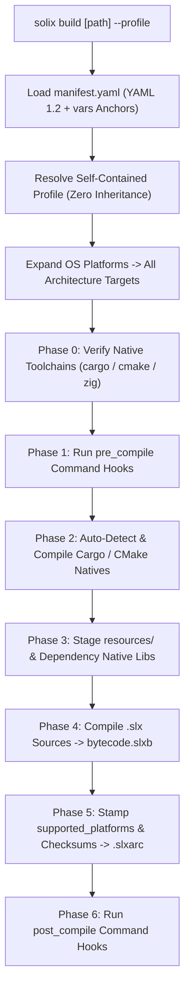

# Solix Build System Architecture (`manifest.yaml` & `solix build`)

* **Document Status:** Authoritative Specification
* **Scope:** Pure-Rust Build Orchestration, `manifest.yaml`, Artifact Isolation, Dual-Mode Native Extensions, Multi-Platform Expansion

---

## 1. Pure-Rust Declarative Build Pipeline

Solix orchestrates project compilation, native library compilation, asset staging, and `.slxarc` archive packaging natively inside the `solix build` Rust binary with zero Python runtime scripts (`manifest.yaml` replaces legacy `manifest.toml` and `scripts/build.py`).

### Execution Flow



---

## 2. Artifact Isolation & Project Directory Layout

Every build executes within isolated staging and cache directories so intermediate objects and native build caches never pollute source directories:

```text
my_solix_project/
├── manifest.yaml                    # Declarative project manifest (YAML + vars anchors)
├── src/                             # Primary Solix source code (.slx)
├── tests/                           # Solix test suites (.slx)
├── resources/                       # Static assets packaged into archive res://
├── lib/                             # Optional prebuilt native libraries
├── natives/                         # Native subprojects (auto-detected Cargo or CMake)
│   ├── rust_bridge/                 # Cargo crate (`Cargo.toml`, `solix-native` feature)
│   └── c_bridge/                    # CMake project (`CMakeLists.txt`, `SOLIX_NATIVE_BUILD`)
└── build/
    ├── .cache/                      # Git-ignored build cache & staging area
    │   ├── cargo/                   # Shared CARGO_TARGET_DIR across profiles/targets
    │   ├── cmake/                   # Per-native, per-target CMake configure & build dirs
    │   └── stage/<profile>/
    │       ├── bin/<name>.slxb
    │       ├── lib/<target_triple>/
    │       └── resources/
    ├── debug/
    │   └── <name>.slxarc
    └── release/
        └── <name>.slxarc
```

---

## 3. Declarative Native Auto-Detection (`natives`)

Under `profiles.<name>.natives.<key>`, no explicit backend `type` field is required:

1. **Cargo (`Cargo.toml` present):**
   * When `[features]` declares `solix-native`, `solix build` passes `--features solix-native` and sets `SOLIX_NATIVE_BUILD=1`.
   * Inside a Solix checkout (or when `SOLIX_FFI_RUST_DIR` is set), `solix build` automatically injects `--config patch."https://github.com/Jehudme/solix-language.git".solix-ffi.path=...` so local `ffi/rust` changes take effect immediately.
2. **CMake (`CMakeLists.txt` present):**
   * `solix build` configures CMake with `-DSOLIX_NATIVE_BUILD=ON` and sets `SOLIX_NATIVE_BUILD=1`.
   * Sets `SOLIX_FFI_SOURCE_DIR` to local `ffi/c` when present so CMake `FetchContent` links against the local `solix::ffi` SDK without network fetches.
3. **Standalone Execution Outside `solix build`:**
   * Running `cargo build` / `cargo test` or `cmake` / `ctest` directly builds the same directory as a normal standalone library (`SOLIX_NATIVE_BUILD=OFF` and default Cargo features disabled).

---

## 4. `pre_compile` & `post_compile` Command Hooks

Profiles support sequential command lists:
* `pre_compile`: Runs after toolchain verification and before native/Solix compilation (e.g., generating C bindings or fetching vendored headers).
* `post_compile`: Runs after the final `.slxarc` archive is packaged.

Hook commands receive `SOLIX_PROJECT_ROOT`, `SOLIX_PROFILE`, `SOLIX_BIN`, `SOLIX_STAGE_DIR`, `SOLIX_CACHE_DIR`, and `SOLIX_OUTPUT_SLXARC`.

---

## 5. OS-to-All-Architectures Platform Expansion

Specifying an OS name under `platforms` expands automatically to every architecture supported for that OS:

| Platform Token | Expanded Targets | Native Compiler Strategy |
| :--- | :--- | :--- |
| `linux` | `linux-x86_64`, `linux-aarch64` | Native Clang/GCC/Cargo or `cargo-zigbuild` / `zig cc` |
| `macos` | `macos-x86_64`, `macos-aarch64` | Native macOS Clang (`--target`) or `cargo-zigbuild` / `zig cc` |
| `windows` | `windows-x86_64` | `x86_64-pc-windows-gnu` (or `x86_64-pc-windows-msvc` on native Windows host / `--target host`) |
| `all` | All 5 desktop targets | Combines `linux`, `macos`, `windows` |
| `host` | Current host triple | Native host compiler toolchain |

Set `--target host` (or `SOLIX_TARGET_TRIPLE=host`) during local development to compile only the host architecture, and `SOLIX_NO_AUTO_RUSTUP=1` to disable automatic `rustup target add` installation.

---

## Related Documentation
* [`manifest.yaml` Wiki Reference](../wiki/manifest.md)
* [Formal `manifest.yaml` Specification](../spec/tools/cli/manifest.md)
* [Formal `solix build` CLI Specification](../spec/tools/cli/build.md)
* [FFI SDK Wiki (`solix::ffi` & `solix-ffi`)](../wiki/ffi/README.md)
