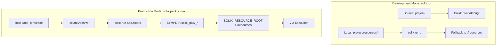

# Application Packaging & Resources

This guide explains how to package Solix applications into single-file portable distribution archives (`.slxarc`), bundle native shared libraries and static assets, and access internal resources using the `solix.io.filesystem.Resource` API.

---

## Table of Contents

1. [Introduction](#introduction)
2. [The Anatomy of a `.slxarc` Bundle](#the-anatomy-of-a-slxpac-bundle)
3. [Packaging with `solix pack`](#packaging-with-solix-pack)
4. [Executing Bundles with `solix run`](#executing-bundles-with-solix-run)
5. [The Resource API (`solix.io.filesystem.Resource`)](#the-resource-api-solixiofilesystemresource)
6. [The `res://` Virtual URI Scheme](#the-res-virtual-uri-scheme)
7. [Dual-Location Filesystem API](#dual-location-filesystem-api)
8. [Multi-Depth (Transitive) Dependency Bundling & Staging](#multi-depth-transitive-dependency-bundling--staging)
9. [Development vs. Production Workflow](#development-vs-production-workflow)
10. [Universal Multi-Platform Cross-Compilation with Zig](#universal-multi-platform-cross-compilation-with-zig)
11. [Summary of Best Practices](#summary-of-best-practices)

---

## Introduction

Modern applications frequently require more than just compiled bytecode: they depend on native shared libraries (such as platform drivers, cryptographic helpers, or audio/graphics bindings) and static asset files (such as configuration files, localization files, shaders, templates, and icons).

Solix provides a unified, cross-platform packaging solution:
- **`solix pack`**: Assembles your compiled bytecode, native libraries (`lib/`), and static resources (`resources/`) into a single, self-contained, compressed `.slxarc` archive.
- **`solix run`**: Directly ingests, unpacks to a content-hashed cache, loads bundled native libraries, and executes `.slxarc` bundles with zero manual extraction.
- **`Resource` & `res://`**: Standard library APIs to access bundled assets cleanly from Solix code regardless of whether running from source or from an archive.

---

## The Anatomy of a `.slxarc` Bundle

An `.slxarc` file is a ZIP-compatible archive containing a deterministic internal folder structure:

```
my_app.slxarc
├── manifest.json       # Project metadata, profile configuration, and package entry
├── bytecode.slxb     # Compiled Solix bytecode for the selected profile
├── lib/                # Native shared libraries (.so, .dll, .dylib)
│   ├── libplugin.so
│   └── solixlib_native.so
└── resources/          # Static application assets
    ├── config.json
    ├── templates/
    │   └── email.html
    └── assets/
        └── logo.png
```

| Path | Required | Purpose |
|---|---|---|
| `manifest.json` | **Yes** | Cloned project manifest identifying name, version, entry point, and profile details. |
| `bytecode.slxb` | **Yes** | Compiled bytecode binary produced during project build. |
| `lib/` | Optional | Shared libraries loaded automatically by the runtime VM into the native registry. |
| `resources/` | Optional | Static asset files mounted as the application resource root. |

---

## Packaging with `solix pack`

The `solix pack` command builds the specified project and packages the build artifacts into an `.slxarc` bundle.

### Basic Invocations

Pack the current directory:
```bash
solix pack
```
This builds the default `debug` profile and emits `<project_name>.slxarc` into the project root.

Pack with a specific build profile (e.g. `release`):
```bash
solix pack -p release
```

Pack into a custom output file or directory:
```bash
solix pack -p release -o dist/my_app_v1.0.slxarc
```

Pack a target project located in another directory:
```bash
solix pack /path/to/project -o /dist/app.slxarc
```

### Packaging Options

| Option | Short Flag | Description | Default |
|---|---|---|---|
| `[target]` | - | Target project directory containing `manifest.json` or `manifest.toml` | `.` (current directory) |
| `--profile` | `-p` | Build profile defined in the manifest | `debug` |
| `--output` | `-o` | Destination path for the generated `.slxarc` archive | `<target>/<project>.slxarc` |

---

## Executing Bundles with `solix run`

The `solix run` launcher command accepts `.slxarc` bundle archives directly:

```bash
solix run dist/my_app_v1.0.slxarc
```

You can pass command-line arguments to the application after `--`:
```bash
solix run dist/my_app_v1.0.slxarc -- --verbose --port 8080
```

### Content-Hashed Execution Cache

When executing an `.slxarc` archive:
1. `solix run` computes a deterministic SHA-256 hash of the archive contents.
2. The package is unpacked into the system temporary cache:
   - **Linux / macOS**: `/tmp/solix_pac/<app_name>_<sha256_short>/`
   - **Windows**: `%TEMP%\solix_pac\<app_name>_<sha256_short>\`
3. If an identical bundle was previously unpacked and remains unmodified, extraction is skipped and execution begins immediately ($O(1)$ startup).
4. All native shared libraries found in `lib/` are automatically registered into `RuntimeOptions::native_libraries`.
5. The `resources/` directory is mounted into `RuntimeOptions::resource_directory` and exported as `SOLIX_RESOURCE_ROOT`.
6. The VM boots and executes the bundled `bytecode.slxb`.

---

## The Resource API (`solix.io.filesystem.Resource`)

To read bundled assets from inside your Solix program, import `solix.io.filesystem.Resource`:

```solix
import solix.io.filesystem.Resource;
import solix.collections.List;
import solix.core.String;
import solix.system.Console;

class App {
    public static int32 main() {
        // Query resource directory path
        String res_dir = Resource.get_resource_directory();
        Console::println("Resource root: " + res_dir);

        // Check if an asset exists
        if (Resource.exists(new String("config.json"))) {
            // Read entire text content
            String config_data = Resource.read_all_text(new String("config.json"));
            Console::println("Config content:\n" + config_data);
        }

        // Read all lines into a List<String>
        List<String> lines = Resource.read_all_lines(new String("templates/items.txt"));
        for (int32 i = 0; i < lines.size(); i = i + 1) {
            Console::println(lines.get(i));
        }

        // Resolve absolute path to a resource
        String logo_path = Resource.get_path(new String("assets/logo.png"));
        Console::println("Logo absolute path: " + logo_path);

        return 0;
    }
}
```

### Method Summary

| Method | Return Type | Description |
|---|---|---|
| `Resource.get_resource_directory()` | `String` | Returns the absolute path of the resource root directory. |
| `Resource.get_path(String rel_path)` | `String` | Returns the canonical absolute path of a relative resource path. |
| `Resource.exists(String rel_path)` | `bool` | Returns `true` if the resource exists and is a regular file. |
| `Resource.read_all_text(String rel_path)` | `String` | Reads all text from the resource. Throws `FileNotFoundException` if missing. |
| `Resource.read_all_lines(String rel_path)` | `List<String>` | Reads all lines from the resource into a `List<String>`. |

---

## The `res://` Virtual URI Scheme

For maximum convenience, all standard file reading and inspection operations support the `res://` virtual URI prefix scheme. Any path starting with `res://` is automatically redirected to the active resource directory:

```solix
import solix.io.filesystem.File;
import solix.io.filesystem.Path;
import solix.core.String;
import solix.system.Console;

class App {
    public static int32 main() {
        // Transparent read via File.read_all_text
        String cfg = File::read_all_text(new String("res://config.json"));
        Console::println(cfg);

        // Transparent existence check
        if (File::exists(new String("res://assets/banner.txt"))) {
            Console::println("Banner asset is present!");
        }

        // Querying with Path
        Path p = new Path("res://assets/banner.txt");
        if (p.is_resource()) {
            Console::println("Path is an application resource!");
        }

        return 0;
    }
}
```

---

## Dual-Location Filesystem API

When writing code that could read either from the host machine or from bundled application resources depending on user configuration, use the dual-location overloads on `File`:

```solix
import solix.io.filesystem.File;
import solix.core.String;

class ConfigLoader {
    // is_resource == true  -> loads from bundled resources/
    // is_resource == false -> loads from host filesystem
    public static String load_settings(String path, bool is_bundled) {
        if (!File::exists(path, is_bundled)) {
            return new String("{}");
        }
        return File::read_all_text(path, is_bundled);
    }
}
```

---

## Multi-Depth (Transitive) Dependency Bundling & Staging

Real-world projects often depend on libraries that themselves depend on other libraries (e.g., `App -> LibA -> LibB`). Solix handles multi-depth transitive dependencies seamlessly during both `solix build` and `solix pack`:

### 1. Build Directory Staging (`solix build`)
When you build a project, the build command:
- Gathers all native shared libraries (`.so`, `.dll`, `.dylib`) from the root project and all transitive dependencies, placing them into `<output_directory>/lib/`.
- Recursively copies all static assets (`resources/`) from all transitive dependencies and the root project into `<output_directory>/resources/`.
- **Collision Override**: If the root project provides an asset with the same relative path as a dependency (e.g., `resources/shared/theme.json`), the root project's file automatically takes precedence.

### 2. Single-File Packaging (`solix pack`)
When packaging an application with `solix pack`:
- All native shared libraries across all dependency depths are bundled into `<bundle>/lib/`.
- All static resources across all dependency depths are merged into `<bundle>/resources/`.
- The resulting `.slxarc` contains everything needed to execute on any machine without needing the original dependency directories.

---

---

## Compiling Native Companion Libraries with Lifecycle Hooks

When a Solix project or library relies on native companion libraries (authored in Rust or C), you can automate the native compilation directly within `solix build` and `solix pack` using the declarative `pre_compile` lifecycle hook.

### 1. Project Directory Layout with Cargo
```text
my_native_app/
├── manifest.toml
├── natives/
│   └── rust_bridge/
│       ├── Cargo.toml
│       └── src/lib.rs
├── src/
│   └── main.slx
├── lib/
│   └── librust_bridge.so
└── resources/
    └── config.txt
```

### 2. Manifest Configuration

In `manifest.toml`, declare `pre_compile` commands to build the native crate before Solix emits bytecode:

```toml
[package]
name = "my_native_app"
version = "0.1.0"
entry = "src/main.slx"

[lifecycle]
pre_compile = [
    "cargo build --release --manifest-path natives/rust_bridge/Cargo.toml"
]

[dependencies]
solixlib = { path = "../solixlib" }
```

In `natives/rust_bridge/Cargo.toml`, set crate type to dynamic library (`cdylib`):

```toml
[package]
name = "rust_bridge"
version = "0.1.0"
edition = "2024"

[lib]
crate-type = ["cdylib"]
```

The build runner deposits the compiled `.so`, `.dll`, or `.dylib` directly into `lib/`.

### 3. Topological Dependency Pre-Compile Ordering
If your application depends on a library package that also provides native companion libraries:
1. **Topological Discovery**: Solix resolves dependencies in topological order.
2. **Dependency Pre-Compile**: Dependent library pre-compile commands execute first inside the dependency directory, compiling its native artifacts into its local `lib/`.
3. **Application Pre-Compile**: The application pre-compile commands execute next in `my_native_app/`.
4. **Bytecode Compilation**: Solix compiles source code into `.slxb`.
5. **Transitive Staging**: Solix stages all `.so`/`.dll`/`.dylib` files from dependency `lib/` and application `lib/` into the build directory.
6. **Packaging**: `solix pack` packages bytecode, staged native libraries, and resources into the final `.slxarc` bundle.

---

## Development vs. Production Workflow

Solix ensures zero code differences between local development and packaged distribution:



1. **During Development**:
   You can run unbundled via `solix run .` or `solix run build/debug/myapp.slxb`. The runtime falls back to `<project_root>/resources/`.
2. **For Production**:
   Run `solix pack -p release -o myapp.slxarc`. The package is self-contained and ready to distribute to any machine with `solix`.

---

## 10. Universal Multi-Platform Cross-Compilation with Zig

When distributing native libraries or applications across multiple operating systems, developers traditionally needed separate physical machines, complex virtual machines, or heavy Docker containers for Linux, Windows, and macOS.

Solix companion native projects solve this elegantly through **Zig's embedded C/C++ cross-compiler (`zig c++`)** combined with Solix pre-compile lifecycle hooks.

### 10.1 Canonical Project Layout for Native Projects

Any Solix project with companion native C++ code can follow the canonical project architecture:

```
my_native_project/
├── manifest.json              # Solix project manifest
├── src/                       # Pure Solix declarations and source files
│   └── mypackage/
│       └── Math.slx           # Declares native methods (e.g. public static native int32 add(...);)
├── lib/                       # Destination for cross-compiled shared libraries
│   ├── libmy_native.so        # Linux ELF shared object
│   ├── my_native.dll          # Windows PE DLL
│   └── libmy_native.dylib     # macOS Mach-O dynamic library
├── natives/                   # Native Rust companion crate
│   └── rust_bridge/
│       ├── Cargo.toml
│       └── src/lib.rs         # Exports solix_register_natives hook
└── scripts/
    └── build_native.py        # Cross-compilation driver script using Zig
```

### 10.2 The Zig Cross-Compilation Driver (`scripts/build_native.py`)

Zig includes complete, drop-in Clang/LLVM compilers and target sysroots for all major platforms out of the box:
- `x86_64-linux-gnu` (Linux ELF `.so`)
- `x86_64-windows-gnu` (Windows PE `.dll`)
- `x86_64-macos-none` (macOS Mach-O `.dylib`)

To preserve maximum runtime stability:
1. **Host Target**: When compiling for the host system (e.g. Linux on a Linux build machine), the driver invokes the host compiler (`g++` or `clang++`) to guarantee 100% ABI compatibility with the local C++ standard library.
2. **Foreign Targets**: For all other platforms, the driver invokes `zig c++ -shared -fPIC -std=c++20 -target <target>` to generate cross-compiled binaries with zero dependencies.
3. **Graceful Fallback**: If `zig` is not installed on the system, the driver falls back to building only the host platform library, allowing seamless local development without requiring Zig.

### 10.3 Automating Cross-Compilation in `manifest.json`

Hook cross-compilation directly into your `release` profile using `pre_compile`:

```json
{
  "project": "my_native_project",
  "version": "1.0.0",
  "dependencies": [
    { "type": "source", "path": "src/mypackage/Math.slx" }
  ],
  "profiles": {
    "debug": {
      "output_directory": "build/debug",
      "exe_filename": "app.slxb"
    },
    "release": {
      "output_directory": "build/release",
      "exe_filename": "app.slxb",
      "pre_compile": [
        "python3 scripts/build_native.py"
      ]
    }
  }
}
```

### 10.4 Packaging Universal `.slxarc` Bundles

When you run:
```bash
solix pack -p release -o my_app.slxarc
```
Solix executes the build lifecycle:
1. Executes `python3 scripts/build_native.py`, depositing `libmy_native.so`, `my_native.dll`, and `libmy_native.dylib` into `lib/`.
2. Packages the compiled bytecode alongside all three platform shared libraries into `my_app.slxarc`.

### 10.5 Safe Multi-Platform Execution

The resulting `.slxarc` archive is **universal**: it can be distributed to users running Linux, Windows, or macOS.

When a user runs:
```bash
solix run my_app.slxarc
```
The Solix runtime dynamic loader inspects the host operating system:
- On Linux, it loads `lib/libmy_native.so` and ignores `.dll` and `.dylib`.
- On Windows, it loads `lib/my_native.dll` and ignores `.so` and `.dylib`.
- On macOS, it loads `lib/libmy_native.dylib` and ignores `.so` and `.dll`.

---

## 11. Summary of Best Practices

1. **Keep Assets in `resources/`**: Place all read-only application assets inside `<project_root>/resources/`.
2. **Keep Native Libraries in `lib/`**: Place compiled C/C++ plugins (`.so`, `.dll`, `.dylib`) in `<project_root>/lib/`. They are bundled and registered automatically.
3. **Use Zig for Universal Packaging**: Use Zig in `scripts/build_native.py` and hook it into the `release` profile `pre_compile` list to generate cross-platform `.slxarc` archives containing binaries for Linux, Windows, and macOS.
4. **Use `res://` for Uniform Paths**: Use `res://` URIs for internal assets so that configuration strings and file paths remain clear and distinct from host paths.
5. **Automate Native Builds with `pre_compile`**: Use `pre_compile` hooks to invoke build tools so native libraries are guaranteed to be compiled and up to date prior to bundling.
6. **Resources are Read-Only**: Bundled resources in `.slxarc` archives represent static assets. For writable data (user preferences, caches, logs), use standard host filesystem paths obtained via `Path.get_temp_path()` or environment paths.


