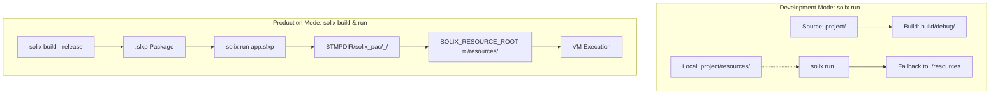

# Application Packaging & Resources

This guide explains how to package Solix applications into single-file portable distribution packages (`.slxp`), bundle native shared libraries and static assets, and access internal resources using the `solix.io.filesystem.Resource` API.

---

## Table of Contents

1. [Introduction](#introduction)
2. [The Anatomy of a `.slxp` Package](#the-anatomy-of-a-slxp-package)
3. [Packaging with `solix build`](#packaging-with-solix-build)
4. [Executing Packages with `solix run`](#executing-packages-with-solix-run)
5. [The Resource API (`solix.io.filesystem.Resource`)](#the-resource-api-solixiofilesystemresource)
6. [The `res://` Virtual URI Scheme](#the-res-virtual-uri-scheme)
7. [Dual-Location Filesystem API](#dual-location-filesystem-api)
8. [Multi-Depth (Transitive) Dependency Bundling & Staging](#multi-depth-transitive-dependency-bundling--staging)
9. [Development vs. Production Workflow](#development-vs-production-workflow)
10. [Universal Multi-Platform Cross-Compilation with Zig](#universal-multi-platform-cross-compilation-with-zig)
11. [Summary of Best Practices](#summary-of-best-practices)

---

## Introduction

Modern applications frequently require more than just compiled bytecode: they depend on native shared libraries (such as platform drivers, cryptographic helpers, or audio/graphics bindings) and static asset files (such as configuration files, localization files, shaders, templates, and icons).

Solix provides a unified, cross-platform packaging solution:
- **`solix build`**: Assembles your compiled bytecode into root `binaries.slxb`, native libraries into `bin/<target_triple>/`, and static resources into `resources/` inside a single, self-contained, compressed `.slxp` package container.
- **`solix run`**: Directly ingests, unpacks to a content-hashed cache, loads bundled companion native libraries, and executes `.slxp` packages with zero manual extraction.
- **`Resource` & `res://`**: Standard library APIs to access bundled assets cleanly from Solix code regardless of whether running from source or from a package.

---

## The Anatomy of a `.slxp` Package

An `.slxp` file is a ZIP-compatible archive containing a deterministic internal folder structure:

```text
my_app.slxp
├── manifest.yaml       # Project metadata, profile configuration, and package entry
├── binaries.slxb       # Primary compiled bytecode container at package root
├── bin/                # Target-tripled native shared libraries
│   └── x86_64-unknown-linux-gnu/
│       ├── native_plugin.so
│       └── libnative_helper.so
└── resources/          # Static application assets
    ├── config.json
    ├── templates/
    │   └── email.html
    └── assets/
        └── logo.png
```

| Path | Required | Purpose |
|---|---|---|
| `manifest.yaml` | **Yes** | Cloned project manifest identifying name, version, entry point, profile details, and target platform checksums (declarative format; `manifest.toml` supported as legacy fallback). |
| `binaries.slxb` | **Yes** | Primary compiled bytecode binary container produced during project build located at the package root. |
| `bin/<target>/` | Optional | Shared libraries loaded automatically by the runtime VM for the host architecture into the native registry. |
| `resources/` | Optional | Static asset files mounted as the application resource root. |

> [!IMPORTANT]
> **Strict Native Loader Isolation Policy:**
> - To avoid polluting the Solix VM FFI symbol table or executing unintended third-party code, the VM dynamic loader **only** loads libraries whose filenames match `native_*` or `libnative_*` (or are explicitly declared in the manifest).
> - Auxiliary/transitive native libraries (such as `libz.so` or vendor support binaries) residing in `bin/<target>/` are available for host OS dynamic linkers (`dlopen` / `LoadLibrary`) but are **not** loaded into the Solix VM FFI dispatch table.
> - The runtime strictly inspects the package's `bin/<target>/` directory for the active host target triple and **never searches the host system PATH**.

---

## Packaging with `solix build`

The `solix build` command builds the specified project and packages the build artifacts into an `.slxp` package container.

### Basic Invocations

Build the default profile:
```bash
solix build
```
This builds the default `debug` profile and emits `<project_name>.slxp` into `build/debug/`.

Build with a specific profile (e.g. `release`):
```bash
solix build --release
```
Emits `<project_name>.slxp` into `build/release/`.

Build for a specific target platform (building all architectures for that platform):
```bash
solix build --platform linux
```

> [!NOTE]
> The legacy command `solix pack` is maintained as a backward-compatibility alias for `solix build`.

---

## Executing Packages with `solix run`

The `solix run` launcher command accepts `.slxp` package containers directly:

```bash
solix run build/release/my_app.slxp
# Or using the package subcommand:
solix run package ./my_app
```

You can pass command-line arguments to the application after `--`:
```bash
solix run build/release/my_app.slxp -- --verbose --port 8080
```

### Content-Hashed Execution Cache

When executing an `.slxp` package:
1. `solix run` computes a deterministic SHA-256 hash of the package contents.
2. The package is unpacked into the system temporary cache:
   - **Linux / macOS**: `/tmp/solix_pac/<app_name>_<sha256_short>/`
   - **Windows**: `%TEMP%\solix_pac\<app_name>_<sha256_short>\`
3. If an identical package was previously unpacked and remains unmodified, extraction is skipped and execution begins immediately ($O(1)$ startup).
4. All companion native shared libraries matching `native_*` in `bin/<host_target>/` are automatically registered into `RuntimeOptions::native_libraries`.
5. The `resources/` directory is mounted into `RuntimeOptions::resource_directory` and exported as `SOLIX_RESOURCE_ROOT`.
6. The VM boots and executes the bundled root `binaries.slxb`.

---

## The Resource API (`solix.io.filesystem.Resource`)

To read bundled assets from inside your Solix program, import `solix.io.filesystem.Resource`:

```solix
import solix.io.filesystem.Resource;

class Main {
    public static int32 main() {
        if (Resource::exists("config.json")) {
            string config_text = Resource::read_to_string("config.json");
            // Process configuration...
        }
        return 0;
    }
}
```

---

## The `res://` Virtual URI Scheme

Application code can reference embedded resources using standard `res://` URIs:

```solix
string shader_source = Resource::read_to_string("res://shaders/basic.vert");
```

---

## Dual-Location Filesystem API

The `Resource` API seamlessly searches both the packaged resources directory and local filesystem fallback directories during development:

1. **Packaged Execution**: When running from an `.slxp` package, `res://` resolves against the unpacked staging directory.
2. **Development Execution**: When running from source via `solix run src/main.slx`, `res://` falls back to `./resources/`.

---

## Multi-Depth (Transitive) Dependency Bundling & Staging

When your application depends on packages that contain their own resources and companion native libraries:
- **Collision Override**: If the root project provides an asset with the same relative path as a dependency (e.g., `resources/shared/theme.json`), the root project's file automatically takes precedence.
- **Topological Staging**: All native companion libraries across all dependencies are staged into their corresponding `bin/<target_triple>/` directories.
- **Resource Merging**: Static resources are merged into the unified root `resources/` directory inside the package.

---

## Development vs. Production Workflow

Solix ensures zero code differences between local development and packaged distribution:



---

## 10. Universal Multi-Platform Cross-Compilation with Zig

When distributing native libraries or applications across multiple operating systems, Solix companion native projects support **Zig's embedded C/C++ cross-compiler (`zig c++`)** combined with Solix pre-compile lifecycle hooks:

```yaml
configuration:
  name: universal_app
  version: "1.0.0"

profiles:
  release:
    entrypoint: Main::main
    platforms:
      - linux
      - windows
      - macos
    pre_compile:
      - python3 scripts/build_native.py
```

`solix build --release` compiles native subprojects under `natives/` across expanded target architectures and packages the resulting shared libraries into `bin/<target_triple>/native_<name>.<ext>` inside `.slxp`.

---

## 11. Summary of Best Practices

1. **Keep Assets in `resources/`**: Place all read-only application assets inside `<project_root>/resources/`.
2. **Name Native Libraries with `native_` Prefix**: Ensure companion shared libraries follow the `native_*` or `libnative_*` naming pattern so the runtime loads them securely into the FFI registry.
3. **Keep Native Binaries in `bin/<target_triple>/`**: Organize prebuilt native libraries under target-specific subdirectories.
4. **Use `manifest.yaml`**: Author manifests using declarative YAML 1.2 syntax (`manifest.toml` is reserved for legacy backwards compatibility).
5. **Use `res://` for Uniform Paths**: Use `res://` URIs for internal assets so that configuration strings and file paths remain clear and distinct from host paths.
6. **Automate Native Builds with `pre_compile`**: Use `pre_compile` hooks to invoke build tools so native libraries are guaranteed to be compiled and up to date prior to bundling.
7. **Resources are Read-Only**: Bundled resources in `.slxp` packages represent static assets. For writable data (user preferences, caches, logs), use standard host filesystem paths.
