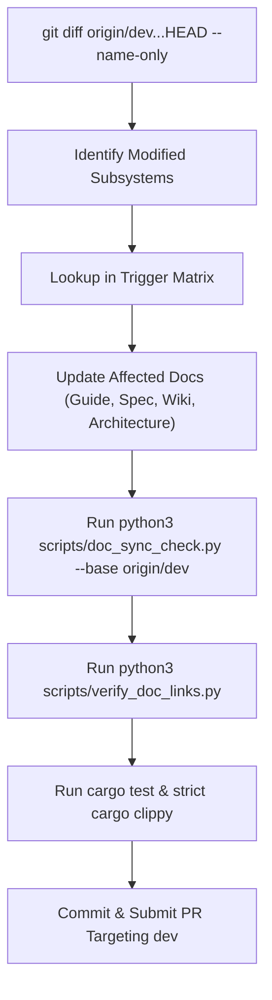

# Mandatory Pre-Merge Git-Diff Documentation Audit Protocol

## Document Metadata

* **Guideline ID:** GL-0013
* **Scope:** Repository-Wide Pre-Merge Quality Gate (`crates/`, `libraries/`, `docs/`)
* **Status:** Final Implementation Standard
* **Audience:** Core Systems Engineers, Compiler Architects, PR Reviewers, Autonomous Agents
* **Normative Conformance:** RFC 2119 / RFC 8174 (`MUST`, `MUST NOT`, `REQUIRED`, `SHALL`, `SHALL NOT`, `SHOULD`, `SHOULD NOT`, `RECOMMENDED`, `MAY`, `OPTIONAL`)

---

## 1. Executive Summary & Purpose

A fundamental vulnerability of software engineering is asynchronous documentation drift: code is modified to add flags, change bytecode lowering, or refine type rules, but documentation is deferred, forgotten, or updated superficially. Within a few release cycles, documentation drifts from truth to historical fiction.

This protocol enforces a **Hard Pre-Merge Gate**: before any topic branch or pull request can be merged into `dev`, the author **MUST** run a Git-diff analysis against `origin/dev`, evaluate the **Strict Cross-Update Trigger Matrix**, and verify that all affected specifications, guides, and wiki entries are fully synchronized within the exact same pull request.

---

## 2. Normative Invariants & Core Principles

All contributors and CI verification pipelines **MUST** enforce the following rules:

1. **The Git-Diff Analysis Command:**
   Before marking any milestone issue complete or submitting a pull request, the author **MUST** execute:
   ```bash
   git diff origin/dev...HEAD --stat
   git diff origin/dev...HEAD --name-only -- crates/ libraries/
   ```
   to inventory all touched Rust crates, diagnostics, AST nodes, opcodes, and CLI flags.
2. **Zero-Drift Enforcement Gate:**
   If a Rust source file in `crates/` or standard library Solix file in `libraries/solixlib/` is modified, the corresponding documentation tiers defined in the Trigger Matrix **MUST** be updated in the same branch. Commits modifying functionality without matching documentation updates will be rejected at code review.
3. **Automated Documentation Sync Check:**
   Every pull request **MUST** pass the automated documentation synchronization verification script:
   ```bash
   python3 scripts/doc_sync_check.py --base origin/dev
   ```
4. **Link Integrity & Automated Drift Verification Mandate:**
   All markdown links across `docs/` and `README.md` **MUST** resolve to valid files, all active CLI subcommands and manifest sections must be fully documented, and zero deprecated terms may be present. This is strictly verified via:
   ```bash
   python3 scripts/verify_docs.py
   ```
5. **No Single-Letter Variables Mandate (GL-0011):**
   All code snippets in updated documentation **MUST NOT** use single-letter variable names (`x`, `y`, `i`, `n`, `s`, `v`, `e`). Every identifier must be descriptive (`coord_x`, `coord_y`, `index`, `item_count`, `error_val`).
6. **No Legacy Syntax in Documentation:**
   All new and updated documentation **MUST** use modern Solix v2.0 semantics:
   * Scope resolution `::` for static methods, static fields, and enums (`Math::sin`, `Color::Red`).
   * `.slxb` and `.slxarc` container extensions.
   * `manifest.toml` package metadata.
   * Canonical diagnostic error codes (`E0000`–`E0290`, `R0001`–`R0023`).

---

## 3. Strict Cross-Update Trigger Matrix

When `git diff origin/dev...HEAD` reveals modifications in any left-hand subsystem, the author **MUST** inspect and synchronize the corresponding documentation tiers:

| Modified Subsystem / Path | Inspect & Update in `docs/wiki/` | Inspect & Update in `docs/spec/` | Inspect & Update in `docs/guide/` & `docs/architecture/` |
| :--- | :--- | :--- | :--- |
| **CLI Arguments & Flags**<br>`crates/solix-toolchain/src/cli.rs`<br>`crates/solix-toolchain/src/commands/` | `docs/wiki/commands/*.md` | `docs/spec/tools/cli/*.md` (`new.md`, `compile.md`, `build.md`, `run.md`, `info.md`, `install.md`, `uninstall.md`, `list.md`, `manifest.md`) | `docs/guide/01_getting_started.md` |
| **Lexer & Tokens**<br>`crates/solix-compilation/src/phases/lexing/` | `docs/wiki/keywords/`<br>`docs/wiki/primitives/`<br>`docs/wiki/errors/lexer-errors.md` | `docs/spec/lexical.md` | `docs/guide/02_variables_and_types.md` |
| **Parser & AST Nodes**<br>`crates/solix-compilation/src/phases/parser/` | `docs/wiki/errors/parser-errors.md` (`E0101`–`E0200`) | `docs/spec/statements/*.md` | Relevant guides in `docs/guide/02..07` |
| **Type Binder & Semantics**<br>`crates/solix-compilation/src/phases/binder/` | `docs/wiki/errors/binder-errors.md` (`E0201`–`E0290`) | `docs/spec/types.md` | `docs/architecture/binder_passes.md`<br>`docs/guide/04_classes_and_oop.md` |
| **Emitter & Bytecode Codegen**<br>`crates/solix-compilation/src/phases/emitter/` | N/A | `docs/spec/vm_isa.md`<br>`docs/spec/statements/*.md` (Register VM lowering listings) | `docs/architecture/pipeline.md` |
| **Register VM & Opcodes**<br>`crates/solix-runtime/src/vm/`<br>`crates/solix-common/src/bytecode/` | `docs/wiki/errors/runtime-errors.md` (`R0001`–`R0023`) | `docs/spec/vm_isa.md` | `docs/architecture/memory_model.md`<br>`docs/architecture/arc_internals.md`<br>`docs/architecture/exception_unwinding.md`<br>`docs/guide/05_memory_management_and_arc.md` |
| **Native Interop & FFI**<br>`crates/solix-runtime/src/native/` | N/A | `docs/spec/native_interop.md` | `docs/guide/09_native_plugins.md` |
| **Standard Library**<br>`libraries/solixlib/src/` | N/A | `docs/spec/libraries/solixlib/*.md` | `docs/guide/` (relevant guides) |
| **Project Manifest & Scaffolding**<br>`crates/solix-toolchain/assets/scripts/solix_scaffold.py`<br>`crates/solix-toolchain/assets/scripts/solix_build.py` | `docs/wiki/commands/package-commands.md` | `docs/spec/tools/cli/new.md`<br>`docs/spec/tools/cli/manifest.md` | `docs/guide/01_getting_started.md`<br>`docs/guide/packaging_and_resources.md` |
| **LSP & Formatting Subsystem**<br>`crates/solix-lsp/src/`<br>`crates/solix-toolchain/src/commands/(lsp\|fmt).rs` | `docs/wiki/commands/lsp.md`<br>`docs/wiki/commands/fmt.md` | `docs/spec/tools/lsp/protocol.md` | `docs/guide/editors_vscode.md` |
| **CI Workflows & Release Governance**<br>`.github/workflows/`<br>`scripts/(pr_risk_audit\|prepare_release_train\|build_docs_site\|sync_github_wiki).py` | N/A | `docs/spec/tools/cli/wiki.md` | `CONTRIBUTING.md`<br>`docs/guidelines/pr-and-release-governance.md`<br>`docs/guidelines/branching-conventions.md`<br>`docs/guide/release.md` |

> [!NOTE]
> User-facing documentation (`docs/guide/`, `docs/wiki/`, `docs/features/`, `docs/spec/`, `docs/architecture/`) **MUST** remain inside the main Git repository. [`scripts/build_docs_site.py`](../../../scripts/build_docs_site.py) compiles these files into the offline `solix wiki` bundle matching every binary release version, and optional one-way GitHub Wiki mirroring reads from this Git Single Source of Truth.

---

## 4. Post-Milestone Synchronization Workflow

At the conclusion of each milestone or Wave 1 integration PR (`feature/* -> dev`):



### Step 1: Git-Diff Inventory
```bash
git diff origin/dev...HEAD --name-only
```
Review the list of changed files in `crates/`, `libraries/`, `scripts/`, and `.github/workflows/`.

### Step 2: Trigger Evaluation
Match each modified file against Section 3's Trigger Matrix. For example, if `crates/solix-toolchain/src/cli.rs` was modified:
- Ensure `docs/spec/tools/cli/` has up-to-date specs for all added/modified flags.
- Ensure `docs/wiki/commands/` reflects all added/modified flags.
- Ensure `docs/guide/01_getting_started.md` documents the practical developer usage.

### Step 3: Run Automated Sync Checker
```bash
python3 scripts/doc_sync_check.py --base origin/dev
python3 scripts/doc_sync_check.py --all-docs
```

### Step 4: Verify Markdown Links
```bash
python3 scripts/verify_doc_links.py
```

### Step 5: Double Verification Pass
Execute two consecutive clean test passes:
```bash
cargo clippy --workspace --all-targets -- -D warnings
cargo test --workspace
cargo clippy --workspace --all-targets -- -D warnings
cargo test --workspace
```
