# CI, Sensitive-Path Governance & On-Demand Release Protocol

## Document Metadata
* **Guideline ID:** GL-0014
* **Scope:** Repository Governance, CI/CD Workflows, Sensitive-Path Audits & On-Demand Release (`dev -> master`)
* **Status:** Final Implementation Standard
* **Audience:** All Contributors, Core Maintainers & Release Admins (`@Jehudme`)
* **Normative Conformance:** RFC 2119 / RFC 8174 (`MUST`, `MUST NOT`, `REQUIRED`, `SHALL`, `SHALL NOT`, `SHOULD`, `SHOULD NOT`, `RECOMMENDED`, `MAY`, `OPTIONAL`)

---

## 1. Two-Workflow Architecture (`ci.yml` + `release.yml`)

Solix separates daily development integration (`dev`) from production releases (`master`) using two dedicated GitHub Actions workflows:

```mermaid
flowchart LR
    TopicBranch["Contributor Topic Branch (feat / fix / docs)"] -->|"PR targeting dev"| IntegrationCI["ci.yml: Lint, Docs, Security, Risk Notice, 3-OS Tests & FFI Suite"]
    IntegrationCI -->|"Pass + Up-to-Date + Admin Approval"| DevBranch["Protected Integration Trunk: dev"]
    DevBranch -->|"Manual workflow_dispatch (release.yml)"| ReleaseGate["Bump Version + Post-Bump Tests + cargo package dry-run"]
    ReleaseGate -->|"Fast-Forward dev -> master + Tag vX.Y.Z"| MasterBranch["Protected Release Trunk: master"]
    MasterBranch -->|"crates.io + Installers + Same-Host Benchmarks + Wiki"| Published["Published Release + Sync master -> dev"]
```

### 1.1 Integration Workflow ([`.github/workflows/ci.yml`](../../.github/workflows/ci.yml))
All feature work, bug fixes, dependency bumps (`.github/dependabot.yml`), and documentation PRs **MUST** target **`dev`**.
* **Action Pinning & Security Scanning:** All third-party GitHub Actions are pinned to immutable commit SHAs with version annotations (`# v2`), validated continuously by `zizmor` and `actionlint`.
* **End-to-End Multi-Platform Command Lifecycle Matrix (`GL-0009`):** Continuous integration executes `scripts/tests/test_cli_lifecycle_matrix.py` across Linux, macOS, and Windows runners, validating all 14 CLI commands (`new`, `compile`, `build`, `run`, `info`, `install`, `uninstall`, `list`, `export`, `lsp`, `dap`, `fmt`, `doc`, `wiki`, `clean`) in hermetic package store isolation.
* **No Direct Pushes to `dev`:** The `dev` Repository Ruleset configures Repository Admin with **`pull_request` bypass mode** (blocking direct `git push origin dev` for everyone, including Admins) while enabling strict up-to-date status checks (**"Require branches to be up to date before merging"**).
* **Dependabot Auto-Merge ([`dependabot-auto-merge.yml`](../../.github/workflows/dependabot-auto-merge.yml)):** Dependency PRs opened by `dependabot[bot]` against `dev` receive automated approval and `--auto` squash-merge so GitHub merges them into `dev` only after all required CI checks pass; failing PRs remain open for manual investigation.
* **Admin-Only Approval Gate:** Pull requests touching [`.github/CODEOWNERS`](../../.github/CODEOWNERS) sensitive paths **MUST** pass all required status checks and receive maintainer approval (`@Jehudme`).

### 1.2 On-Demand Release Workflow ([`.github/workflows/release.yml`](../../.github/workflows/release.yml))
Direct contributor pushes and topic PRs into **`master`** are **STRICTLY PROHIBITED**.
* Releases are triggered explicitly on demand via `workflow_dispatch` on [`release.yml`](../../.github/workflows/release.yml) with selectable bump strategy (`auto`, `patch`, `minor`, `major`) or an explicit SemVer override (`X.Y.Z`), plus an optional `dry_run` mode for workflow validation.
* [`scripts/release/prepare_release_train.py`](../../scripts/release/prepare_release_train.py) computes the version bump from commits ahead of `master`, updates workspace manifests and changelogs (`Cargo.toml`, `Cargo.lock`, root & crate `CHANGELOG.md` files), runs post-bump workspace tests and `cargo package --no-verify` publishability checks, promotes `dev -> master` via `RELEASE_TOKEN`, tags `vX.Y.Z`, publishes crates in dependency order, builds cross-platform binaries/installers + bundled packages (unified via [`scripts/release/merge_bundled_packages.py`](../../scripts/release/merge_bundled_packages.py) into `bin/<target_triple>/` structures) + offline `solix wiki`, runs same-host release and cross-language benchmarks via [`scripts/bench/solix_bench.py`](../../scripts/bench/solix_bench.py) (with `.slxb` pre-compilation, hardware telemetry extraction, and iteration controls), publishes clean emoji-free release notes (skipping duplicate `artifacts/release_changelog.md` prepending in [`release.yml`](../../.github/workflows/release.yml) when `## Release Notes` is already present), mirrors GitHub Wiki, and syncs `master -> dev` via a `[skip ci]` pull request without re-running CI.

---

## 2. Sensitive-Path Governance & Concise Notices

Editing CI workflows, engineering guidelines, build scripts, or runtime security paths **IS NOT banned** — contributors are welcome to improve CI, docs, or tooling. Such edits trigger a concise automated notice and require `@Jehudme` CODEOWNER approval.

### 2.1 Protected Path Matrix (`.github/CODEOWNERS`)

All sensitive categories emit a single **`sensitive`** label via [`scripts/ci/pr_risk_audit.py`](../../scripts/ci/pr_risk_audit.py):

| Category | Protected Paths | Security Rationale |
| :--- | :--- | :--- |
| **CI Workflows & Automation** | `.github/**` | Protects secrets (`RELEASE_TOKEN`, `CARGO_REGISTRY_TOKEN`) and workflow triggers. |
| **Engineering Guidelines & Scripts** | `docs/guidelines/**`, `CONTRIBUTING.md`, governance Python scripts | Protects `GL-0011`, test gates, and doc invariants. |
| **Supply Chain & Build Scripts** | `Cargo.toml`, `Cargo.lock`, `deny.toml`, `cliff.toml`, `scripts/**`, `**/build.rs`, `libraries/*/scripts/**`, `crates/solix-toolchain/assets/**` | `build.rs`, `manifest.yaml` pre/post hooks, and release Python helpers execute during builds and cross-platform packaging (`manifest.yaml` & legacy `manifest.toml`). |
| **Runtime Security, Archives & FFI** | `crates/solix-common/src/project.rs`, `crates/solix-common/src/hash.rs`, `crates/solix-runtime/src/native/**`, `ffi/**` | Safeguards Zip-Slip archive checks, SHA-256 verification, `.slxp` `supported_platforms` host enforcement, and `unsafe` C-ABI boundaries. |

### 2.2 Non-Blocking Auditor (`scripts/ci/pr_risk_audit.py`)
* [`scripts/ci/pr_risk_audit.py`](../../scripts/ci/pr_risk_audit.py) **MUST ALWAYS** exit `0` so valid improvements never fail CI solely for touching protected files. Writing to `$GITHUB_STEP_SUMMARY` is guarded by an explicit `--step-summary` flag, ensuring unit test executions never pollute CI job step summaries.
* When sensitive files change, the job attaches the single `sensitive` label and upserts a concise `## Sensitive Paths Modified` table; when subsequent PR commits revert all sensitive changes, CI automatically removes the `sensitive` label and deletes the sticky notice. Both `pr-risk-audit` and `pr-benchmark` avoid checking out untrusted fork code in privileged `pull_request_target` jobs. `pr-benchmark` executes across all pull requests targeting `dev` (including external fork contributions), publishing back-to-back benchmark comparisons directly to the GitHub Step Summary. To ensure discussion comments are reliably delivered across all pull requests (including external forks where PR event tokens are read-only), `pr-risk-audit` and `pr-benchmark` stage output artifacts (`pr-risk-audit` and `pr-benchmark-report`), which [`pr-discussion-sync.yml`](../../.github/workflows/pr-discussion-sync.yml) consumes on `workflow_run` to synchronize sticky comments and sensitive labels with full repository write permissions without executing untrusted code.

---

## 3. Automated Security Gates

Every PR targeting `dev`, push to `dev`, and scheduled weekly security run executes:
1. **`cargo-deny`** ([`deny.toml`](../../deny.toml)): Validates compatible open-source licenses, blocks unapproved registries/git sources, and checks RustSec advisories.
2. **`cargo-audit` (`--deny warnings`):** Scans `Cargo.lock` against RustSec vulnerability, yanked-crate, and soundness advisories.
3. **`actionlint` & `zizmor`**: Statically analyzes `.github/workflows/*.yml` for YAML issues, script injection, overly permissive tokens, and unpinned actions.
4. **`cargo-llvm-cov` Coverage Gate**: Enforces a minimum workspace line coverage floor (`55%`) in [`.github/workflows/ci.yml`](../../.github/workflows/ci.yml) using `llvm-tools-preview`. [`scripts/ci/render_coverage_summary.py`](../../scripts/ci/render_coverage_summary.py) formats llvm-cov summary metrics into a structured GitHub Flavored Markdown table aggregating total, executed, and missed lines and function coverage percentages by crate subsystem alongside collapsible raw details.
5. **Immutable SHA Pinning:** Third-party GitHub Actions in `.github/workflows/*.yml` **MUST** pin full 40-character commit SHAs alongside version comments, with top-level `permissions: contents: read`.

---

## 4. Documentation Source-of-Truth & Versioned `solix wiki`

User documentation (`docs/guide/`, `docs/wiki/`, `docs/spec/`, `docs/architecture/`) **MUST** remain inside the main Git repository (`GL-0013`).
* Every `solix` release builds [`scripts/docs/build_docs_site.py`](../../scripts/docs/build_docs_site.py) to bundle static HTML + offline `search_index.js` directly inside `crates/solix-toolchain/assets/docs/` (serving `solix wiki` locally without internet or an HTTP daemon), alongside universal cross-platform default libraries (`solix-release`, `raylib-release` built per-target by `scripts/release/build_default_libraries.py`—skipping incompatible host `solix install` verification during cross-target staging—and merged cleanly across YAML/TOML manifests by `scripts/release/merge_bundled_packages.py`). Versioned CLI auto-bootstrap overrides stale default packages in `~/.solix/packages/` automatically on version upgrades.
* Optional one-way GitHub Wiki mirroring ([`scripts/docs/sync_github_wiki.py`](../../scripts/docs/sync_github_wiki.py)) runs during releases and injects a version header directing older-version users to their Git tag's `/docs` tree or local `solix wiki` command.
