# Release Train, Sensitive-Path Governance & Reviewer Security Protocol

## Document Metadata
* **Guideline ID:** GL-0014
* **Scope:** Repository Governance, CI/CD Workflows, Sensitive-Path Audits & Two-Wave Release Train (`dev -> master`)
* **Status:** Final Implementation Standard
* **Audience:** All Contributors, Core Maintainers & Release Admins (`@Jehudme`)
* **Normative Conformance:** RFC 2119 / RFC 8174 (`MUST`, `MUST NOT`, `REQUIRED`, `SHALL`, `SHALL NOT`, `SHOULD`, `SHOULD NOT`, `RECOMMENDED`, `MAY`, `OPTIONAL`)

---

## 1. Two-Wave Release Train Architecture (`dev -> master`)

Solix isolates daily development integration from production releases using two strictly protected branches:

```mermaid
flowchart LR
    TopicBranch["Contributor Topic Branch (feat / fix / docs)"] -->|"Wave 1 PR targeting dev"| Wave1["Wave 1: CI + Security + Risk Audit"]
    Wave1 -->|"Pass + Strict Up-to-Date + Admin Approval"| DevBranch["Protected Integration Trunk: dev"]
    DevBranch -->|"Long-Lived Release PR (SemVer preview)"| Wave2["Wave 2: Validate Release PR Source"]
    Wave2 -->|"Admin Merge to master = Release"| MasterBranch["Protected Release Trunk: master"]
    MasterBranch -->|"release-plz + tag vX.Y.Z + release.yml"| Published["Crates.io + GitHub Releases + solix wiki bundle"]
    MasterBranch -->|"Auto back-sync version commit"| DevBranch
```

### 1.1 Wave 1 (`dev`): Contributor Integration Branch
All feature work, bug fixes, dependency bumps (`.github/dependabot.yml`), and documentation PRs **MUST** target **`dev`**.
* **Zero Merge-Skew Rule:** The `dev` Repository Ruleset enables strict up-to-date status checks (**"Require branches to be up to date before merging"**). If two contributor PRs pass CI independently and one merges first, GitHub blocks the second PR until it merges or rebases the updated `dev` head and re-passes every test.
* **Admin-Only Approval Gate:** Pull requests merging into `dev` **MUST** pass all status checks and receive maintainer approval (`@Jehudme`).

### 1.2 Wave 2 (`master`): Production Release Trunk
Direct pushes and direct topic PRs into **`master`** are **STRICTLY PROHIBITED**.
* **Single Authorized Source (`Validate Release PR Source`):** [`scripts/check_release_pr_source.py`](../../../scripts/check_release_pr_source.py) rejects external forks and arbitrary branches (`feat/*`, `fix/*`, `docs/*`) targeting `master`. Only same-repository PRs originating from **`dev`** (or sanctioned `release-plz/*` / `release/vX.Y.Z` branches) are permitted.
* **Deterministic Versioning:** Merging the release train into `master` triggers workspace version bumping (`Cargo.toml`, `CHANGELOG.md`), Git tag `vX.Y.Z`, `crates.io` publication, universal multi-architecture binaries + bundled `solix wiki` docs via [`release.yml`](../../../.github/workflows/release.yml), and automatic back-sync to `dev`.

---

## 2. Sensitive-Path Governance & Non-Blocking Risk Advisories

Editing CI workflows, engineering guidelines, build scripts, or runtime security paths **IS NOT automatically banned** — contributors may propose legitimate improvements to CI, docs, or tooling. However, such edits require explicit visibility and `@Jehudme` CODEOWNER approval.

### 2.1 Protected Path Matrix (`.github/CODEOWNERS`)

| Tier & Label | Protected Paths | Security Rationale |
| :--- | :--- | :--- |
| **`risk:ci-workflow`** | `.github/**` | Prevents secret exfiltration (`RELEASE_TOKEN`, `CARGO_REGISTRY_TOKEN`) or unsafe `pull_request_target` execution. |
| **`risk:guidelines`** | `docs/internals/guidelines/**`, `CONTRIBUTING.md`, `scripts/doc_sync_check.py`, `scripts/verify_docs.py`, `scripts/verify_doc_links.py`, `scripts/pr_risk_audit.py`, `scripts/check_release_pr_source.py` | Protects `GL-0011` (`#![forbid(unsafe_code)]`, zero single-letter identifiers), test gates, and doc invariants from silent removal. |
| **`risk:supply-chain`** | `Cargo.toml`, `Cargo.lock`, `deny.toml`, `release-plz.toml`, `cliff.toml`, `scripts/**`, `**/build.rs`, `libraries/*/scripts/**`, `crates/solix-toolchain/assets/**` | `build.rs` and `.py` helpers execute arbitrary code at compile/package time across CI and developer machines. |
| **`risk:runtime-security`** | `crates/solix-common/src/project.rs`, `crates/solix-common/src/hash.rs`, `crates/solix-runtime/src/native/**`, `crates/solix-ffi/**` | Safeguards Zip-Slip archive traversal checks, SHA-256 verification, and `unsafe` C-ABI boundaries. |

### 2.2 Non-Blocking Auditor (`scripts/pr_risk_audit.py`)
* [`scripts/pr_risk_audit.py`](../../../scripts/pr_risk_audit.py) **MUST ALWAYS** exit `0` so valid improvements never fail CI solely for touching protected files.
* For every matched risk tier, the workflow writes a summary table to `$GITHUB_STEP_SUMMARY`, emits file annotations (`::warning file=...::...`), and maintains a sticky reviewer checklist comment without checking out untrusted fork code inside privileged `pull_request_target` jobs.

---

## 3. Automated Security Gates

Every PR targeting `dev` and scheduled weekly cron run executes:
1. **`cargo-deny`** ([`deny.toml`](../../../deny.toml)): Validates compatible open-source licenses, blocks unapproved registries/git sources, and checks RustSec advisories.
2. **`cargo-audit` (`--deny warnings`):** Scans `Cargo.lock` using checksum-verified `cargo-audit` against RustSec vulnerability, yanked-crate, and soundness advisories cleanly without requiring elevated GitHub Checks API permissions.
3. **`actionlint` & `zizmor`**: Statically analyzes `.github/workflows/*.yml` for YAML mistakes, command injection (`${{ github.event.* }}`), overly permissive tokens, and unpinned actions.
4. **Immutable SHA Pinning:** Third-party GitHub Actions in `.github/workflows/*.yml` **MUST** pin full 40-character commit SHAs alongside version comments, with top-level `permissions: contents: read`.

---

## 4. Documentation Source-of-Truth & Versioned `solix wiki`

User documentation (`docs/guide/`, `docs/wiki/`, `docs/features/`, `docs/spec/`, `docs/architecture/`) **MUST** remain inside the main Git repository (`GL-0013`).
* Every `solix` release builds [`scripts/build_docs_site.py`](../../../scripts/build_docs_site.py) to bundle static HTML + offline `search_index.js` directly inside `crates/solix-toolchain/assets/docs/` (serving `solix wiki` locally without internet or an HTTP daemon).
* Optional one-way GitHub Wiki mirroring ([`scripts/sync_github_wiki.py`](../../../scripts/sync_github_wiki.py)) runs only after `master` releases and injects a version header directing older-version users to their Git tag's `/docs` tree or local `solix wiki` command.
