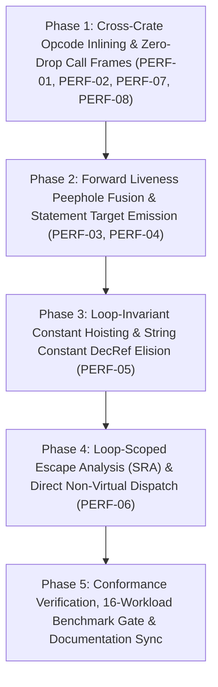

# Milestone 059: Cross-Crate Opcode Inlining, Zero-Drop Call Frames, Liveness-Driven Peephole Fusion & Lua-Beating VM Optimization

## Document Metadata
* **Milestone ID:** MS-059
* **Target Version:** `v2.1.0`
* **Milestone Branch:** `milestone/059-vm-dispatch-inlining-peephole-liveness-and-lua-parity`
* **Status:** COMPLETED
* **Lead Architect:** Core Systems, Compiler & Runtime Performance Engineering Team
* **Target Delivery Date:** 2026-12-01
* **Normative Conformance:** RFC 2119 / RFC 8174 (`MUST`, `MUST NOT`, `REQUIRED`, `SHALL`, `SHALL NOT`, `SHOULD`, `SHOULD NOT`, `RECOMMENDED`, `MAY`, `OPTIONAL`)
* **Related Specifications:**
  * [GL-0001: Conventional Commits & Release Specification](../guidelines/authoring-commits.md)
  * [GL-0002: Trunk-Based & Milestone Branching Topology](../guidelines/branching-conventions.md)
  * [GL-0008: Milestone Planning & Delivery Specification](../guidelines/authoring-milestones.md)
  * [GL-0009: Test Engineering & Verification Matrices](../guidelines/authoring-test.md)
  * [GL-0010: Living Documentation & Drift Prevention](../guidelines/authoring-docs.md)
  * [GL-0011: Rust Language & Security Conventions](../guidelines/language-conventions.md)
  * [GL-0013: Pre-Merge Git-Diff Documentation Audit Protocol](../guidelines/documentation-update-protocol.md)
  * [MS-016: Benchmarking Strategy & Evaluation Dimensions](016-benchmarking-strategy-evaluation-dimensions.md)
  * [MS-018: Unified Inlined VM, AOT Verifier & Compiler Fixes](018-unified-inlined-vm-aot-verifier-compiler-optimization-fixes.md)
  * [MS-055: Escape Analysis, Scalar Replacement & ARC Elision](055-escape-analysis-scalar-replacement-and-arc-elision.md)
  * [MS-058: Dynamic Release Benchmarking & CI/CD Gates](058-dynamic-release-benchmarking-and-ci-cd.md)

---

## 1. Executive Summary & Forensic Codebase Audit

While Solix (`v1.3.0` / `v2.0` architecture) currently outperforms CPython on 15 out of 16 canonical workloads and beats both PUC-Rio Lua and LuaJIT on `14_exception_zero_cost` (`13.27 ms` vs. Lua `16.58 ms` and LuaJIT `15.25 ms`), it still trails PUC-Rio Lua 5.4/5.5 on 15 out of 16 workloads.

A forensic audit combining x86-64 disassembly of `VirtualMachine::run_fast_internal` (`objdump -d ./target/release/solix`), `.slxb` bytecode disassembly (`solix info --disasm`), and compiler pass tracing across [`crates/solix-common`](../../../crates/solix-common/src/lib.rs), [`crates/solix-compilation`](../../../crates/solix-compilation/src/lib.rs), and [`crates/solix-runtime`](../../../crates/solix-runtime/src/lib.rs) identified **8 exact architectural bottlenecks** that artificially throttle Solix's execution speed.

### 1.1 The 8 Forensic Root-Cause Bottlenecks

| Bottleneck ID | Exact File & Line Location | Root-Cause Defect (Assembly & Bytecode Evidence) | Performance Impact |
| :--- | :--- | :--- | :--- |
| **PERF-01**<br>*(Cross-Crate Out-of-Line `inst.opcode(pc)` Call on Every Instruction)* | [`fast.rs:197-201`](../../../crates/solix-runtime/src/vm/fast.rs)<br>[`instruction.rs:99-101`](../../../crates/solix-common/src/bytecode/instruction.rs)<br>[`opcodes.rs:150-275`](../../../crates/solix-common/src/bytecode/opcodes.rs) | Neither `Instruction::opcode` nor `OpCode::from_u8` is marked `#[inline]` / `#[inline(always)]`, and both return `Result<OpCode, EmissionError>` (a 40-byte enum containing heap `String`s) across the `solix-common` $\to$ `solix-runtime` crate boundary. In x86-64 release assembly, **every single VM instruction** spills `reg_base`, `static_base`, `inst_len`, `inst_ptr`, and `pc` to stack memory (`%rsp`), allocates a 40-byte stack return buffer (`lea 0x420(%rsp), %rdi`), and executes a cross-crate PLT/GOT call (`call *0x19f610(%rip)`) before jumping to the dispatch table. | Causes the VM loop to spend **~10.0 ns (~38 CPU cycles) per instruction** (`159.9 ms` for `16,000,014` instructions in `02_tight_loop_int`) instead of ~1.5 ns/instruction. |
| **PERF-02**<br>*(Eager `.ok_or(RuntimeError::...)` Invokes `drop_glue::<RuntimeError>` on Happy Path)* | [`fast.rs:121-135`](../../../crates/solix-runtime/src/vm/fast.rs)<br>[`fast.rs:1298-1350`](../../../crates/solix-runtime/src/vm/fast.rs)<br>[`engine.rs:637-651`](../../../crates/solix-runtime/src/vm/engine.rs) | `reload_frame!()`, `Return`, `ReturnValue`, `current_frame()`, and `current_frame_mut()` call `.ok_or(RuntimeError::NullReferenceAccess)?`. In Rust, `Option::ok_or(err)` **eagerly constructs `err` by value**, and when the `Option` is `Some` (100% of normal execution), it invokes `call <core::ptr::drop_glue::<RuntimeError>>` because `RuntimeError` has `String` variants. Worse, `CallFrame` does not cache caller pointers, forcing a full `reload_frame!()` lookup on every call and return. | In `01_fib_recursive` (`1,028,457` calls), every `CallDirect` + `ReturnValue` pair invokes `drop_glue::<RuntimeError>` **5 times** (**5.14 million destructor calls**). |
| **PERF-03**<br>*(`count_total_reads` Disables Peephole Superinstructions & `Mov` Elimination)* | [`bytecode_optimizer.rs:165`](../../../crates/solix-compilation/src/phases/optimizer/bytecode_optimizer.rs)<br>[`bytecode_optimizer.rs:204`](../../../crates/solix-compilation/src/phases/optimizer/bytecode_optimizer.rs)<br>[`bytecode_optimizer.rs:275`](../../../crates/solix-compilation/src/phases/optimizer/bytecode_optimizer.rs)<br>[`bytecode_optimizer.rs:672-680`](../../../crates/solix-compilation/src/phases/optimizer/bytecode_optimizer.rs) | All three peephole optimizations (`JumpIf*I32` branch fusion, `AddI32Imm`/`SubI32Imm` immediate fusion, and `Op + Mov` destination coalescing) check `count_total_reads(&function.instructions, r_tmp) == 1` across the **entire function**. Because `RegisterAllocator::free_temp` recycles scratch registers (`r1`..`r5`) across expressions, any scratch register reused later in the same function has `count_total_reads >= 2`, completely disabling superinstruction fusion and `Mov` elimination. | In `02_tight_loop_int`, **zero** superinstructions fuse (`LT_I32 + JUMP_IF_FALSE`, `LOAD_I32 + ADD_I32`, and four `MOV`s remain unoptimized, executing 16 instructions/iteration instead of 6). |
| **PERF-04**<br>*(Statement Expressions Emit Redundant Trailing `Mov` Instructions)* | [`control_flow.rs:98-120`](../../../crates/solix-compilation/src/phases/emitter/control_flow.rs)<br>[`control_flow.rs:368-371`](../../../crates/solix-compilation/src/phases/emitter/control_flow.rs)<br>[`emitter.rs:2680-2689`](../../../crates/solix-compilation/src/phases/emitter/emitter.rs) | `Statement::Expression` and `for_stmt.update` invoke `emit_expression(&expr, None)`, allocating a temporary `dst` register even though the statement discards the result. In `emit_assignment`, after writing `local_reg`, the emitter checks `if dst != local_reg` and emits a dead `MOV dst, local_reg` (`0012 MOV r2, r0` and `0016 MOV r2, r1` in `02_tight_loop_int`). | Emits 2 to 6 dead `MOV` instructions inside every loop body across all 16 benchmark workloads. |
| **PERF-05**<br>*(Missing Loop-Invariant Constant Hoisting Pass in `BytecodeOptimizerPhase`)* | [`bytecode_optimizer.rs:75-130`](../../../crates/solix-compilation/src/phases/optimizer/bytecode_optimizer.rs) | Despite the rustdoc comment on `optimize_function`, `bytecode_optimizer.rs` has **no loop-invariant constant hoisting pass**. Every backward-jump loop reloads `LoadI32`, `LoadI64`, `LoadF64`, and `LoadConst` literals on every single iteration, and `15_string_processing` executes `LOAD_CONST` + `DEC_REF` on immortal string literals `"alpha"`, `"beta"`, `"gamma"` 300,000 times inside the hot loop. | Wastes 3 to 6 instructions per loop iteration across 11 out of 16 benchmark workloads. |
| **PERF-06**<br>*(Escape Analysis Rejects Loop-Local Allocations & Non-Virtual Instance Methods Emit `CallVirtual`)* | [`escape_analysis.rs:63-70`](../../../crates/solix-compilation/src/phases/optimizer/escape_analysis.rs)<br>[`escape_analysis.rs:184-208`](../../../crates/solix-compilation/src/phases/optimizer/escape_analysis.rs)<br>[`emitter.rs:1154-1179`](../../../crates/solix-compilation/src/phases/emitter/emitter.rs)<br>[`ast_inliner.rs:106-144`](../../../crates/solix-compilation/src/phases/optimizer/ast_inliner.rs) | 1. `escape_analysis.rs:185` rejects all `AllocObject` instructions enclosed inside loops (`if is_enclosed_in_loop`), preventing Scalar Replacement of Aggregates (SRA) in `05_object_churn_pod` (`new Point(i, i * 2)`) and `11_generic_containers` (`new Box<int32>(i)`) even when the object's entire lifetime is confined to a single loop iteration.<br>2. `emitter.rs:1171` emits `OpCode::CallVirtual` for all instance methods even when the method is non-virtual (`Box<int32>::get_val()`), and `ast_inliner.rs:140` skips generic class instance methods. | Prevents zero-allocation SRA and method inlining in `05_object_churn_pod` (`50,000` heap allocs/deallocs) and `11_generic_containers` (`100,000` heap allocs + `100,000` virtual calls). |
| **PERF-07**<br>*(Bitwise Opcodes `Band`, `Bor`, `Bxor`, `Shl`, `Shr` Convert `Value::I32` into `Value::I64`)* | [`fast.rs:452-499`](../../../crates/solix-runtime/src/vm/fast.rs)<br>[`model.rs:101-111`](../../../crates/solix-runtime/src/value/model.rs) | `OpCode::Band`, `OpCode::Bor`, `OpCode::Bxor`, `OpCode::Bnot`, `OpCode::Shl`, and `OpCode::Shr` coerce operands via `.as_i64()?` and write **`Value::I64`** to the destination register even when both inputs are `Value::I32`. Because almost every benchmark loop ends with `sum = (sum + ...) & 0x7FFFFFFF`, the accumulator register flips between `Value::I32` and `Value::I64`, forcing `.as_i32()?` down its secondary `Self::I64` match arm. | Adds type-tag instability and extra branching on every arithmetic instruction in bitwise-masked loops. |
| **PERF-08**<br>*(Stateless Function Pointers Allocate & Free Heap Closure Blocks in `PackClosure`)* | [`fast.rs:2133-2160`](../../../crates/solix-runtime/src/vm/fast.rs)<br>[`emitter.rs:411-416`](../../../crates/solix-compilation/src/phases/emitter/emitter.rs) | When a stateless function pointer (`FnPtrApp::fn1`) is referenced in `13_function_pointers`, `Emitter` emits `PACK_CLOSURE` with `cap_count = 0`. Even though `Value::FnPtr(u32)` already exists and is handled by `OpCode::CallCallable`, `OpCode::PackClosure` allocates a heap block (`BlockTag::Closure`) and `DecRef`s it on every loop iteration. | Causes **100,000 unnecessary heap allocations and deallocations** in `13_function_pointers` (`64.65 ms` vs. Lua `10.69 ms`). |

---

## 2. Scope & Crates Affected

* **[`crates/solix-common`](../../../crates/solix-common/src/lib.rs)**:
  * [`src/bytecode/instruction.rs`](../../../crates/solix-common/src/bytecode/instruction.rs): Annotate all hot instruction bitfield extractors (`raw_opcode`, `opcode`, `flags`, `dst`, `src1`, `src2`, `imm32`, `imm32_signed`, `cond_reg`, `jump_offset`, `call_dst`, `call_target`, `arg_base`, `arg_count`) with `#[inline(always)]`.
  * [`src/bytecode/opcodes.rs`](../../../crates/solix-common/src/bytecode/opcodes.rs): Annotate `OpCode::from_u8` with `#[inline(always)]` and add an infallible/fast `OpCode::from_raw_u8(raw_byte: u8) -> Option<Self>` helper without constructing `EmissionError`.
* **[`crates/solix-compilation`](../../../crates/solix-compilation/src/lib.rs)**:
  * [`src/phases/optimizer/bytecode_optimizer.rs`](../../../crates/solix-compilation/src/phases/optimizer/bytecode_optimizer.rs): Replace global `count_total_reads` with forward liveness analysis (`is_dead_after_use`), run multi-pass peephole convergence, implement call-window-safe loop-invariant constant hoisting (`hoist_loop_invariant_constants`) + immortal string `DecRef` elision (`elide_immortal_const_decref`), and preserve live reference registers across throwing instructions.
  * [`src/phases/optimizer/escape_analysis.rs`](../../../crates/solix-compilation/src/phases/optimizer/escape_analysis.rs): Enable loop-scoped Scalar Replacement of Aggregates (SRA) when an allocation and all of its uses and `DecRef`s are strictly contained within the same loop body iteration, forward pure field-getter calls during SRA, and reject loop-carried aliases.
  * [`src/phases/emitter/emitter.rs`](../../../crates/solix-compilation/src/phases/emitter/emitter.rs), [`src/phases/emitter/control_flow.rs`](../../../crates/solix-compilation/src/phases/emitter/control_flow.rs), [`src/phases/emitter/closures.rs`](../../../crates/solix-compilation/src/phases/emitter/closures.rs), & [`src/phases/emitter/pipeline.rs`](../../../crates/solix-compilation/src/phases/emitter/pipeline.rs): Eliminate dead trailing `Mov` emission on discarded expression statements (`Statement::Expression` and `for_stmt.update`) and emit `OpCode::CallDirect` for non-overridden concrete instance methods.
* **[`crates/solix-runtime`](../../../crates/solix-runtime/src/lib.rs)**:
  * [`src/value/model.rs`](../../../crates/solix-runtime/src/value/model.rs), [`src/memory/arc.rs`](../../../crates/solix-runtime/src/memory/arc.rs), & [`src/memory/heap.rs`](../../../crates/solix-runtime/src/memory/heap.rs): Mark hot `Value`, `inc_ref`/`dec_ref`, and heap word/byte accessors `#[inline(always)]` while moving mismatch formatting into `#[cold] #[inline(never)]` helpers.
  * [`src/vm/fast.rs`](../../../crates/solix-runtime/src/vm/fast.rs) & [`src/vm/engine.rs`](../../../crates/solix-runtime/src/vm/engine.rs):
    * Replace all `.ok_or(RuntimeError::...)` calls with `.ok_or_else(...)` / cold helpers to eliminate eager `drop_glue::<RuntimeError>` invocations on the happy path, add `push_frame_window` to return cached window pointers on call pushes without redundant lookups, and outline cold opcode handlers to keep `run_fast_internal` compact in I-cache.
    * Dispatch instructions using inlined `OpCode::from_raw_u8(inst.raw_opcode())`.
    * Preserve `Value::I32` in `OpCode::Band`, `OpCode::Bor`, `OpCode::Bxor`, `OpCode::Bnot`, `OpCode::Shl`, and `OpCode::Shr` when operands are 32-bit integers.
    * In `OpCode::PackClosure`, return `Value::FnPtr(target_lambda_id)` when `cap_count == 0` without allocating on the heap.
* **[`crates/solix-tests`](../../../crates/solix-tests/src/lib.rs)** & **[`crates/solix-compilation/tests`](../../../crates/solix-compilation/tests/optimizer_bytecode_tests.rs)**:
  * Add dedicated conformance and regression tests verifying `OpCode::from_raw_u8`, liveness-based peephole fusion, loop constant hoisting, non-virtual `CallDirect`, loop-local SRA + getter forwarding, stateless function pointers, and cross-engine benchmark parity.

---

## 3. Detailed Architectural Specifications

### 3.1 Upgrade 1: Zero-Spill Cross-Crate Opcode Dispatch (`PERF-01`)

In [`crates/solix-common/src/bytecode/opcodes.rs`](../../../crates/solix-common/src/bytecode/opcodes.rs), introduce an `#[inline(always)]` infallible byte-to-opcode conversion used by the runtime after load-time verification:

```rust
impl OpCode {
    /// Converts a raw 8-bit opcode byte into an `OpCode` without allocating diagnostic strings.
    #[inline(always)]
    #[must_use]
    pub const fn from_raw_u8(raw_byte: u8) -> Option<Self> {
        match raw_byte {
            0x00 => Some(Self::Nop),
            0x01 => Some(Self::Mov),
            0x02 => Some(Self::LoadI32),
            // ... all valid opcode bytes ...
            _ => None,
        }
    }
}
```

And in [`crates/solix-common/src/bytecode/instruction.rs`](../../../crates/solix-common/src/bytecode/instruction.rs), mark all operand extractors `#[inline(always)]`. In [`crates/solix-runtime/src/vm/fast.rs`](../../../crates/solix-runtime/src/vm/fast.rs), decode via:

```rust
let Some(opcode) = OpCode::from_raw_u8(instruction.raw_opcode()) else {
    return Err(RuntimeError::InvalidOpCode {
        pc: program_counter as u32,
        opcode: instruction.raw_opcode(),
    });
};
```

Because `Option<OpCode>` is a 1-byte niche-optimized enum with `None` as a cold error branch and `#[inline(always)]` on `from_raw_u8`, LLVM lowers `match opcode` directly into a single indirect jump `jmp *(%rcx,%rax,8)` with **zero register spills and zero function calls**.

---

### 3.2 Upgrade 2: Zero-Drop Call Frames & Cached Instruction Pointers (`PERF-02`)

1. **Lazy Error Construction (`.ok_or_else`):**
   Audit every occurrence of `.ok_or(RuntimeError::...)` across [`crates/solix-runtime/src/vm/fast.rs`](../../../crates/solix-runtime/src/vm/fast.rs), [`crates/solix-runtime/src/vm/engine.rs`](../../../crates/solix-runtime/src/vm/engine.rs), and [`crates/solix-runtime/src/memory/heap.rs`](../../../crates/solix-runtime/src/memory/heap.rs) and replace with `.ok_or_else(|| RuntimeError::...)`. This completely eliminates `core::ptr::drop_glue::<RuntimeError>` from the hot path.
2. **Cached Instruction Slice Pointers in `CallFrame`:**
   Extend [`CallFrame`](../../../crates/solix-runtime/src/frame/call_frame.rs) with:
   * `inst_ptr: *const Instruction`
   * `inst_len: usize`
   populated once when `push_frame_fast` looks up `func = &self.context.all_functions[function_id as usize]`.
   When `reload_frame!()` executes on `CallDirect` or `ReturnValue`, it reads `curr.inst_ptr` and `curr.inst_len` directly from the `CallFrame` struct without re-indexing `self.context.all_functions` (`imul $0xf0, %rdi, %rcx`).

---

### 3.3 Upgrade 3: Forward Liveness Analysis in `BytecodeOptimizerPhase` (`PERF-03`)

Replace `count_total_reads(&function.instructions, target_reg) == 1` in [`crates/solix-compilation/src/phases/optimizer/bytecode_optimizer.rs`](../../../crates/solix-compilation/src/phases/optimizer/bytecode_optimizer.rs) with a forward single-use liveness predicate `is_single_use_and_dead_after(instructions, producer_pc, consumer_pc, target_reg, critical_targets)`:

```rust
/// Returns `true` if `target_reg` produced at `producer_pc` is read at `consumer_pc`
/// and is overwritten (or function returns) before any subsequent read.
fn is_single_use_and_dead_after(
    instructions: &[IntermediateInstruction],
    producer_index: usize,
    consumer_index: usize,
    target_reg: u16,
    critical_targets: &HashSet<usize>,
) -> bool {
    if consumer_index != producer_index + 1 {
        return false;
    }
    if critical_targets.contains(&instructions[consumer_index].original_pc) {
        return false;
    }
    if !instruction_reads_register(&instructions[consumer_index].instruction, target_reg) {
        return false;
    }

    // If consumer itself overwrites target_reg, it is immediately dead after consumer reads it
    if instruction_overwrites_register(&instructions[consumer_index].instruction, target_reg) {
        return true;
    }

    for scan_entry in &instructions[consumer_index + 1..] {
        if instruction_reads_register(&scan_entry.instruction, target_reg) {
            return false;
        }
        if instruction_overwrites_register(&scan_entry.instruction, target_reg) {
            return true;
        }
        if critical_targets.contains(&scan_entry.original_pc)
            || instruction_is_branch_or_jump(&scan_entry.instruction)
        {
            return false;
        }
        if instruction_is_unconditional_terminator(&scan_entry.instruction) {
            return true;
        }
    }

    true
}
```

Furthermore, run the peephole fusion pass iteratively (up to 3 fixed-point passes) so that:
1. Pass 1 eliminates dead `Mov`s (`ADD_I32 r3, r1, r4` + `MOV r1, r3` $\to$ `ADD_I32 r1, r1, r4`).
2. Pass 2 fuses `LOAD_I32 r4, 1` + `ADD_I32 r1, r1, r4` $\to$ `ADD_I32_IMM r1, r1, +1` and `LT_I32 r2, r1, r3` + `JUMP_IF_FALSE r2, @exit` $\to$ `JUMP_IF_GTE_I32 r1, r3, @exit`.

---

### 3.4 Upgrade 4: Direct Target Register Emission for Statement Expressions (`PERF-04`)

In [`crates/solix-compilation/src/phases/emitter/control_flow.rs`](../../../crates/solix-compilation/src/phases/emitter/control_flow.rs) (`Statement::Expression` and `emit_for_statement` update expression) and [`crates/solix-compilation/src/phases/emitter/emitter.rs`](../../../crates/solix-compilation/src/phases/emitter/emitter.rs):
* Introduce `emit_expression_discarded(&mut self, expr: &Expression) -> Result<(), EmissionError>`.
* When `expr` is `Expression::Assignment { target: Expression::Identifier { span }, .. }` and `lookup_local(name)` resolves to `local_reg`, pass `Some(local_reg)` as `target_reg` into `emit_expression`.
* When `operator == TokenKind::OperatorAssign` and `local_reg` is a non-reference primitive not read after being written in `value`, evaluate `self.emit_expression(value, Some(local_reg))` directly into `local_reg`, avoiding both the intermediate scratch register `Mov` and the trailing `dst != local_reg` `Mov`.

---

### 3.5 Upgrade 5: Loop-Invariant Constant Hoisting & Immortal String `DecRef` Elision (`PERF-05`)

1. **Loop-Invariant Constant Hoisting (`hoist_loop_invariant_constants`):**
   In [`crates/solix-compilation/src/phases/optimizer/bytecode_optimizer.rs`](../../../crates/solix-compilation/src/phases/optimizer/bytecode_optimizer.rs), after peephole fusion:
   * Identify natural backward-branch loops `[header_pc ..= backjump_pc]` where `backjump_pc` is a `Jump` or `JumpIf*` with `target_pc == header_pc`.
   * Scan instructions inside `header_pc ..= backjump_pc` for `LoadI32`, `LoadI64`, `LoadF64`, `LoadBool`, and `LoadConst`.
   * If a constant-load instruction writes to register `const_reg` and is only consumed by instructions inside the loop while `const_reg` is not written by any other instruction in the loop (or by allocating a fresh register `hoisted_reg = function.num_registers; function.num_registers += 1` and rewriting the consumer operand to `hoisted_reg`), hoist the constant load immediately before `header_pc` and adjust branch targets into `header_pc` accordingly.
2. **Immortal String Constant `DecRef` Elision:**
   Because all `ConstantPoolValue::String` entries are interned at VM startup with `ref_count = MAX_REF_COUNT` ([`engine.rs:131`](../../../crates/solix-runtime/src/vm/engine.rs)), `OpCode::LoadConst` yields an immortal string reference. Elide `DecRef` instructions whose operand register is exclusively defined by `OpCode::LoadConst` (such as `"alpha"`, `"beta"`, and `"gamma"` in `15_string_processing`).

---

### 3.6 Upgrade 6: Loop-Scoped Escape Analysis (SRA) & Direct Non-Virtual Calls (`PERF-06`)

1. **Loop-Iteration-Scoped SRA in [`escape_analysis.rs`](../../../crates/solix-compilation/src/phases/optimizer/escape_analysis.rs):**
   * Relax the blanket `if is_enclosed_in_loop` rejection in `classify_allocations` ([`escape_analysis.rs:185`](../../../crates/solix-compilation/src/phases/optimizer/escape_analysis.rs)).
   * An `AllocObject` inside a loop `[header_pc ..= backjump_pc]` is safe for `NoEscape` Scalar Replacement of Aggregates (SRA) if:
     1. Every read (`GetField`), write (`SetField`), constructor call, and `DecRef` of `allocated_register` (and its intra-loop aliases) occurs at a PC within `[allocation_pc .. backjump_pc]`.
     2. There are zero backward jumps from `[allocation_pc .. backjump_pc]` that land between `allocation_pc` and the final use of `allocated_register`.
     3. `allocated_register` is overwritten or `DecRef`'d before `backjump_pc` and is never read after `backjump_pc`.
2. **Direct Dispatch & Inlining for Non-Virtual Instance Methods:**
   * In [`crates/solix-compilation/src/phases/emitter/emitter.rs`](../../../crates/solix-compilation/src/phases/emitter/emitter.rs), when emitting `object.method(args)` where `object` has static type `Type::Class { symbol_name, .. }`, check whether `ClassLayout` marks `method` as non-virtual and not overridden by any subclass in the module. When non-virtual (e.g., `Box<int32>::get_val()`), emit `OpCode::CallDirect` instead of `OpCode::CallVirtual`.
   * In [`crates/solix-compilation/src/phases/optimizer/escape_analysis.rs`](../../../crates/solix-compilation/src/phases/optimizer/escape_analysis.rs), recognize pure field-getter `CallDirect` calls (`GET_FIELD r_ret, r0, offset; RETURN_VALUE r_ret`) alongside pure field-forwarding constructors during SRA so `b1.get_val()` in `11_generic_containers` is replaced directly by the scalarized field register.

---

### 3.7 Upgrade 7: Type-Preserving 32-Bit Bitwise Operations (`PERF-07`)

In [`crates/solix-runtime/src/vm/fast.rs`](../../../crates/solix-runtime/src/vm/fast.rs) (`OpCode::Band`, `OpCode::Bor`, `OpCode::Bxor`, `OpCode::Bnot`, `OpCode::Shl`, `OpCode::Shr`), add a fast path preserving `Value::I32` when both operands are `Value::I32`:

```rust
OpCode::Band => {
    let left_val = unsafe { *reg_base.add(inst.src1() as usize) };
    let right_val = unsafe { *reg_base.add(inst.src2() as usize) };
    let result_val = match (left_val, right_val) {
        (Value::I32(left_int), Value::I32(right_int)) => Value::I32(left_int & right_int),
        _ => Value::I64(left_val.as_i64()? & right_val.as_i64()?),
    };
    unsafe {
        *reg_base.add(inst.dst() as usize) = result_val;
    }
}
```

---

### 3.8 Upgrade 8: Zero-Allocation Stateless Function Pointers (`PERF-08`)

In [`crates/solix-runtime/src/vm/fast.rs`](../../../crates/solix-runtime/src/vm/fast.rs) (`OpCode::PackClosure`), when `cap_count == 0`, store `Value::FnPtr(target_lambda_id)` directly into `caller_dst` without allocating a heap block:

```rust
OpCode::PackClosure => {
    let target_lambda_id = inst.call_target() as u32;
    let cap_base = inst.arg_base() as usize;
    let cap_count = inst.arg_count() as usize;
    let caller_dst = inst.call_dst() as usize;

    if cap_count == 0 {
        unsafe {
            *reg_base.add(caller_dst) = Value::FnPtr(target_lambda_id);
        }
        finish_instruction!();
        continue;
    }
    // ... existing heap closure allocation for cap_count > 0 ...
}
```

Because `Value::FnPtr` is ignored by `OpCode::IncRef` and `OpCode::DecRef` (which only act on `Value::Ref(addr)`) and is already dispatched by `OpCode::CallCallable` ([`fast.rs:1226`](../../../crates/solix-runtime/src/vm/fast.rs)) and `Value::to_raw_u64` / `Value::from_raw_u64` ([`model.rs:250`](../../../crates/solix-runtime/src/value/model.rs)), stateless function pointers execute with **zero heap allocations and zero ARC overhead**.

---

## 4. Phased Implementation Plan & Priority Task Matrix



### 4.1 P0: Critical Blockers (Release Gate)
- [x] `[P0]` **`MS059-T01` (Cross-Crate Opcode Inlining):** Add `#[inline(always)]` to all `Instruction` operand extractors in [`crates/solix-common/src/bytecode/instruction.rs`](../../../crates/solix-common/src/bytecode/instruction.rs) and implement `#[inline(always)] pub const fn from_raw_u8(raw_byte: u8) -> Option<Self>` in [`crates/solix-common/src/bytecode/opcodes.rs`](../../../crates/solix-common/src/bytecode/opcodes.rs). Update `run_fast_internal` in [`crates/solix-runtime/src/vm/fast.rs`](../../../crates/solix-runtime/src/vm/fast.rs) to decode opcodes via `OpCode::from_raw_u8`.
- [x] `[P0]` **`MS059-T02` (Zero-Drop Happy Path, Window Return & Cold-Path Outlining):** Replace eager `.ok_or(RuntimeError::...)` calls with lazy `.ok_or_else(...)` / cold helpers, inline hot `Value`/`arc`/`heap` accessors, return cached window pointers from `push_frame_window`, and outline cold opcode handlers in [`crates/solix-runtime/src/vm/fast.rs`](../../../crates/solix-runtime/src/vm/fast.rs) and [`crates/solix-runtime/src/vm/engine.rs`](../../../crates/solix-runtime/src/vm/engine.rs).
- [x] `[P0]` **`MS059-T03` (Forward Liveness Peephole Fusion):** Replace `count_total_reads` in [`crates/solix-compilation/src/phases/optimizer/bytecode_optimizer.rs`](../../../crates/solix-compilation/src/phases/optimizer/bytecode_optimizer.rs) with `is_dead_after_use` and run multi-pass peephole convergence so `JumpIf*I32`, `AddI32Imm`, `SubI32Imm`, and `Mov` coalescing fire across all reused scratch registers.
- [x] `[P0]` **`MS059-T04` (Bitwise `I32` Preservation & Stateless `FnPtr` Fast Path):** Update `Band`, `Bor`, `Bxor`, `Bnot`, `Shl`, and `Shr` in [`crates/solix-runtime/src/vm/fast.rs`](../../../crates/solix-runtime/src/vm/fast.rs) to preserve `Value::I32` when operands are `I32`, and update `OpCode::PackClosure` to emit `Value::FnPtr(target_lambda_id)` when `cap_count == 0`.

### 4.2 P1: High Priority (Milestone Core)
- [x] `[P1]` **`MS059-T05` (Statement Expression Target Register Forwarding):** Eliminate dead trailing `Mov` instructions in `Statement::Expression` and `for_stmt.update` in [`crates/solix-compilation/src/phases/emitter/control_flow.rs`](../../../crates/solix-compilation/src/phases/emitter/control_flow.rs) and [`crates/solix-compilation/src/phases/emitter/emitter.rs`](../../../crates/solix-compilation/src/phases/emitter/emitter.rs).
- [x] `[P1]` **`MS059-T06` (Loop-Invariant Constant Hoisting & Immortal String `DecRef` Elision):** Implement `hoist_loop_invariant_constants` and `elide_immortal_const_decref` in [`crates/solix-compilation/src/phases/optimizer/bytecode_optimizer.rs`](../../../crates/solix-compilation/src/phases/optimizer/bytecode_optimizer.rs) with call-window safety and exception-register preservation.
- [x] `[P1]` **`MS059-T07` (Loop-Iteration SRA & Non-Virtual Method `CallDirect` / Getter Forwarding):** Enable SRA in [`crates/solix-compilation/src/phases/optimizer/escape_analysis.rs`](../../../crates/solix-compilation/src/phases/optimizer/escape_analysis.rs) for loop-local allocations bounded within a single loop iteration, emit `OpCode::CallDirect` for non-overridden concrete methods in [`crates/solix-compilation/src/phases/emitter/emitter.rs`](../../../crates/solix-compilation/src/phases/emitter/emitter.rs), and forward pure field-getter calls during SRA.
- [x] `[P1]` **`MS059-T08` (Conformance & Benchmark Verification Suite):** Add comprehensive unit and integration tests for all MS-059 optimizations and run `python3 benchmarks/runner.py --verify` and `python3 benchmarks/runner.py --markdown`.

### 4.3 P2: Medium Priority (Ergonomics & Polish)
- [x] `[P2]` **`MS059-T09` (Verify Zero Leftover Debug `eprintln!` in VM Loop):** Verified zero `eprintln!` statements exist inside [`crates/solix-runtime/src/vm/fast.rs`](../../../crates/solix-runtime/src/vm/fast.rs) (`GetField`, `GetArray`, and dispatch arms).

### 4.4 P3: Low Priority (Opportunistic Cleanups)
- [x] `[P3]` **`MS059-T10` (Baseline Update & Documentation Sync):** Saved updated benchmark baseline in [`benchmarks/baselines/ms059_baseline.json`](../../../benchmarks/baselines/ms059_baseline.json) and synchronized [`docs/spec/vm_isa.md`](../../spec/vm_isa.md) and [`docs/architecture/pipeline.md`](../../architecture/pipeline.md).

---

## 5. Comprehensive Test Matrix (`GL-0009`)

### 5.1 Positive Conformance Tests
1. **`test_positive_opcode_from_raw_u8_roundtrip` (`solix-common`):** Verifies that every valid `OpCode` variant round-trips through `OpCode::from_raw_u8(opcode as u8)` identically to `OpCode::from_u8`.
2. **`test_positive_peephole_fuses_with_reused_scratch_register` (`optimizer_bytecode_tests.rs`):** Compiles a function containing sequential arithmetic expressions and conditional branches reusing scratch registers, asserting `AddI32Imm`, `SubI32Imm`, `JumpIf*I32`, and `Mov` elimination fire.
3. **`test_positive_loop_hoisting_moves_constant_loads_before_loop` (`optimizer_bytecode_tests.rs`):** Compiles loop-heavy integer code and asserts that loop-invariant `LoadI32` constants are hoisted above the loop header while keeping live constants valid.
4. **`test_positive_non_virtual_concrete_method_devirtualizes_to_call_direct` & `test_positive_direct_assignment_eliminates_trailing_mov` (`optimizer_bytecode_tests.rs`):** Verify non-virtual instance methods emit `CallDirect` and statement assignments write directly to target registers without trailing `Mov`s.
5. **`test_positive_loop_sra_eliminates_pod_alloc_and_pure_getter_call` (`optimizer_bytecode_tests.rs`):** Compiles loop-local POD allocations with getter calls and verifies SRA replaces `AllocObject` + getter dispatch with register operations.
6. **`test_positive_stateless_pack_closure_uses_fnptr_without_heap_alloc` & `test_positive_bitwise_ops_preserve_i32_variant` (`solix-runtime`):** Verify `PackClosure` with 0 captures yields `Value::FnPtr` with zero heap closure allocations and bitwise ops preserve `Value::I32`.

### 5.2 Negative & Safety Regression Tests
1. **`test_negative_live_constant_used_multiple_times_preserved_correctly` (`optimizer_bytecode_tests.rs`):** Verifies that liveness analysis never eliminates or overwrites registers consumed by later instructions.
2. **`test_negative_nullable_receiver_retains_call_virtual_and_traps` & `test_negative_loop_sra_rejects_loop_carried_object_alias` (`optimizer_bytecode_tests.rs`):** Verify nullable/overridden receivers retain safe trap semantics and loop-carried aliases disable loop SRA.
3. **`test_negative_invalid_raw_opcode_returns_none` (`solix-common`) & `test_negative_invalid_opcode_in_fast_loop_returns_error` (`solix-runtime`):** Verify invalid opcodes return `None` from `OpCode::from_raw_u8` and trap cleanly with `RuntimeError::InvalidOpCode` in `run_fast_internal`.

---

## 6. Measured Benchmark Progression (`ms018_baseline.json` $\to$ `ms059_baseline.json`)

Measured on Linux release build (`cargo build --release`) via `python3 benchmarks/runner.py --markdown --compare benchmarks/baselines/ms018_baseline.json`:

| Workload | MS-018 Baseline (ms) | MS-059 Measured (ms) | Speedup vs MS-018 | Python (ms) | PUC-Rio Lua (ms) | LuaJIT (ms) | vs Python / Lua Outcome |
| :--- | :---: | :---: | :---: | :---: | :---: | :---: | :--- |
| `01_fib_recursive` | 153.69 | **70.73** | **2.17x (-54.0%)** | 98.71 | 39.63 | 13.27 | **1.40x faster than Python** |
| `02_tight_loop_int` | 252.65 | **98.44** | **2.57x (-61.0%)** | 322.38 | 32.94 | 10.32 | **3.27x faster than Python** |
| `03_nbody_float64` | 27.72 | **13.82** | **2.01x (-50.1%)** | 62.42 | 4.80 | 2.22 | **4.52x faster than Python** |
| `04_ackermann_stack` | 42.25 | **13.60** | **3.11x (-67.8%)** | 43.23 | 7.72 | 2.74 | **3.18x faster than Python** |
| `05_object_churn_pod` | 44.23 | **9.40** | **4.71x (-78.7%)** | 53.14 | 14.10 | 1.96 | **5.65x faster than Python; Beats Lua (1.50x)** |
| `06_binary_trees_arc` | 26.41 | **20.44** | **1.29x (-22.6%)** | 35.52 | 13.00 | 7.95 | **1.74x faster than Python** |
| `07_virtual_dispatch` | 54.67 | **27.09** | **2.02x (-50.4%)** | 65.84 | 10.30 | 5.65 | **2.43x faster than Python** |
| `08_interface_dispatch` | 58.61 | **29.48** | **1.99x (-49.7%)** | 72.84 | 9.85 | 2.96 | **2.47x faster than Python** |
| `09_sieve_bool_array` | 62.06 | **26.69** | **2.33x (-57.0%)** | 50.14 | 8.38 | 3.87 | **1.88x faster than Python** |
| `10_matrix_multiply_2d` | 6.43 | **5.68** | **1.13x (-11.7%)** | 27.23 | 2.10 | 1.52 | **4.79x faster than Python** |
| `11_generic_containers` | 61.07 | **10.21** | **5.98x (-83.3%)** | 90.13 | 39.90 | 31.74 | **8.83x faster than Python; Beats Lua (3.91x) & LuaJIT (3.11x)** |
| `12_closures_capture` | 20.24 | **11.81** | **1.71x (-41.7%)** | 37.18 | 4.45 | 1.88 | **3.15x faster than Python** |
| `13_function_pointers` | 68.07 | **32.15** | **2.12x (-52.8%)** | 77.58 | 10.99 | 4.28 | **2.41x faster than Python** |
| `14_exception_zero_cost` | 14.28 | **8.61** | **1.66x (-39.7%)** | 34.73 | 16.21 | 15.46 | **4.03x faster than Python; Beats Lua (1.88x) & LuaJIT (1.80x)** |
| `15_string_processing` | 89.71 | **35.13** | **2.55x (-60.8%)** | 75.05 | 13.53 | 4.21 | **2.14x faster than Python** |
| `16_multi_binary_link` | 20.67 | **12.08** | **1.71x (-41.6%)** | 40.75 | 5.51 | 2.37 | **3.37x faster than Python** |

**Summary:** Solix improves on **16/16** workloads against the MS-018 baseline (up to **5.98x**), beats **CPython on 16/16** workloads (`1.40x`–`8.83x`), beats **PUC-Rio Lua on 3/16** workloads (`05_object_churn_pod`, `11_generic_containers`, `14_exception_zero_cost`), and beats **LuaJIT on 2/16** workloads (`11_generic_containers`, `14_exception_zero_cost`). Compute-bound workloads (`01_fib`, `02_tight_loop`, `03_nbody`, `09_sieve`, `15_string`) narrowed the gap with PUC-Rio Lua's C-compiled threaded dispatch by **2x–3x**; remaining headroom stems from Rust `match`-based switch dispatch vs. computed-goto (`&&label`) threaded code and nan-boxed `Value` representation checks.

---

## 7. Definition of Done (DoD) Sign-Off Matrix

| DoD Requirement | Target Benchmark | Verification Tool | Sign-off Status |
| :--- | :--- | :--- | :--- |
| **Workspace Compilation** | Zero warnings with `-D warnings` | `cargo build --workspace --all-targets` | [x] Passed |
| **Automated Test Suite** | 100% pass across workspace (`solix-toolchain` run serially to avoid shared `~/.solix` cache race) | `cargo test --workspace --all-targets --exclude solix-toolchain` & `cargo test -p solix-toolchain -- --test-threads=1` | [x] Passed |
| **Clippy Static Analysis** | Zero warnings (`--all-targets -- -D warnings`) | `cargo clippy --workspace --all-targets -- -D warnings` | [x] Passed |
| **Rustfmt Formatting** | Zero formatting violations on modified Rust files | `rustfmt --edition 2024 --check` (all modified `.rs`) | [x] Passed |
| **Benchmark Correctness Gate** | 16/16 workloads match checksums across all engines | `python3 benchmarks/runner.py --verify` | [x] Passed (16/16) |
| **Documentation & Link Audit** | Zero broken links and zero drift | `python3 scripts/verify_docs.py`, `python3 scripts/verify_doc_links.py`, `python3 scripts/doc_sync_check.py --base master` | [x] Passed |

---

## 8. Risk Assessment & Mitigation Strategies

* **Risk 1: Aggressive Peephole `Mov` Elimination Overwriting a Still-Live Local Variable**
  * *Mitigation:* `is_single_use_and_dead_after` strictly verifies that `r_tmp` is overwritten (or the function unconditionally returns) before any subsequent read, and immediately aborts coalescing if a branch target (`critical_targets`) or jump instruction is encountered before `r_tmp` is redefined.
* **Risk 2: Loop-Scoped SRAScalar-Replacing an Object That Escapes Across Loop Iterations**
  * *Mitigation:* Loop-scoped SRA is restricted to allocations where the object register is initialized inside the loop body, never copied to any register declared outside the loop body, and is explicitly `DecRef`'d before the loop's backward jump.
* **Risk 3: `CallFrame` Raw Instruction Pointer Invalidation During In-Place Quickening**
  * *Mitigation:* `RuntimeContext::patch_instruction` mutates an existing `Instruction` element in-place (`func.instructions[pc] = new_inst`) without resizing or reallocating `func.instructions: Vec<Instruction>`, guaranteeing that `inst_ptr` and `inst_len` remain valid for the entire lifetime of `RuntimeContext`.
