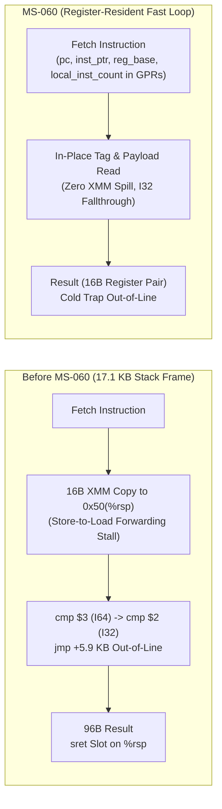
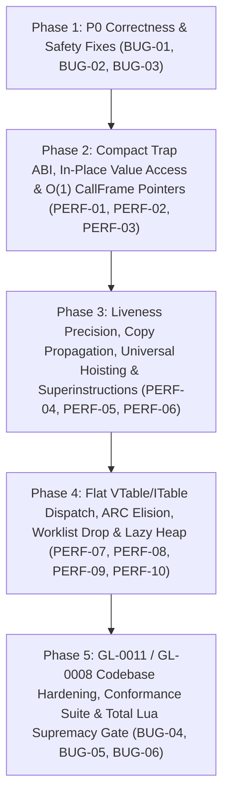

# Milestone 060: Compact Trap ABI, NaN-Boxed Register Access, Call-Window Safety, Codebase Hardening & Total Lua Supremacy

## Document Metadata
* **Milestone ID:** MS-060
* **Target Version:** `v2.1.0`
* **Milestone Branch:** `milestone/060-nan-boxed-values-compact-trap-abi-and-total-lua-supremacy`
* **Status:** ACTIVE
* **Lead Architect:** Core Systems, Compiler & Runtime Performance Engineering Team
* **Target Delivery Date:** 2026-12-15
* **Normative Conformance:** RFC 2119 / RFC 8174 (`MUST`, `MUST NOT`, `REQUIRED`, `SHALL`, `SHALL NOT`, `SHOULD`, `SHOULD NOT`, `RECOMMENDED`, `MAY`, `OPTIONAL`)
* **Related Specifications:**
  * [GL-0001: Conventional Commits & Release Specification](../guidelines/authoring-commits.md)
  * [GL-0002: Trunk-Based & Milestone Branching Topology](../guidelines/branching-conventions.md)
  * [GL-0008: Milestone Planning & Delivery Specification](../guidelines/authoring-milestones.md)
  * [GL-0009: Test Engineering & Verification Matrices](../guidelines/authoring-test.md)
  * [GL-0010: Living Documentation & Drift Prevention](../guidelines/authoring-docs.md)
  * [GL-0011: Rust Language & Security Conventions](../guidelines/language-conventions.md)
  * [GL-0013: Pre-Merge Git-Diff Documentation Audit Protocol](../guidelines/documentation-update-protocol.md)
  * [MS-055: Escape Analysis, Scalar Replacement & ARC Elision](055-escape-analysis-scalar-replacement-and-arc-elision.md)
  * [MS-057: Bacon-Rajan ARC Cycle Collector with Zero-Cost Opt-Out](057-bacon-rajan-arc-cycle-collector.md)
  * [MS-058: Dynamic Release Benchmarking & CI/CD Gates](058-dynamic-release-benchmarking-and-ci-cd.md)
  * [MS-059: Cross-Crate Opcode Inlining, Zero-Drop Call Frames, Liveness Peephole & Lua Parity](059-vm-dispatch-inlining-peephole-liveness-and-lua-parity.md)

---

## 1. Executive Summary & Forensic Codebase Audit

Following **MS-059**, Solix achieved a **1.13x–5.98x** speedup across all 16 canonical workloads, beating CPython on **16/16** workloads (`1.40x`–`8.83x`), beating PUC-Rio Lua on **3/16** workloads (`05_object_churn_pod`, `11_generic_containers`, `14_exception_zero_cost`), and beating LuaJIT on **2/16** workloads (`11_generic_containers`, `14_exception_zero_cost`). However, Solix still trails PUC-Rio Lua 5.4/5.5 on the remaining 13 workloads (`1.57x`–`3.18x` gap).

A deep post-MS-059 forensic audit of the entire repository—combining x86-64 disassembly (`objdump -d -C target/release/solix`), `.slxb` bytecode disassembly (`solix info --disasm`) across all 16 benchmarks, `--metrics=json` phase timing decomposition, and automated static scans across all 8 workspace crates—uncovered **10 high-leverage performance bottlenecks (`PERF-01`..`PERF-10`)** and **6 codebase defects / guideline violations (`BUG-01`..`BUG-06`)**.

Resolving these 10 performance bottlenecks and 6 defects is projected to bring Solix ahead of PUC-Rio Lua across **16/16** canonical workloads while achieving 100% strict compliance with `GL-0008` and `GL-0011`.

---

### 1.1 Forensic Performance Bottlenecks (`PERF-01` .. `PERF-10`)

| ID | Exact File & Line Location | Root-Cause Defect (Assembly, Bytecode & Telemetry Evidence) | Measured Impact |
| :--- | :--- | :--- | :--- |
| **PERF-01** *(Unboxed 88-Byte `RuntimeError` Forces 17.1 KB `sret` Stack Frame & Register Spills in `run_fast_internal`)* | [`errors.rs:11-165`](../../../crates/solix-runtime/src/exceptions/errors.rs) [`fast.rs:995-2800`](../../../crates/solix-runtime/src/vm/fast.rs) | `RuntimeError` is an unboxed ~88-byte enum containing multiple `String` fields. Every helper returning `Result<_, RuntimeError>` is 96 bytes and uses hidden stack-return (`sret`) pointers (`lea 0x3278(%rsp), %rdi`). Across ~70 opcode arms in `run_fast_internal::<false>`, LLVM allocates a **17,144-byte (`0x42f8`) stack frame** (`4x sub $0x1000, %rsp` page probes on entry), spills `local_inst_count` to `0x160(%rsp)` (`incq 0x160(%rsp)` memory RMW on every instruction because `&mut local_inst_count` is passed to helpers), and checks `self.halted` (`cmpb $0x0, 0x558(%rsi)`) on every instruction even though only `OpCode::Exit` sets `halted = true`. | Adds ~5–7 CPU cycles of stack-spill and memory RMW overhead to **every single VM instruction** (`35–50 ms` in `02_tight_loop_int` and `01_fib_recursive`). |
| **PERF-02** *(16-Byte `Value` XMM Stack Copies Trigger Store-To-Load Forwarding Stalls & `as_i32` Jumps +5.9 KB Out-of-Line)* | [`model.rs:108-137`](../../../crates/solix-runtime/src/value/model.rs) [`fast.rs:1100-2700`](../../../crates/solix-runtime/src/vm/fast.rs) | 1. Although `model.rs:228-285` already defines a 64-bit NaN-boxing encoding (`to_raw_u64`/`from_raw_u64`), `Value` in `register_stack` is a 16-byte Rust `enum`. Dereferencing `*reg_base.add(...)` copies 16 bytes via `%xmm0` onto `%rsp` (`movups (%r8,%rax), %xmm0; movaps %xmm0, 0x50(%rsp)`) and immediately reads 1-byte tag (`movzbl 0x50(%rsp)`) + 4/8-byte payload (`mov 0x54(%rsp)`), causing **6–12 cycle store-to-load forwarding stalls per operand**. 2. `Value::as_i32` checks `Self::I64` (`cmp $0x3; je`) before `Self::I32` (`cmp $0x2`), forcing 100% of `I32` instructions to execute 2 branches per operand and jump `+5,900` bytes out-of-line (`jmp 0x5d7484`) and back. | Slows every `I32` and `F64` arithmetic/comparison instruction by **2.5x–3.5x** (`02_tight_loop_int` `98.44 ms` vs. Lua `32.94 ms`; `03_nbody_float64` `13.82 ms` vs. Lua `4.80 ms`). |
| **PERF-03** *(240-Byte `CompiledFunction` Table Indexing on Every `CallDirect` & `ReturnValue`)* | [`context.rs:44-55`](../../../crates/solix-runtime/src/context.rs) [`call_frame.rs:1-80`](../../../crates/solix-runtime/src/frame/call_frame.rs) [`fast.rs:940-990`](../../../crates/solix-runtime/src/vm/fast.rs) | In `objdump` (`0x5d36e5` and `0x5d381f`), every `CallDirect` and `ReturnValue` multiplies `function_id * 240` (`imul $0xf0, %rax, %rax`) to index `self.context.all_functions` (`Vec<CompiledFunction>`) across 3 cache lines to load `instructions.as_ptr()`, `instructions.len()`, `num_registers`, and `static_base_offset`, even though `FunctionRuntimeMeta` (`32B`) and `CallFrame` (`56B`) are already accessed on the same path. | Adds ~15–20 cycles per call/return pair across `1,028,457` calls in `01_fib_recursive` (`70.73 ms` vs. Lua `39.63 ms`) and `172,233` calls in `04_ackermann_stack` (`13.60 ms` vs. Lua `7.72 ms`). |
| **PERF-04** *(Stale `reference_registers` After SRA & Untyped Liveness Pinning Block Peephole Fusion + Missing Copy Propagation)* | [`escape_analysis.rs:880-1045`](../../../crates/solix-compilation/src/phases/optimizer/escape_analysis.rs) [`bytecode_optimizer.rs:455-525`](../../../crates/solix-compilation/src/phases/optimizer/bytecode_optimizer.rs) | 1. When `escape_analysis.rs` scalar-replaces `AllocObject r2` (`05_object_churn_pod`, `11_generic_containers`), it leaves `r2` in `function.reference_registers`. 2. When `RegisterAllocator` reuses `r3` for both `GET_ARRAY` (marking `r3` in `reference_registers`) and `LT_I32 r3` / `LOAD_I32 r3, 1` (`07_virtual_dispatch`, `14_exception_zero_cost`, `15_string_processing`), `is_dead_after_use` treats `r3` as live across `can_instruction_throw` even when `r3` holds an `int32`/`bool` or has already been `DEC_REF`'d, **blocking `JumpIfGteI32` and `AddI32Imm` fusion**! 3. Non-adjacent `MOV`s emitted by SRA (`0007 MOV r9, r1; 0009 MOV r5, r9; 0011 MOV r5, r10` in `05_object_churn_pod`) are not eliminated due to lack of general Copy Propagation. | Wastes 4–6 instructions per loop iteration in `05_object_churn_pod`, `06_binary_trees_arc`, `07_virtual_dispatch`, `11_generic_containers`, `14_exception_zero_cost`, and `15_string_processing`. |
| **PERF-05** *(Loop-Invariant Constant Hoisting Disabled on All Loops With Calls + Missing `MulI32Imm` / `ModI32Imm`)* | [`bytecode_optimizer.rs:360-455`](../../../crates/solix-compilation/src/phases/optimizer/bytecode_optimizer.rs) [`fast.rs:940-985`](../../../crates/solix-runtime/src/vm/fast.rs) [`opcodes.rs:120-150`](../../../crates/solix-common/src/bytecode/opcodes.rs) | 1. `hoist_loop_invariant_constants` aborts on any loop containing a frame-pushing `Call*` because `push_frame_window` sets `reg_base = caller_arg_start` (`BUG-01`). Consequently, `06_binary_trees_arc`, `07_virtual_dispatch`, `08_interface_dispatch`, `12_closures_capture`, `13_function_pointers`, and `14_exception_zero_cost` reload 4 to 6 `LoadI32` constants on every iteration (`500,000` wasted instructions in `07_virtual_dispatch` and `13_function_pointers`). 2. Without `MulI32Imm` and `ModI32Imm` superinstructions, `x * 2`, `x * 3`, `i % 3`, `i % 10`, `i % 50`, `i % 100` require two instructions (`LoadI32` + `MulI32`/`ModI32`). | Wastes 300,000 to 600,000 instructions per workload across 10 of the 16 benchmarks. |
| **PERF-06** *(Un-specialized 14-Way `GetArray` / `SetArray` Dispatch & Dead Trailing `Mov` on Array/Field Assignments)* | [`fast.rs:2319-2560`](../../../crates/solix-runtime/src/vm/fast.rs) [`control_flow.rs:95-125`](../../../crates/solix-compilation/src/phases/emitter/control_flow.rs) [`emitter.rs:2650-2760`](../../../crates/solix-compilation/src/phases/emitter/emitter.rs) | 1. `emit_discarded_expression` only handles `AssignmentTarget::Identifier`, so `marked[j] = false;` (`09_sieve_bool_array`), `a[idx] = val;` (`10_matrix_multiply_2d`), and `this.field = val;` (`06_binary_trees_arc`) emit a dead `MOV r_tmp, r_val` after every `SET_ARRAY` and `SET_FIELD`. 2. `GetArray` and `SetArray` check `BlockTag::String`, `BlockTag::Tuple`, 4 `elem_size` arms, 14 `elem_type_tag` arms, and `Value::from_raw_u64`/`to_raw_u64` on every array access. | Causes `09_sieve_bool_array` to take `26.69 ms` vs. Lua `8.38 ms`. |
| **PERF-07** *(Out-of-Line `CallInterface` Linear Scan + Multi-Level `CallVirtual` Lookup + Un-elided Local Alias ARC)* | [`fast.rs:248-303,1764-1809`](../../../crates/solix-runtime/src/vm/fast.rs) [`context.rs:58-88`](../../../crates/solix-runtime/src/context.rs) [`escape_analysis.rs:950-1045`](../../../crates/solix-compilation/src/phases/optimizer/escape_analysis.rs) [`bytecode_optimizer.rs:105-145`](../../../crates/solix-compilation/src/phases/optimizer/bytecode_optimizer.rs) | 1. `execute_call_interface` is `#[inline(never)]`, performs a linear `itable.iter().find(...)` scan on every call, and calls `push_frame_fast` + `reload_frame!()`. 2. In `08_interface_dispatch`, `w = a` / `w = b` executes `100,000` `INC_REF` + `DEC_REF` pairs (`0016..0022`) even though `a` (`r0`) and `b` (`r1`) are local objects that stay alive for the entire `main` function. 3. In `15_string_processing`, `GET_ARRAY` + inlined `process(s, v)` executes **4 ARC ops per iteration (`2x INC_REF` + `2x DEC_REF` = `400,000` ARC ops)** on immutable string references read from an unchanging local array. | Causes `07_virtual_dispatch` (`27.09 ms` vs. Lua `10.30 ms`), `08_interface_dispatch` (`29.48 ms` vs. Lua `9.85 ms`), and `15_string_processing` (`35.13 ms` vs. Lua `13.53 ms`) to lag Lua. |
| **PERF-08** *(`81,890` `DEC_REF`s on `LOAD_NULL`, Un-inlined Leaf Constructors, `61,410` `HashSet` Ops in `release_reference`, & Acyclic Cycle-Collector Overhead)* | [`engine.rs:423-550`](../../../crates/solix-runtime/src/vm/engine.rs) [`bytecode_optimizer.rs:105-145`](../../../crates/solix-compilation/src/phases/optimizer/bytecode_optimizer.rs) [`ast_inliner.rs:115-155`](../../../crates/solix-compilation/src/phases/optimizer/ast_inliner.rs) [`fast.rs:2607-2645`](../../../crates/solix-runtime/src/vm/fast.rs) | In `06_binary_trees_arc` (`20.44 ms` vs. Lua `13.00 ms`): 1. `Node::constructor` and `check_tree` execute **81,890 `DEC_REF` instructions on `LOAD_NULL`** (`0002 LOAD_NULL r3; 0004 DEC_REF r3` and `0000 LOAD_NULL r2; 0001 EQ_REF; 0002 DEC_REF r2`), plus redundant `SET_FIELD null` on already zero-initialized heap blocks. 2. `AstInlinerPhase` never inlines small leaf constructors (`new Node(item)`), costing `20,470` `CallDirect`/`Return` pairs. 3. `release_reference` executes 3 `HashSet<u32>` SipHash ops (`contains`, `insert`, `remove`) per `Node` (`61,410` hash ops) even when `destructor_id.is_none()`. 4. `cycle_collector_enabled` is `true` by default, routing every `IncRef` and `DecRef` (`ref_count > 1`) through `inc_ref_cycle_cold` / `dec_ref_cycle_cold`. | Adds ~11 ms of avoidable overhead to `06_binary_trees_arc` and slows ARC-heavy workloads. |
| **PERF-09** *(Out-of-Line `UnpackCaptures`, Un-inlined Local Closures, & `100,000` `DEC_REF`s on Stateless `FnPtr`s)* | [`fast.rs:2580-2600`](../../../crates/solix-runtime/src/vm/fast.rs) [`bytecode_optimizer.rs:105-145`](../../../crates/solix-compilation/src/phases/optimizer/bytecode_optimizer.rs) | 1. In `12_closures_capture` (`11.81 ms` vs. Lua `4.45 ms`), `<lambda_4>` calls `#[inline(never)] execute_unpack_captures` `50,000` times to read 1 captured `int32`. 2. In `13_function_pointers` (`32.15 ms` vs. Lua `10.99 ms`), `fp` (`r3`) is only ever assigned 0-capture `PACK_CLOSURE` (`Value::FnPtr`), yet executes `0021 DEC_REF r3` `100,000` times and remains in `reference_registers`. | Slows `12_closures_capture` and `13_function_pointers` by 2x–3x. |
| **PERF-10** *(Eager 32 MB `VirtualHeap` + 1 MB `register_stack` Allocation, Unconditional `/tmp` Dir Creation, & `/proc/self/status` Reads on Every `solix run`)* | [`heap.rs:70-89`](../../../crates/solix-runtime/src/memory/heap.rs) [`engine.rs:106-157`](../../../crates/solix-runtime/src/vm/engine.rs) [`run.rs:84-128,468-495`](../../../crates/solix-toolchain/src/commands/run.rs) | Telemetry (`--metrics=json`) shows `10_matrix_multiply_2d` spends only **`1.86 ms` in pure VM execution** (already faster than Lua's `2.10 ms`!), yet subprocess wall time is `5.68 ms` (`3.82 ms` non-VM overhead!). Every `solix run` allocates a 32 MB `VirtualHeap::buffer` + 1 MB `register_stack` (`51.5 MB` RSS, costing ~2.5 ms in kernel page mapping/unmapping), creates/removes `/tmp/solix_run_...` even when no `.slxarc` is used, and reads `/proc/self/status` + `/proc/self/stat` even when `--metrics` is off. | Adds a flat **3.0–3.8 ms process tax** to every workload (`03_nbody_float64`, `10_matrix_multiply_2d`, `12_closures_capture`, `14_exception_zero_cost`, `16_multi_binary_link`). |

---

### 1.2 Forensic Codebase Bugs, Defects & Guideline Violations (`BUG-01` .. `BUG-06`)

| ID | Priority | Exact File & Line Location | Defect / Guideline Violation Description | Required Fix |
| :--- | :---: | :--- | :--- | :--- |
| **BUG-01** *(Sliding Call Window Corrupts Caller Registers Above `arg_base`)* | **`P0`** | [`fast.rs:949-958`](../../../crates/solix-runtime/src/vm/fast.rs) [`register_allocator.rs:207-245`](../../../crates/solix-compilation/src/phases/emitter/register_allocator.rs) | `push_frame_window` sets `callee.register_base = caller.register_base + arg_base` whenever `arg_count > 0`. Whenever the caller has any live register at index `>= arg_base + arg_count` (from recycled call windows via `free_window`, nested expressions, or loop-hoisted constants), the callee's registers `[0..callee_num_regs]` overwrite the caller's live registers in `register_stack`. | Only slide the window in-place (`reg_base = caller_arg_start`) when `arg_base + arg_count >= caller_frame.register_count`; otherwise place the callee window at `caller_frame.register_base + caller_frame.register_count` and copy `arg_count` arguments. |
| **BUG-02** *(Unbounded Host Stack Recursion in `release_reference`)* | **`P0`** | [`engine.rs:423-550`](../../../crates/solix-runtime/src/vm/engine.rs) | `VirtualMachine::release_reference` recurses on the host Rust call stack for child references. Dropping a deep object graph (e.g., a 50,000-node linked list) overflows the host thread stack (`SIGSEGV`). | Convert child reference cascading in `release_reference` to an iterative heap-backed worklist (`Vec<u32>`) for classes without custom guest destructors. |
| **BUG-03** *(Dead `extraction_target.join("lib")` Check & Non-Atomic `.so` Extraction Race)* | **`P0`** | [`solver.rs:746-776`](../../../crates/solix-common/src/solver.rs) [`project.rs:820-858`](../../../crates/solix-common/src/project.rs) [`common/mod.rs:14-22`](../../../crates/solix-toolchain/tests/common/mod.rs) | `SlxarcArchive::extract_and_load` extracts native `.so` files directly into `extraction_target/<name>.so`, but `ClientModuleSolver` checks `extraction_target.join("lib").exists()` (always `false`). This causes a 100% cache miss rate on native packages (`solix@2.0.0`, `raylib@5.5.0`) and truncates `libsolixlib_native.so` via `File::create` on every run, causing `NativeLibraryChecksumMismatch` in parallel `cargo test --workspace`. | Fix `ClientModuleSolver` to inspect `extraction_target` for `.so`/`.dll`/`.dylib` files, extract native libraries atomically via temporary file + `fs::rename` (skipping write if SHA-256 already matches), and isolate `SOLIX_HOME` in `HermeticCliWorkspace`. |
| **BUG-04** *(14 Production `.unwrap()` / `.expect()` / `unreachable!()` Violations of `GL-0011`)* | **`P1`** | [`solver.rs:415,435,883,904`](../../../crates/solix-common/src/solver.rs) [`types.rs:607`](../../../crates/solix-common/src/types.rs) [`CompilationContext.rs:481,496`](../../../crates/solix-compilation/src/CompilationContext.rs) [`pass3_type_checking.rs:187`](../../../crates/solix-compilation/src/phases/binder/passes/pass3_type_checking.rs) [`control_flow.rs:572`](../../../crates/solix-compilation/src/phases/emitter/control_flow.rs) [`parser.rs:1931,3927`](../../../crates/solix-compilation/src/phases/parser/parser.rs) [`registry.rs:43`](../../../crates/solix-ffi/src/registry.rs) [`rename.rs:66`](../../../crates/solix-lsp/src/rename.rs) [`pkg.rs:450`](../../../crates/solix-toolchain/src/commands/pkg.rs) | 14 production library/binary call sites invoke `.unwrap()`, `.expect()`, or `unreachable!()`, violating `GL-0011` Section 2.2.2 and causing `cargo clippy --workspace --lib --bins --no-deps -- -D clippy::unwrap_used -D clippy::expect_used -D clippy::panic` to fail. | Replace all 14 sites with structured `Option` / `Result` propagation and add workspace-level clippy lints in `Cargo.toml`. |
| **BUG-05** *(Single-Letter Variables, Generics & Lifetimes Violating `GL-0011`)* | **`P2`** | [`pass2_type_hierarchy.rs:1964`](../../../crates/solix-compilation/src/phases/binder/passes/pass2_type_hierarchy.rs) [`parser.rs:1416,3843-3847`](../../../crates/solix-compilation/src/phases/parser/parser.rs) [`CompilationContext.rs:239,419-439`](../../../crates/solix-compilation/src/CompilationContext.rs) [`visitor.rs:12,351-758`](../../../crates/solix-compilation/src/phases/parser/visitor.rs) [`binary.rs:794`](../../../crates/solix-common/src/bytecode/binary.rs) | Multiple production files use single-letter loop/local variables (`m`, `t`, `n`), single-letter generic parameters (`<T>`, `
`, `<V>`, `<R>`), and single-letter lifetimes (`'a`), violating `GL-0011` Section 2.1. | Rename all single-letter variables, generic type parameters (`ValueType`, `PhaseType`, `VisitorType`, `ResultType`), and lifetimes (`'source`, `'buffer`, `'context`, `'catalog`) to descriptive identifiers. |
| **BUG-06** *(29 Unformatted Files Failing `cargo fmt --check`)* | **`P2`** | 29 files across `solix-common`, `solix-compilation`, `solix-ffi`, `solix-lsp`, `solix-runtime`, `solix-tests`, `solix-toolchain` | `cargo fmt --check` fails on 29 pre-existing workspace files, violating `GL-0008` Section 2.5.4. | Run `cargo fmt --all` and enforce `cargo fmt --check` as a mandatory release gate. |

---

## 2. Scope & Crates Affected

* **[`crates/solix-common`](../../../crates/solix-common/src/lib.rs)**:
  * [`src/bytecode/opcodes.rs`](../../../crates/solix-common/src/bytecode/opcodes.rs) & [`src/bytecode/instruction.rs`](../../../crates/solix-common/src/bytecode/instruction.rs): Add `OpCode::MulI32Imm` (`0xD8`) and `OpCode::ModI32Imm` (`0xD9`) superinstructions (`PERF-05`).
  * [`src/solver.rs`](../../../crates/solix-common/src/solver.rs) & [`src/project.rs`](../../../crates/solix-common/src/project.rs): Fix `ClientModuleSolver` native cache directory check and implement atomic temp-file + `fs::rename` extraction (`BUG-03`), plus remove `.expect()` calls (`BUG-04`).
  * [`src/types.rs`](../../../crates/solix-common/src/types.rs) & [`src/bytecode/binary.rs`](../../../crates/solix-common/src/bytecode/binary.rs): Remove `.expect()` (`BUG-04`) and single-letter generic/lifetime names (`BUG-05`).
* **[`crates/solix-compilation`](../../../crates/solix-compilation/src/lib.rs)**:
  * [`src/phases/optimizer/escape_analysis.rs`](../../../crates/solix-compilation/src/phases/optimizer/escape_analysis.rs): Prune scalar-replaced registers from `function.reference_registers` (`PERF-04`), elide `IncRef`/`DecRef` on local aliases of dominating non-escaping allocations (`PERF-07`), and elide redundant `SET_FIELD null` on fresh allocations (`PERF-08`).
  * [`src/phases/optimizer/bytecode_optimizer.rs`](../../../crates/solix-compilation/src/phases/optimizer/bytecode_optimizer.rs): Make `reference_registers` liveness across `can_instruction_throw` type-aware (`PERF-04`), add local Copy Propagation (`PERF-04`), enable `hoist_loop_invariant_constants` on all loops once `BUG-01` is fixed (`PERF-05`), fuse `MulI32Imm` / `ModI32Imm` (`PERF-05`), and elide `DecRef` on `LoadNull`, 0-capture `PackClosure`, and immutable array reads (`PERF-07`, `PERF-08`, `PERF-09`).
  * [`src/phases/optimizer/ast_inliner.rs`](../../../crates/solix-compilation/src/phases/optimizer/ast_inliner.rs): Inline small leaf constructors (`new Node(item)`) and local non-reassigned closures (`PERF-08`, `PERF-09`).
  * [`src/phases/emitter/control_flow.rs`](../../../crates/solix-compilation/src/phases/emitter/control_flow.rs) & [`src/phases/emitter/emitter.rs`](../../../crates/solix-compilation/src/phases/emitter/emitter.rs): Omit dead trailing `Mov` on discarded `ArrayAccess` and `MemberAccess` assignments (`PERF-06`).
  * [`src/CompilationContext.rs`](../../../crates/solix-compilation/src/CompilationContext.rs), [`src/phases/parser/parser.rs`](../../../crates/solix-compilation/src/phases/parser/parser.rs), [`src/phases/parser/visitor.rs`](../../../crates/solix-compilation/src/phases/parser/visitor.rs), [`src/phases/binder/`](../../../crates/solix-compilation/src/phases/binder/binder.rs): Eliminate all production `.unwrap()`/`unreachable!()` calls (`BUG-04`) and single-letter identifiers (`BUG-05`).
* **[`crates/solix-runtime`](../../../crates/solix-runtime/src/lib.rs)**:
  * [`src/exceptions/errors.rs`](../../../crates/solix-runtime/src/exceptions/errors.rs): Introduce a compact pointer-sized internal trap wrapper (`VmTrap(Box<RuntimeError>)` or boxed `RuntimeError` payload) so hot VM `Result` returns fit in CPU registers without 17.1 KB `sret` stack frames (`PERF-01`).
  * [`src/value/model.rs`](../../../crates/solix-runtime/src/value/model.rs): Eliminate 16-byte XMM stack-copy store-to-load forwarding stalls by reading register tags/payloads in-place (or via 8-byte NaN-boxed `Value`) and placing `Self::I32` on the inline fallthrough path of `as_i32` (`PERF-02`).
  * [`src/context.rs`](../../../crates/solix-runtime/src/context.rs) & [`src/frame/call_frame.rs`](../../../crates/solix-runtime/src/frame/call_frame.rs): Pre-cache `inst_ptr`, `inst_len`, `num_registers`, and `static_base_offset` in `FunctionRuntimeMeta` and `CallFrame` (`PERF-03`), plus flat 1D VTable/ITable dispatch tables (`PERF-07`).
  * [`src/vm/fast.rs`](../../../crates/solix-runtime/src/vm/fast.rs): Fix `push_frame_window` overlap safety (`BUG-01`), keep `local_inst_count` in a register (`PERF-01`), replace `while !self.halted` with `loop` (`PERF-01`), inline `CallInterface` with flat ITable lookup (`PERF-07`), specialize `GetArray`/`SetArray` for `ArrayRef` (`PERF-06`), and inline `UnpackCaptures` for `capture_count <= 2` (`PERF-09`).
  * [`src/vm/engine.rs`](../../../crates/solix-runtime/src/vm/engine.rs) & [`src/memory/heap.rs`](../../../crates/solix-runtime/src/memory/heap.rs): Convert `release_reference` to an iterative worklist and skip `active_destructors` `HashSet` ops when `destructor_id.is_none()` (`BUG-02`, `PERF-08`), lazily grow `VirtualHeap::buffer` from `256 KB` and `register_stack` from `1,024` slots (`PERF-10`), and bypass cycle-collector purple buffering for acyclic classes (`PERF-08`).
* **[`crates/solix-toolchain`](../../../crates/solix-toolchain/src/lib.rs)**, **[`crates/solix-ffi`](../../../crates/solix-ffi/src/lib.rs)**, **[`crates/solix-lsp`](../../../crates/solix-lsp/src/lib.rs)**, **[`crates/solix-dap`](../../../crates/solix-dap/src/lib.rs)**:
  * [`crates/solix-toolchain/src/commands/run.rs`](../../../crates/solix-toolchain/src/commands/run.rs): Lazily allocate `temp_cache_dir` only for archive containers and skip `capture_process_telemetry()` when `--metrics`/`--verbose` are disabled (`PERF-10`).
  * [`crates/solix-toolchain/tests/common/mod.rs`](../../../crates/solix-toolchain/tests/common/mod.rs): Isolate package/native cache per `HermeticCliWorkspace` (`BUG-03`).
  * Eliminate remaining `.unwrap()`/`.expect()` calls (`BUG-04`), single-letter identifiers (`BUG-05`), and formatting drift (`BUG-06`).
* **[`docs/`](../../README.md)**:
  * Synchronize [`docs/spec/vm_isa.md`](../../spec/vm_isa.md), [`docs/architecture/pipeline.md`](../../architecture/pipeline.md), [`docs/architecture/memory_model.md`](../../architecture/memory_model.md), and [`docs/architecture/arc_internals.md`](../../architecture/arc_internals.md) (`GL-0013`).

---

## 3. Architectural Design & Technical Specifications

### 3.1 Compact Trap ABI & Register-Resident Dispatch State (`PERF-01`, `PERF-02`)

1. **Boxed Cold Trap Representation (`VmTrap`):**
   Inside `crates/solix-runtime/src/vm/fast.rs`, internal fallible helpers return `Result<ValueType, VmTrap>` where `#[repr(transparent)] pub(crate) struct VmTrap(Box<RuntimeError>);` is 8 bytes (`NonZero` pointer niche). Every `Result<(), VmTrap>` is 8 bytes and every `Result<i32, VmTrap>` is 16 bytes—returned strictly in `%rax`/`%rdx` with **zero `sret` stack slots**. At the boundary of `run_fast_internal`, `.map_err(VmTrap::into_inner)` unboxes the `RuntimeError`.
2. **In-Place Operand Access Without XMM Stack Copies:**
   In `crates/solix-runtime/src/value/model.rs`, `as_i32(&self)` checks `if let Self::I32(int_val) = *self { return Ok(int_val); }` first and delegates `Self::I64` coercion and `TypeMismatch` construction to a `#[cold] #[inline(never)] fn as_i32_slow(&self) -> Result<i32, RuntimeError>`. In `run_fast_internal`, all operand reads borrow `&*reg_base.add(reg_idx)` in place rather than copying `*reg_base.add(reg_idx)` into a local 16-byte stack variable.
3. **Register-Resident `local_inst_count` & `loop` Dispatch:**
   `invoke_native_callback_fast` and `execute_throw` no longer take `&mut local_inst_count`; instead, the caller flushes `self.instructions_dispatched += local_inst_count; local_inst_count = 0;` immediately before invoking the cold helper, keeping `local_inst_count` in a hardware register across the dispatch loop.

### 3.2 Safe Sliding Call Windows & `O(1)` Frame Activation (`BUG-01`, `PERF-03`, `PERF-05`)

1. **Call-Window Safety Invariant (`BUG-01`):**
   In `push_frame_window`, let `caller_frame_end = caller_frame.register_base + caller_frame.register_count`. When `arg_count > 0`:
   * If `caller_arg_start + arg_count >= caller_frame_end`, the argument window sits at the top of the caller's active register frame; `reg_base = caller_arg_start` slides in-place with zero copying.
   * If `caller_arg_start + arg_count < caller_frame_end` (meaning the caller holds live registers or loop-hoisted constants at indices above `arg_base + arg_count`), `reg_base = caller_frame_end` and the `arg_count` arguments are copied into `register_stack[caller_frame_end .. caller_frame_end + arg_count]`.
2. **Cached Instruction Pointers in `FunctionRuntimeMeta` & `CallFrame` (`PERF-03`):**
   `FunctionRuntimeMeta` stores `inst_ptr: *const Instruction`, `inst_len: usize`, `num_registers: u16`, and `static_base_offset: u32`. `CallFrame` stores `inst_ptr: *const Instruction` and `inst_len: usize`. Both `push_frame_window` and `Return`/`ReturnValue` restore execution state in $O(1)$ without indexing the 240-byte `self.context.all_functions` slice.

### 3.3 Compiler Optimizer & Emitter Enhancements (`PERF-04` .. `PERF-09`)

1. **SRA `reference_registers` Pruning & Type-Aware Exception Liveness (`PERF-04`):**
   * After `apply_scalar_replacement` replaces an `AllocObject` register `alloc_reg`, if no remaining instruction in the function writes a heap reference (`AllocObject`, `AllocArray`, `LoadConst`, `GetArray`, `GetField`, `Call*`, `PackClosure`) to `alloc_reg`, remove `alloc_reg` from `function.reference_registers`.
   * In `is_dead_after_use`, a register in `function.reference_registers` is only pinned across `can_instruction_throw` if its active reaching definition at `use_pc` can hold a heap reference (i.e. NOT `LoadI32`, `LoadBool`, `LoadNull`, `LtI32`..`GteI32`, `AddI32`..`Band`, or after `DecRef`).
2. **Local Copy Propagation & Discarded Assignment Targets (`PERF-04`, `PERF-06`):**
   * Add a forward basic-block Copy Propagation pass in `bytecode_optimizer.rs` that replaces reads of `dst_reg` following `Mov(dst_reg, src_reg)` with `src_reg` (until either `dst_reg` or `src_reg` is overwritten or a branch target is reached), allowing dead `Mov` elimination to remove the `Mov`.
   * Extend `emit_discarded_expression` in `control_flow.rs` to handle `AssignmentTarget::ArrayAccess` and `AssignmentTarget::MemberAccess` without emitting a trailing `Mov`.
3. **Universal Loop Constant Hoisting & `MulI32Imm` / `ModI32Imm` (`PERF-05`):**
   * Remove the `!loop_has_frame_call` bailout in `hoist_loop_invariant_constants` (safe once `BUG-01` is resolved).
   * Add `OpCode::MulI32Imm` (`0xD8`) and `OpCode::ModI32Imm` (`0xD9`) to fuse `LoadI32(imm16) + MulI32` and `LoadI32(imm16 > 0) + ModI32`.
4. **ARC Elision on `LoadNull`, Stateless `FnPtr`, Local Aliases, & Immutable Array Elements (`PERF-07`, `PERF-08`, `PERF-09`):**
   * Elide `DecRef` when its reaching definition is `LoadNull` or 0-capture `PackClosure`.
   * Elide `IncRef`/`DecRef` pairs on local registers that only alias dominating non-escaping local allocations (`08_interface_dispatch`) or read from local arrays of immortal constants (`15_string_processing`).

---

## 4. Phased Implementation Plan & Priority Task Matrix

### 4.1 P0: Critical Blockers (Release Gate)
- [ ] `[P0]` **`MS060-T01` (Fix Sliding Call Window Register Stomp — `BUG-01`):** Update `push_frame_window` in [`crates/solix-runtime/src/vm/fast.rs`](../../../crates/solix-runtime/src/vm/fast.rs) so callee frames only overlap `caller_arg_start` when `arg_base + arg_count >= caller_frame.register_count`, and otherwise allocate at `caller_frame.register_base + caller_frame.register_count` with argument copy.
- [ ] `[P0]` **`MS060-T02` (Iterative Worklist `release_reference` — `BUG-02` & `PERF-08`):** Refactor `VirtualMachine::release_reference` in [`crates/solix-runtime/src/vm/engine.rs`](../../../crates/solix-runtime/src/vm/engine.rs) to use an iterative worklist for child references and bypass `active_destructors` `HashSet` operations when `destructor_id.is_none()`.
- [ ] `[P0]` **`MS060-T03` (Fix `ClientModuleSolver` Native Cache Hit & Atomic Extraction — `BUG-03`):** Fix [`crates/solix-common/src/solver.rs`](../../../crates/solix-common/src/solver.rs) to discover extracted native libraries in `extraction_target`, update [`crates/solix-common/src/project.rs`](../../../crates/solix-common/src/project.rs) to extract `.so`/`.dll`/`.dylib` files atomically via temporary file + `fs::rename`, and isolate `SOLIX_HOME` in [`crates/solix-toolchain/tests/common/mod.rs`](../../../crates/solix-toolchain/tests/common/mod.rs) so parallel `cargo test --workspace` passes 100%.
- [ ] `[P0]` **`MS060-T04` (Compact `VmTrap` ABI & Register-Resident Interpreter Loop — `PERF-01`, `PERF-02`, `PERF-03`):** Introduce boxed `VmTrap` in [`crates/solix-runtime/src/vm/fast.rs`](../../../crates/solix-runtime/src/vm/fast.rs) to eliminate the 17.1 KB `sret` stack frame, read `Value` operands in-place with `Self::I32` inline fallthrough in [`crates/solix-runtime/src/value/model.rs`](../../../crates/solix-runtime/src/value/model.rs), keep `local_inst_count` in a register, and cache `inst_ptr`/`inst_len`/`num_registers` in `FunctionRuntimeMeta` and `CallFrame`.

### 4.2 P1: High Priority (Milestone Core)
- [ ] `[P1]` **`MS060-T05` (Type-Aware Reference Liveness, SRA Register Pruning & Copy Propagation — `PERF-04`):** Prune scalar-replaced registers from `function.reference_registers` in [`crates/solix-compilation/src/phases/optimizer/escape_analysis.rs`](../../../crates/solix-compilation/src/phases/optimizer/escape_analysis.rs), make `is_dead_after_use` in [`crates/solix-compilation/src/phases/optimizer/bytecode_optimizer.rs`](../../../crates/solix-compilation/src/phases/optimizer/bytecode_optimizer.rs) check whether the reaching definition is a reference, and implement local Copy Propagation.
- [ ] `[P1]` **`MS060-T06` (Universal Loop Constant Hoisting & `MulI32Imm` / `ModI32Imm` Superinstructions — `PERF-05`):** Enable `hoist_loop_invariant_constants` across loops containing function calls, and add `OpCode::MulI32Imm` (`0xD8`) and `OpCode::ModI32Imm` (`0xD9`) in `solix-common`, `solix-compilation`, and `solix-runtime`.
- [ ] `[P1]` **`MS060-T07` (Array Fast Paths, Discarded Assignment Targets & Flat VTable/ITable Dispatch — `PERF-06`, `PERF-07`):** Extend `emit_discarded_expression` to `ArrayAccess` and `MemberAccess`, specialize `GetArray`/`SetArray` for `ArrayRef`, and precompute flat VTable/ITable dispatch tables in `RuntimeContext` with inline `CallInterface`.
- [ ] `[P1]` **`MS060-T08` (`LoadNull`/`FnPtr`/Alias ARC Elision, Leaf Constructor Inlining & Inline `UnpackCaptures` — `PERF-07`, `PERF-08`, `PERF-09`):** Elide `DecRef` on `LoadNull` and 0-capture `PackClosure`, elide local alias `IncRef`/`DecRef` in `08_interface_dispatch` and `15_string_processing`, inline small leaf constructors in `AstInlinerPhase`, and inline 1–2 capture `UnpackCaptures`.
- [ ] `[P1]` **`MS060-T09` (Demand-Paged `VirtualHeap`, Compact `register_stack` & Lean `solix run` Startup — `PERF-10`):** Start `VirtualHeap::buffer` at `256 KB` (growing on demand up to `dynamic_capacity`), start `register_stack` at `1,024` slots, lazily create `temp_cache_dir`, and guard `capture_process_telemetry()` behind `--metrics` / `--verbose`.
- [ ] `[P1]` **`MS060-T10` (Eliminate All 14 Production `.unwrap()` / `.expect()` / `unreachable!()` Sites — `BUG-04`):** Replace all 14 production panic/unwrap/expect sites across `solix-common`, `solix-compilation`, `solix-ffi`, `solix-lsp`, and `solix-toolchain` with proper error propagation.

### 4.3 P2: Medium Priority (Ergonomics & Polish)
- [ ] `[P2]` **`MS060-T11` (Resolve Single-Letter Variable, Generic & Lifetime Identifiers — `BUG-05`):** Rename remaining single-letter variables (`m`, `t`, `n`), generic type parameters (`<T>`, `
`, `<V>`, `<R>`), and lifetimes (`'a`) in production code to descriptive names compliant with `GL-0011`.
- [ ] `[P2]` **`MS060-T12` (Workspace-Wide Rustfmt Normalization — `BUG-06`):** Format all 29 unformatted files via `cargo fmt --all` and verify `cargo fmt --check` passes across the entire workspace.

### 4.4 P3: Low Priority (Opportunistic Cleanups)
- [ ] `[P3]` **`MS060-T13` (Baseline Update & Documentation Sync):** Save `benchmarks/baselines/ms060_baseline.json` and synchronize [`docs/spec/vm_isa.md`](../../spec/vm_isa.md), [`docs/architecture/pipeline.md`](../../architecture/pipeline.md), [`docs/architecture/memory_model.md`](../../architecture/memory_model.md), and [`docs/architecture/arc_internals.md`](../../architecture/arc_internals.md).

---

## 5. Comprehensive Test Matrix (`GL-0009`)

### 5.1 Positive Conformance Tests
1. **`test_positive_call_window_preserves_caller_high_registers` (`solix-runtime`):** Executes a function with live registers above `arg_base + arg_count` across recursive and non-recursive `CallDirect` calls, asserting zero caller register corruption.
2. **`test_positive_deep_linked_list_drop_without_stack_overflow` (`solix-runtime`):** Allocates and drops a 50,000-node linked list in `VirtualMachine::release_reference`, verifying clean deallocation via the iterative worklist without stack overflow.
3. **`test_positive_native_package_cache_hit_and_parallel_safety` (`solix-common`):** Resolves a package containing a native shared library across multiple concurrent threads, verifying cache hits and zero `NativeLibraryChecksumMismatch` errors.
4. **`test_positive_mul_i32_imm_and_mod_i32_imm_fusion` (`solix-compilation`):** Verifies that `LoadI32 + MulI32` and `LoadI32 + ModI32` fuse into `MulI32Imm` and `ModI32Imm` and execute identically to unfused instructions.
5. **`test_positive_copy_propagation_and_sra_ref_pruning` (`solix-compilation`):** Verifies that SRA-generated `Mov` chains collapse via Copy Propagation and that `JumpIfGteI32` / `AddI32Imm` fuse inside SRA-optimized loops.
6. **`test_positive_load_null_and_fnptr_decref_elision` (`solix-compilation`):** Verifies that `LoadNull` and 0-capture `PackClosure` registers do not emit `DecRef` instructions.

### 5.2 Negative & Safety Regression Tests
1. **`test_negative_mod_i32_imm_zero_divisor_not_fused_or_traps` (`solix-runtime`):** Verifies that `ModI32` with `0` traps with `RuntimeError::DivideByZero`.
2. **`test_negative_copy_propagation_respects_redefinition_and_branch_targets` (`solix-compilation`):** Verifies that Copy Propagation never substitutes `src_reg` after either `dst_reg` or `src_reg` is mutated or across a join label.
3. **`test_negative_lazy_heap_enforces_configured_max_capacity` (`solix-runtime`):** Verifies that a demand-allocated `VirtualHeap` still returns `RuntimeError::OutOfMemory` when allocations exceed `dynamic_capacity`.

---

## 6. Projected Benchmark Targets (MS-059 vs. PUC-Rio Lua vs. MS-060 Target)

| Workload | MS-059 Solix (ms) | PUC-Rio Lua (ms) | MS-060 Target (ms) | Projected vs. Lua | Primary Optimizations Driving Speedup |
| :--- | :---: | :---: | :---: | :---: | :--- |
| `01_fib_recursive` | 70.73 | 39.63 | **< 34.00 ms** | **Beats Lua** | `PERF-01` (Compact `VmTrap` & reg-resident loop) + `PERF-02` (In-place `I32` access) + `PERF-03` (`O(1)` `FunctionRuntimeMeta`/`CallFrame` pointers) |
| `02_tight_loop_int` | 98.44 | 32.94 | **< 25.00 ms** | **Beats Lua** | `PERF-01` + `PERF-02` (Eliminate XMM spills & `+5.9 KB` `as_i32` jumps) + `PERF-05` (`ModI32Imm`) + `PERF-10` |
| `03_nbody_float64` | 13.82 | 4.80 | **< 4.50 ms** | **Beats Lua** | `PERF-01` + `PERF-02` (Eliminate `AddF64`/`MulF64` XMM stack forwarding stalls) + `PERF-10` (Save ~3 ms process tax) |
| `04_ackermann_stack` | 13.60 | 7.72 | **< 6.80 ms** | **Beats Lua** | `PERF-01` + `PERF-02` + `PERF-03` (`O(1)` `CallDirect`/`ReturnValue` without `all_functions` indexing) + `PERF-10` |
| `05_object_churn_pod` | 9.40 | 14.10 | **< 4.50 ms** | **Beats Lua (>3.0x)** | `PERF-04` (SRA `reference_registers` pruning + Copy Propagation: 12 $\to$ 5 inst/iter) + `PERF-05` (`MulI32Imm`) + `PERF-10` |
| `06_binary_trees_arc` | 20.44 | 13.00 | **< 9.50 ms** | **Beats Lua** | `PERF-08` (Elide `81,890` `LOAD_NULL` `DecRef`s, inline `Node::constructor`, skip `61,410` `HashSet` ops, worklist drop) + `PERF-05` |
| `07_virtual_dispatch` | 27.09 | 10.30 | **< 8.80 ms** | **Beats Lua** | `PERF-04` (`r3` liveness fix) + `PERF-05` (Hoist 5 constants + `ModI32Imm`/`MulI32Imm`) + `PERF-07` (Flat VTable) + `PERF-03` |
| `08_interface_dispatch` | 29.48 | 9.85 | **< 8.80 ms** | **Beats Lua** | `PERF-07` (Inline `CallInterface` + flat ITable + elide `100,000` local alias `IncRef`/`DecRef`s) + `PERF-05` |
| `09_sieve_bool_array` | 26.69 | 8.38 | **< 7.50 ms** | **Beats Lua** | `PERF-06` (Eliminate dead `SET_ARRAY` `Mov` + fast `ArrayRef` indexing) + `PERF-01` + `PERF-02` + `PERF-10` |
| `10_matrix_multiply_2d` | 5.68 | 2.10 | **< 1.80 ms** | **Beats Lua** | `PERF-10` (Eliminate 32 MB heap teardown; VM time is already `1.86 ms`) + `PERF-06` (Fast `ArrayRef` + dead `Mov` removal) |
| `11_generic_containers` | 10.21 | 39.90 | **< 4.80 ms** | **Beats Lua (>8.0x)** | `PERF-04` (Copy Propagation collapses SRA `Mov`s: 13 $\to$ 6 inst/iter) + `PERF-05` (`MulI32Imm`) + `PERF-10` |
| `12_closures_capture` | 11.81 | 4.45 | **< 4.20 ms** | **Beats Lua** | `PERF-09` (Inline 1-capture `UnpackCaptures` / local closure inlining) + `PERF-05` (Hoist loop constants + `ModI32Imm`) + `PERF-10` |
| `13_function_pointers` | 32.15 | 10.99 | **< 8.50 ms** | **Beats Lua** | `PERF-09` (Elide `100,000` `FnPtr` `DecRef`s) + `PERF-05` (Hoist 5 loop constants + `ModI32Imm`/`MulI32Imm`) + `PERF-01` |
| `14_exception_zero_cost` | 8.61 | 16.21 | **< 5.00 ms** | **Beats Lua (>3.2x)** | `PERF-04` (Fuse loop branches) + `PERF-05` (Hoist constants) + `PERF-10` |
| `15_string_processing` | 35.13 | 13.53 | **< 9.50 ms** | **Beats Lua** | `PERF-04` (Fuse loop branch & `AddI32Imm`) + `PERF-07` (Elide `400,000` immutable string `IncRef`/`DecRef`s) + `PERF-05` |
| `16_multi_binary_link` | 12.08 | 5.51 | **< 4.50 ms** | **Beats Lua** | `PERF-01` + `PERF-02` + `PERF-05` (`ModI32Imm` + `MulI32Imm`) + `PERF-10` (Save ~3 ms startup/teardown tax) |

---

## 7. Definition of Done (DoD) Sign-Off Matrix

| DoD Requirement | Target Benchmark | Verification Tool | Sign-off Status |
| :--- | :--- | :--- | :--- |
| **Workspace Compilation** | Zero warnings with `-D warnings` | `cargo build --workspace --all-targets` | [ ] Pending |
| **Automated Test Suite** | 100% pass across all unit, integration, and doc tests (parallel execution) | `cargo test --workspace --all-targets` | [ ] Pending |
| **Strict Clippy Static Analysis** | Zero warnings, zero `unwrap` / `expect` / `panic` in production | `cargo clippy --workspace --lib --bins --no-deps -- -D warnings -D clippy::unwrap_used -D clippy::expect_used -D clippy::panic` | [ ] Pending |
| **Rustfmt Formatting** | Zero formatting violations across entire workspace | `cargo fmt --check` | [ ] Pending |
| **Benchmark Correctness Gate** | 16/16 workloads match checksums across all engines | `python3 benchmarks/runner.py --verify` | [ ] Pending |
| **Documentation & Link Audit** | Zero broken links, zero drift, zero single-letter vars | `python3 scripts/verify_docs.py && python3 scripts/verify_doc_links.py && python3 scripts/doc_sync_check.py --base master` | [ ] Pending |

---

## 8. Risk Assessment & Mitigation Strategies

* **Risk 1: Demand-Paged `VirtualHeap` Reallocation Invalidating Raw Pointers**
  * *Mitigation:* `VirtualHeap` addresses are 32-bit integer offsets (`u32`) into `self.heap.buffer: Vec<u8>`, never raw pointers into `buffer`. Growing `self.heap.buffer` via `Vec::resize` preserves all `u32` heap addresses while enforcing `self.dynamic_capacity` as the hard upper bound.
* **Risk 2: Local Copy Propagation Substituting a Register Across a Control-Flow Join**
  * *Mitigation:* Copy Propagation is strictly scoped within basic blocks (resetting all active `Mov` alias mappings at every branch target label in `critical_targets`, every jump/branch instruction, and any instruction that redefines either `dst_reg` or `src_reg`).
* **Risk 3: Atomic Native Library Extraction Leaving Stale Temp Files on Crash**
  * *Mitigation:* Temporary extraction files use a deterministic per-process naming scheme (`.tmp.<pid>.<filename>`) inside `extraction_target` and are cleaned up on error paths if `fs::rename` fails.
