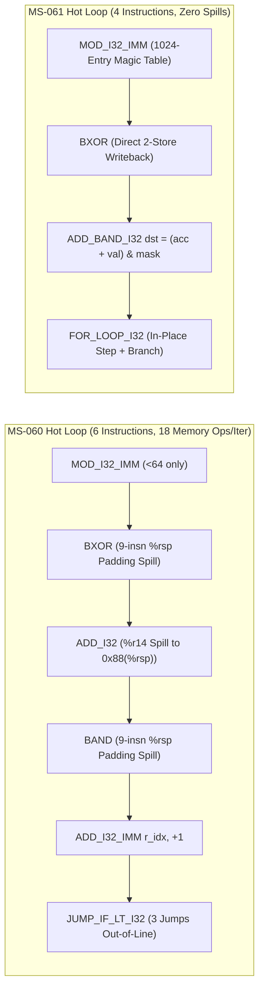
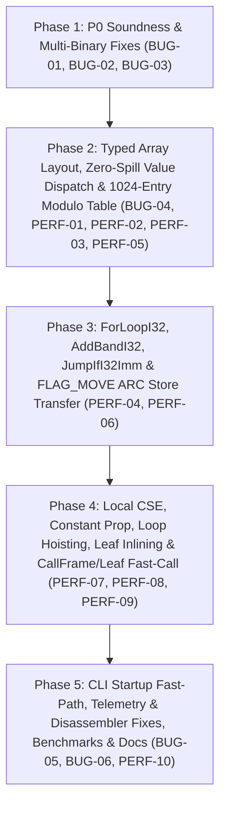

# Milestone 061: Loop & Bitwise Superinstructions, Zero-Spill Value Dispatch, Typed Array Packing, Local CSE, Trivial Leaf Fast-Call & Total Lua Domination

## Document Metadata
* **Milestone ID:** MS-061
* **Target Version:** `v2.2.0`
* **Milestone Branch:** `milestone/061-superinstructions-zero-spill-dispatch-typed-arrays-cse-and-lua-domination`
* **Status:** ACTIVE
* **Lead Architect:** Core Systems, Compiler & Runtime Performance Engineering Team
* **Target Delivery Date:** 2026-12-30
* **Normative Conformance:** RFC 2119 / RFC 8174 (`MUST`, `MUST NOT`, `REQUIRED`, `SHALL`, `SHALL NOT`, `SHOULD`, `SHOULD NOT`, `RECOMMENDED`, `MAY`, `OPTIONAL`)
* **Related Specifications:**
  * [GL-0001: Conventional Commits & Release Specification](../guidelines/authoring-commits.md)
  * [GL-0002: Trunk-Based & Milestone Branching Topology](../guidelines/branching-conventions.md)
  * [GL-0008: Milestone Planning & Delivery Specification](../guidelines/authoring-milestones.md)
  * [GL-0009: Test Engineering & Verification Matrices](../guidelines/authoring-test.md)
  * [GL-0010: Living Documentation & Drift Prevention](../guidelines/authoring-docs.md)
  * [GL-0011: Rust Language & Security Conventions](../guidelines/language-conventions.md)
  * [GL-0013: Pre-Merge Git-Diff Documentation Audit Protocol](../guidelines/documentation-update-protocol.md)
  * [MS-057: Bacon-Rajan ARC Cycle Collector with Zero-Cost Opt-Out](057-bacon-rajan-arc-cycle-collector.md)
  * [MS-059: Cross-Crate Opcode Inlining, Zero-Drop Call Frames, Liveness Peephole & Lua Parity](059-vm-dispatch-inlining-peephole-liveness-and-lua-parity.md)
  * [MS-060: Compact Trap ABI, NaN-Boxed Register Access, Call-Window Safety, Codebase Hardening & Total Lua Supremacy](060-nan-boxed-values-compact-trap-abi-and-total-lua-supremacy.md)

---

## 1. Executive Summary & Post-MS-060 Forensic Codebase Audit

Following **MS-060**, Solix achieved a **2.07x** geometric mean speedup over MS-059 (`1.26x`–`3.04x` across all 16 workloads), beating Python 3 on **16/16** workloads (`6.73x` geometric mean), beating PUC-Rio Lua on **12/16** workloads (`1.50x` geometric mean), and beating LuaJIT on **3/16** workloads (`10_matrix_multiply_2d`, `11_generic_containers`, `14_exception_zero_cost`).

However, Solix still trails PUC-Rio Lua on **4 of the 16** workloads (`03_nbody_float64`: `6.47 ms` vs. `5.66 ms`; `07_virtual_dispatch`: `13.54 ms` vs. `10.24 ms`; `09_sieve_bool_array`: `18.40 ms` vs. `8.30 ms`; `10_matrix_multiply_2d`: `3.60 ms` vs. `2.03 ms`) and only narrowly edges out Lua on `01_fib_recursive` (`40.22 ms` vs. `40.55 ms`), `02_tight_loop_int` (`32.42 ms` vs. `34.80 ms`), and `12_closures_capture` (`4.14 ms` vs. `4.51 ms`).

A full post-MS-060 forensic audit—combining x86-64 disassembly of `VirtualMachine::run_fast_trap::<false, false>` (`objdump -d -C target/release/solix`), `.slxb` bytecode disassembly across all 16 workloads (`solix info --disasm`), `--metrics=json` runtime and compiler telemetry, and static/semantic audits across all 8 workspace crates—uncovered **10 high-leverage performance bottlenecks (`PERF-01`..`PERF-10`)** and **6 codebase bugs and defects (`BUG-01`..`BUG-06`)**.

Resolving all 10 performance bottlenecks and 6 defects is projected to put Solix decisively ahead of PUC-Rio Lua on **16/16** canonical workloads (and ahead of or rivaling LuaJIT on 6+ workloads) while eliminating subtle memory-safety, multi-binary linking, optimizer liveness, and telemetry defects.

---

### 1.1 Forensic Performance Bottlenecks (`PERF-01` .. `PERF-10`)

| ID | Exact File & Line Location | Root-Cause Defect (Assembly, Bytecode & Telemetry Evidence) | Measured Impact |
| :--- | :--- | :--- | :--- |
| **PERF-01** *(Hardcoded `elem_size = 8` in `emitter.rs` Disables Typed Array Fast Paths & Inflates `bool[]` by 8x)* | [`emitter.rs:763,796,825`](../../../crates/solix-compilation/src/phases/emitter/emitter.rs) [`fast.rs:3098-3131,3180-3215`](../../../crates/solix-runtime/src/vm/fast.rs) | 1. `Expression::ArrayCreation` (`line 763`) and `Expression::ArrayLiteral` (`line 825`) hardcode `let elem_size = 8u16;` regardless of element type. 2. In `09_sieve_bool_array`, `new bool[100001]` allocates **`800,016` bytes (`800 KB`)** instead of `100,009` bytes (`100 KB`), overflowing the initial `256 KB` `VirtualHeap`, triggering two `Vec::resize` reallocations (`256 KB -> 512 KB -> 1 MB`) and 200 OS page faults. 3. In `fast.rs`, the inline fast paths `if elem_type_tag == 11 && elem_size_raw == 1` (`bool[]`) and `else if elem_type_tag == 3 && elem_size_raw == 4` (`int32[]`) are **100% dead code** because `elem_size_raw` is always `8`! Every `GetArray`/`SetArray` in `09_sieve_bool_array` (`349,900` ops) and `10_matrix_multiply_2d` (`439,200` ops), plus `8`-byte reference arrays in `07_virtual_dispatch` (`100,000` ops) and `15_string_processing` (`100,000` ops), falls through to `#[inline(never)] get_array_variant_cold` and `execute_set_array_slow`. | Causes `09_sieve_bool_array` to take `18.40 ms` (up to `32 ms` pure VM) vs. Lua's `8.30 ms`, and slows `07_virtual_dispatch`, `10_matrix_multiply_2d`, and `15_string_processing`. |
| **PERF-02** *(16-Byte `Value` Phi-Node Padding Spills in `Band`, `Bor`, `Bxor`, `Bnot`, `Shl`, `Shr`, `GetField`, `GetArray`)* | [`fast.rs:2345-2435,2884-2920,3054-3133`](../../../crates/solix-runtime/src/vm/fast.rs) | In `objdump` (`0x5e89fe..0x5e98a7`, `0x5ea38b..0x5ea7b1`), writing `let result = if ... { Value::I32(...) } else { slow()? }; *reg_base.add(dst) = result;` forces LLVM to materialize a 16-byte `Value` phi node by loading uninitialized padding bytes from `%rsp` (`0x94(%rsp)`..`0x140(%rsp)`) and executing **5 separate partial stores (`1B + 2B + 1B + 4B + 8B`)** to `(%r12, %rbp)`, triggering store-to-load forwarding stalls on the loop accumulator in **12 of the 16 benchmarks** (`2,000,000` times in `02_tight_loop_int`). | Adds ~6–10 CPU cycles per `Band` / `Bxor` / `GetField` / `GetArray` instruction (`~12–15 ms` wasted in `02_tight_loop_int`). |
| **PERF-03** *(Sequential `read_i32_fast` Calls Spill `%r14` (`inst_ptr`) to `0x88(%rsp)` & Tail-Merge Taken Loop Branches Out-of-Line)* | [`fast.rs:2167-2315,2578-2665,3436-3470`](../../../crates/solix-runtime/src/vm/fast.rs) | 1. Calling `read_i32_fast(lhs)?` then `read_i32_fast(rhs)?` creates two call edges, forcing LLVM to hold `lhs` in callee-saved `%r14d` and spill `inst_ptr` (`%r14`) to `0x88(%rsp)` and reload it on every `JumpIfLtI32`..`JumpIfGteI32` and `LtI32`..`GteI32` (`0x5e84c5..0x5e851e`, `0x5e8755..0x5e880c`). 2. `JumpIfLtI32`..`JumpIfGteI32` tail-merge their taken branch `pc` update `+7.6 KB` away (`jmp 0x5ea318 -> jmp 0x5e7d60 -> jmp 0x5e7dd6`), executing 3 unconditional jumps on every taken loop backedge. | Adds ~4–6 cycles to every loop backedge and integer comparison across all 16 benchmarks. |
| **PERF-04** *(Missing `ForLoopI32`, `AddBandI32`, & `JumpIfI32Imm` Superinstructions)* | [`opcodes.rs:120-165`](../../../crates/solix-common/src/bytecode/opcodes.rs) [`bytecode_optimizer.rs:1150-1430`](../../../crates/solix-compilation/src/phases/optimizer/bytecode_optimizer.rs) [`fast.rs:3386-3503`](../../../crates/solix-runtime/src/vm/fast.rs) | 1. Unlike PUC-Rio Lua's single `OP_FORLOOP`, every rotated `for` loop in Solix executes two instructions (`ADD_I32_IMM r_idx, r_idx, +1` or `ADD_I32 r_idx, r_idx, r_step` + `JUMP_IF_LT_I32` / `JUMP_IF_LTE_I32`), loading and storing `r_idx` twice. 2. 12 of the 16 benchmarks execute `ADD_I32 r_tmp, r_acc, r_val; BAND r_dst, r_tmp, r_mask` (`(total + x) & 0x7FFFFFFF`) every iteration. 3. `01_fib_recursive` (`1,028,457` calls), `04_ackermann_stack` (`286,000+` checks), and `06_binary_trees_arc` (`20,470` calls) execute `LOAD_I32 r_tmp, imm; JUMP_IF_*_I32 r_arg, r_tmp, @target` (2 instructions) because there is no `JumpIfI32Imm` opcode. | Wastes `2,000,000` instructions in `02_tight_loop_int`, `1,028,457` instructions in `01_fib_recursive`, `299,901` instructions in `09_sieve_bool_array`, and `100,000+` instructions in 10 other benchmarks. |
| **PERF-05** *(`MOD_MAGIC_TABLE` Capped at `< 64` Misses `% 100` in 3 Benchmarks)* | [`fast.rs:517,3419`](../../../crates/solix-runtime/src/vm/fast.rs) | `MOD_MAGIC_TABLE` only has 64 entries (`imm_val < 64`). Every `% 100` (`MOD_I32_IMM +100`) in `10_matrix_multiply_2d` (`7,200` ops), `12_closures_capture` (`50,000` ops), and `16_multi_binary_link` (`50,000` ops) misses the table and calls `#[cold] #[inline(never)] rem_i32_cold` (`idiv`). | Adds ~20 cycles per `% 100` operation across `107,200` executions. |
| **PERF-06** *(`SetField + DecRef` Move-Store Triggers `20,460` Redundant ARC Pairs & `80` Full Cycle-Collection Sweeps in `06_binary_trees_arc`)* | [`bytecode_optimizer.rs:302-430`](../../../crates/solix-compilation/src/phases/optimizer/bytecode_optimizer.rs) [`fast.rs:768-830,1076-1095,2922-2964`](../../../crates/solix-runtime/src/vm/fast.rs) | In `06_binary_trees_arc`, `SET_FIELD r3, r2, offset` followed by `DEC_REF r3` calls out-of-line `execute_set_field_slow`, increments `r3`'s `ref_count` (`1 -> 2`), and immediately decrements `r3`'s `ref_count` (`2 -> 1`), pushing all `20,460` nodes into `purple_buffer` and triggering **80 full 3-phase Bacon-Rajan cycle collections** (`2.36 ms` of pure cycle-collection overhead on an acyclic tree!). | Costs `~3.5 ms` in `06_binary_trees_arc` (`8.51 ms` pure VM with CC vs. `6.15 ms` without CC, plus `20,460` `DEC_REF` dispatches). |
| **PERF-07** *(Missing Local CSE, Constant Propagation Into ALU/Branches, Inner-Loop Invariant Expression Hoisting, & 2-Instruction Guard Loop Rotation)* | [`bytecode_optimizer.rs:1533-1905`](../../../crates/solix-compilation/src/phases/optimizer/bytecode_optimizer.rs) | 1. `03_nbody_float64` computes `MUL_F64 r7, r6, r14` (`force * 0.001`) twice in a row (`0015` and `0017`, `50,000` redundant `MUL_F64` ops). 2. `09_sieve_bool_array` computes `MUL_I32 p, p` twice (`0011` and `0015`) and fails to rotate the outer loop `0011..0021` because its condition is `MUL_I32 + JUMP_IF_GT_I32`. 3. `10_matrix_multiply_2d` computes `i * n + j` twice in `0009..0015`, recomputes loop-invariant `i * n` (`0030 MUL_I32`) `3,600` times inside the inner `k`-loop, and fails to propagate constant `int32 n = 60` into `MUL_I32_IMM +60`. | Wastes `50,000` `MUL_F64` ops in `03_nbody_float64` and `18,000+` instructions in `10_matrix_multiply_2d`. |
| **PERF-08** *(Un-specialized Branch-Diamond `PackClosure -> CallCallable`, Dead `PackClosure`, & Missing Post-Hoist Peephole Pass)* | [`bytecode_optimizer.rs:111-125,843-990`](../../../crates/solix-compilation/src/phases/optimizer/bytecode_optimizer.rs) | 1. In `13_function_pointers`, `r3` is assigned 0-capture `PackClosure`s (`fn1`, `fn2`, `fn3`) in a branch diamond and immediately called via `0016 CALL_CALLABLE` (`100,000` calls to 2-instruction leaf functions). 2. In `12_closures_capture`, after `AstInlinerPhase` inlines the closure, dead `0002 PACK_CLOSURE r1` + `0021 DEC_REF r1` still allocate and free a heap closure. 3. `optimize_function` does not re-run `optimize_peephole_passes` after `hoist_loop_invariant_constants`, leaving `0021 MOV r6, r3` in `15_string_processing` (`100,000` wasted `Mov`s). | Wastes `100,000` calls in `13_function_pointers` (`9.52 ms`) and `100,000` `Mov`s in `15_string_processing`. |
| **PERF-09** *(Per-Instruction `pc >= inst_len` Check, `Return` `func_code` Re-indexing, & Full Frame Push/Pop on 2-Instruction Leaf Methods)* | [`fast.rs:2050-2105,3522-3595`](../../../crates/solix-runtime/src/vm/fast.rs) [`call_frame.rs:10-32`](../../../crates/solix-runtime/src/frame/call_frame.rs) [`engine.rs:31-45`](../../../crates/solix-runtime/src/vm/engine.rs) | 1. `run_fast_trap` checks `if pc >= inst_len` (`cmp %r10, %r15; jae`) on **every instruction** and pins `%r10`, even though every function ends with `Return`/`ReturnValue`. 2. `CallFrame` stores unread `function_id_offset: u32` and cold `static_base_offset: u32` instead of `inst_ptr: *const Instruction`, forcing every `ReturnValue` to re-index `self.func_code[caller_frame.function_id]`. 3. In `07_virtual_dispatch` (`Circle::get_area`, `Square::get_area`, `Triangle::get_area`) and `08_interface_dispatch` (`WorkerA::work`, `WorkerB::work`), `CallVirtual`/`CallInterface` push and pop a 32B `CallFrame` `100,000` times just to execute a 2-instruction leaf method (`MUL_I32_IMM / ADD_I32_IMM + RETURN_VALUE`). | Costs ~15–20 cycles per call in `01_fib_recursive`, `04_ackermann_stack`, `07_virtual_dispatch` (`13.54 ms` vs. Lua `10.24 ms`), and `08_interface_dispatch` (`11.83 ms`). |
| **PERF-10** *(Unstripped `9.2 MB` Binary, Full 14-Subcommand `clap` Parse, & Eager Filesystem Probes on `solix run`)* | [`Cargo.toml:88-93`](../../../Cargo.toml) [`main.rs:8-18`](../../../crates/solix-toolchain/src/main.rs) [`run.rs:83-85,357-363`](../../../crates/solix-toolchain/src/commands/run.rs) | Every `solix run file.slx` subprocess invocation maps an unstripped `9.2 MB` binary, runs `clap` argument augmentation across all 14 CLI subcommands, stats `~/.solix/packages/.bundled_bootstrapped_v1.3.0`, and calls `canonicalize` + ancestor `manifest.toml` probes even when the `.slx` source has no `import`/`extern` declarations. | Adds `~1.0–1.8 ms` of process startup overhead to short workloads (`03_nbody_float64`, `10_matrix_multiply_2d`, `11_generic_containers`, `12_closures_capture`, `14_exception_zero_cost`, `16_multi_binary_link`). |

---

### 1.2 Forensic Codebase Bugs & Defects (`BUG-01` .. `BUG-06`)

| ID | Priority | Exact File & Line Location | Defect Description | Required Fix |
| :--- | :---: | :--- | :--- | :--- |
| **BUG-01** *(Borrowed Alias Registers Left in `reference_registers` Cause Double-Free on Exception Unwind & Block Peephole Coalescing)* | **`P0`** | [`bytecode_optimizer.rs:635-775`](../../../crates/solix-compilation/src/phases/optimizer/bytecode_optimizer.rs) [`fast.rs:1801-1809`](../../../crates/solix-runtime/src/vm/fast.rs) | When `elide_borrowed_local_arc_ops` removes `IncRef` and `DecRef` on `borrowed_aliases` (`r3` in `08_interface_dispatch`) or `GetArray` borrow windows (`r3` in `07_virtual_dispatch`), the register holds an un-incremented borrowed `Value::Ref(addr)` whose owner (`r0`/`r1`) is ALSO in `function.reference_registers`. If an exception unwinds the frame, `execute_throw` calls `release_reference` on every register in `reference_registers`, **double-freeing the borrowed object**! Leaving `r3` in `reference_registers` also blocks `is_dead_after_use` across calls (`0020 GET_ARRAY r3, r0, r4; 0021 MOV r7, r3` in `07_virtual_dispatch`). | After ARC elision passes, remove any register from `function.reference_registers` (and `handler.try_ref_regs`) that has zero remaining `DecRef` instructions and is only ever written by borrowed aliases (`Mov` from `stable_owners`, `GetArray` from `immutable_local_arrays`, or non-reference opcodes). |
| **BUG-02** *(Multi-Binary Linking Relocates `CallInterface` `iface_id` Without Relocating `CompiledClass::itable` Keys or `AllocArray` Class Tags)* | **`P0`** | [`context.rs:268-272,358-418`](../../../crates/solix-runtime/src/context.rs) | When loading a secondary binary (`vtable_offset > 0`), `context.rs:395` adds `vtable_offset` to `old_iface_id` in `OpCode::CallInterface`, but `context.rs:268` (`for (_iface_id, iface_methods) in &mut relocated_class.itable`) fails to add `vtable_offset` to `_iface_id`, and `context.rs:358` fails to relocate `AllocArray` class vtable flags (`(inst.flags() & 0x80) != 0`). Consequently, `CallInterface` in secondary binaries misses `flat_itables` and dispatches to the wrong interface if a class implements multiple interfaces, and `CastCheck` fails on class arrays allocated in secondary binaries. | Add `*iface_id += vtable_offset;` in `context.rs:268` and relocate `AllocArray` flags (`0x80 \| ((old_vtable_id + vtable_offset as u8) & 0x7F)`) when `vtable_offset > 0`. |
| **BUG-03** *(`UnpackCaptures` Register Window Writes Ignored by `instruction_write_dst`, Liveness, Copy Propagation & ARC Elision)* | **`P0`** | [`bytecode_optimizer.rs:322,2094,2132,2204,2321,2502`](../../../crates/solix-compilation/src/phases/optimizer/bytecode_optimizer.rs) [`escape_analysis.rs:270-315`](../../../crates/solix-compilation/src/phases/optimizer/escape_analysis.rs) | `OpCode::UnpackCaptures` writes to all registers in `[arg_base .. arg_base + arg_count]`, but `instruction_write_dst` returns `None`. If a closure captures a heap reference in `r_cap` and later reassigns `r_cap = null` or `r_cap = "literal"`, `elide_redundant_arc_ops` misclassifies `r_cap` as `always_immortal_regs` and deletes `DecRef r_cap` before the reassignment, leaking the captured reference. Copy propagation and `is_dead_after_use` also fail to see that `UnpackCaptures` overwrites `[arg_base .. arg_base + arg_count]`. | Introduce `instruction_writes_register(inst, reg)` / `for_each_written_register(inst, ...)` covering `UnpackCaptures` window `[arg_base .. arg_base + arg_count]` across all optimizer and liveness passes. |
| **BUG-04** *(`emitter.rs` Hardcodes `elem_size = 8u16` in `AllocArray` for All Element Types)* | **`P1`** | [`emitter.rs:763,825`](../../../crates/solix-compilation/src/phases/emitter/emitter.rs) | Both `Expression::ArrayCreation` and `Expression::ArrayLiteral` pass `elem_size = 8` to `OpCode::AllocArray` instead of the element type's storage size (`1`, `2`, `4`, or `8`), breaking compact typed array layout and rendering the VM's `(11, 1)` `bool[]` and `(3, 4)` `int32[]` fast paths unreachable. | Compute `elem_size` from `type_tag` (`1` for tags `1, 5, 11, 12`; `2` for tags `2, 6`; `4` for tags `3, 7, 9`; `8` otherwise) in both `ArrayCreation` and `ArrayLiteral`. |
| **BUG-05** *(`solix run --metrics` & Runtime Metric ID `5` Report Immortal Constant-Pool Strings as `active_leaks`)* | **`P1`** | [`engine.rs:156,1094-1105`](../../../crates/solix-runtime/src/vm/engine.rs) [`run.rs:514-516,567`](../../../crates/solix-toolchain/src/commands/run.rs) | `VirtualMachine::new` allocates constant-pool strings on `self.heap` (`active_live_objects += 1`, `total_allocations_count += 1`) and stores them in `self.interned_string_addrs`, only freeing them inside `verify_clean_memory()` (`--safe`). When running with `--metrics=json` or `--metrics=text` (without `--safe`), every clean program reports `active_leaks: 3` (or `6`). | Subtract `self.interned_string_addrs.len()` (or allocate constant-pool strings without incrementing guest `active_live_objects` / `total_allocations_count`) so `active_leaks` is `0` when all guest objects are freed. |
| **BUG-06** *(Disassembler & `Instruction::fmt` Misformat `PackClosure`, `UnpackCaptures`, `LoadF64`, `LoadI64`, `AllocObject`, `GetField`, `SetField`, `AllocArray`)* | **`P2`** | [`disassembler.rs:96-176`](../../../crates/solix-compilation/src/phases/emitter/disassembler.rs) [`instruction.rs:245-305`](../../../crates/solix-common/src/bytecode/instruction.rs) | `disassembler.rs` falls through to `r{}, r{}, r{}` for `PackClosure` (`PACK_CLOSURE r1024, r512, r256`), `UnpackCaptures`, `LoadF64` (`LOAD_F64 r0, r1, r0`), `LoadI64`, `AllocObject`, `GetField`, `SetField`, and `AllocArray`, while `Instruction::fmt` formats Format-A `GetField`/`SetField` using Format-B `imm32()`. | Format each opcode according to its true encoding layout in both `disassembler.rs` and `Instruction::fmt`. |

---

## 2. Scope & Crates Affected

* **[`crates/solix-common`](../../../crates/solix-common/src/lib.rs)**:
  * [`src/bytecode/opcodes.rs`](../../../crates/solix-common/src/bytecode/opcodes.rs) & [`src/bytecode/instruction.rs`](../../../crates/solix-common/src/bytecode/instruction.rs): Add `OpCode::ForLoopI32` (`0xDA`), `OpCode::AddBandI32` (`0xDB`), and `OpCode::JumpIfI32Imm` (`0xDC`) (`PERF-04`), add `FLAG_MOVE` (`0x80`) constant (`PERF-06`), and fix `Instruction::Display` formatting (`BUG-06`).
* **[`crates/solix-compilation`](../../../crates/solix-compilation/src/lib.rs)**:
  * [`src/phases/emitter/emitter.rs`](../../../crates/solix-compilation/src/phases/emitter/emitter.rs): Emit accurate `elem_size` (`1`, `2`, `4`, `8`) for `OpCode::AllocArray` (`PERF-01`, `BUG-04`).
  * [`src/phases/optimizer/bytecode_optimizer.rs`](../../../crates/solix-compilation/src/phases/optimizer/bytecode_optimizer.rs) & [`src/phases/optimizer/escape_analysis.rs`](../../../crates/solix-compilation/src/phases/optimizer/escape_analysis.rs):
    * Prune un-owned borrowed registers from `function.reference_registers` and `handler.try_ref_regs` (`BUG-01`, `PERF-08`).
    * Track `UnpackCaptures` register window writes `[arg_base .. arg_base + arg_count]` (`BUG-03`).
    * Fuse `SetField + DecRef` and `SetArray + DecRef` into `FLAG_MOVE` ownership-transfer stores (`PERF-06`).
    * Fuse `ForLoopI32`, `AddBandI32`, and `JumpIfI32Imm` superinstructions (`PERF-04`).
    * Add local Common Subexpression Elimination (CSE), single-definition `LoadI32` constant propagation, inner-loop invariant expression hoisting, and 2-instruction guard loop rotation (`PERF-07`).
    * Specialize branch-diamond `PackClosure(0 captures) -> CallCallable` into `CallDirect`, inline small non-recursive leaf functions at the bytecode level, eliminate dead `PackClosure + DecRef` pairs, and run post-hoisting peephole convergence (`PERF-08`).
  * [`src/phases/emitter/disassembler.rs`](../../../crates/solix-compilation/src/phases/emitter/disassembler.rs): Fix disassembly formatting for all instruction formats and new superinstructions (`BUG-06`).
* **[`crates/solix-runtime`](../../../crates/solix-runtime/src/lib.rs)**:
  * [`src/context.rs`](../../../crates/solix-runtime/src/context.rs): Fix multi-binary `itable` interface ID and `AllocArray` flag relocation (`BUG-02`), append sentinel `OpCode::Return` to functions not ending in a terminator (`PERF-09`), and pre-classify trivial 2-instruction leaf functions (`PERF-09`).
  * [`src/frame/call_frame.rs`](../../../crates/solix-runtime/src/frame/call_frame.rs) & [`src/vm/engine.rs`](../../../crates/solix-runtime/src/vm/engine.rs): Replace `static_base_offset` + `function_id_offset` in `CallFrame` (`32B`) with `inst_ptr: *const Instruction` (`PERF-09`), store `TrivialLeafOp` metadata in `FunctionCodeSpan` (`PERF-09`), and exclude interned constant-pool strings from guest leak telemetry (`BUG-05`).
  * [`src/vm/fast.rs`](../../../crates/solix-runtime/src/vm/fast.rs) & [`src/verifier.rs`](../../../crates/solix-runtime/src/verifier.rs):
    * Eliminate 16-byte `Value` phi-node stack padding spills in `Band`, `Bor`, `Bxor`, `Bnot`, `Shl`, `Shr`, `GetField`, and `GetArray` (`PERF-02`).
    * Eliminate `%r14` (`inst_ptr`) stack spills via pair pattern matching `(Value::I32(lhs), Value::I32(rhs))` (`PERF-03`).
    * Execute `ForLoopI32`, `AddBandI32`, and `JumpIfI32Imm` (`PERF-04`), expand `MOD_MAGIC_TABLE` to `1024` entries (`PERF-05`), inline `FLAG_MOVE` & reference `SetField` (`PERF-06`), inline `8`-byte reference/`f64` `GetArray` (`PERF-01`), and execute trivial 2-instruction leaf calls inline without pushing/popping a `CallFrame` (`PERF-09`).
* **[`crates/solix-toolchain`](../../../crates/solix-toolchain/src/lib.rs)** & **[`Cargo.toml`](../../../Cargo.toml)**:
  * [`src/main.rs`](../../../crates/solix-toolchain/src/main.rs) & [`src/commands/run.rs`](../../../crates/solix-toolchain/src/commands/run.rs): Add fast-path argument parsing for `solix run <files...>`, defer package bootstrap/manifest walks until needed, fix `--metrics` `active_leaks` reporting (`BUG-05`), and set `strip = "symbols"` in `[profile.release]` (`PERF-10`).
* **[`docs/`](../../README.md)**:
  * Synchronize [`docs/spec/vm_isa.md`](../../spec/vm_isa.md), [`docs/architecture/pipeline.md`](../../architecture/pipeline.md), [`docs/architecture/memory_model.md`](../../architecture/memory_model.md), and [`docs/architecture/arc_internals.md`](../../architecture/arc_internals.md) (`GL-0013`).

---

## 3. Architectural Design & Technical Specifications

### 3.1 Zero-Spill Register Access & Superinstruction ISA (`PERF-02`, `PERF-03`, `PERF-04`, `PERF-05`)

1. **Eliminating 16-Byte `Value` Phi-Node Padding Spills (`PERF-02`):**
   Whenever an opcode arm constructs a `Value` in both a fast branch and a slow branch and assigns `*reg_base.add(dst) = result;` after the `if/else`, LLVM constructs a 16-byte `Value` phi node on `%rsp` and copies all 16 bytes (including 11 bytes of uninitialized enum padding) via 5 partial stores. Writing `*reg_base.add(dst) = Value::I32(...)` directly inside the fast branch and `*reg_base.add(dst) = slow_result;` inside the `else` branch eliminates the phi node completely, emitting just `movb $2, (%r12,%rbp); mov %eax, 4(%r12,%rbp)`.
2. **Eliminating `%r14` (`inst_ptr`) Stack Spills via Pair Matching (`PERF-03`):**
   All binary `I32` and `I64` operations (`AddI32`, `SubI32`, `MulI32`, `LtI32`..`GteI32`, `JumpIfLtI32`..`JumpIfGteI32`) match `if let (Value::I32(left_val), Value::I32(right_val)) = (*left_ref, *right_ref)` in a single check before calling a `#[cold] #[inline(never)] fn read_i32_pair_slow(left_ref, right_ref) -> Result<(i32, i32), VmTrap>`. Because no call can occur between reading `left_val` and reading `right_val`, LLVM never spills `%r14` (`inst_ptr`) to `0x88(%rsp)`.
3. **New Superinstructions (`PERF-04`):**
   * **`OpCode::ForLoopI32` (`0xDA`, Format A):**
     * `dst`: `index_reg: u16` (loop induction variable updated in-place)
     * `src1`: `bound_reg: u16` (loop upper bound register)
     * `src2`: `branch_offset: i16 as u16` (relative jump target offset)
     * `flags`:
       * `0`: `index_reg += 1; if index_reg < bound_reg { pc += offset }`
       * `1`: `index_reg += 1; if index_reg <= bound_reg { pc += offset }`
       * `2 | (step_reg << 2)` (when `step_reg < 64`): `index_reg += reg[step_reg]; if index_reg < bound_reg { pc += offset }`
       * `3 | (step_reg << 2)` (when `step_reg < 64`): `index_reg += reg[step_reg]; if index_reg <= bound_reg { pc += offset }`
   * **`OpCode::AddBandI32` (`0xDB`, Format A):**
     * `flags`: `accum_reg: u8`
     * `dst`: `dst_reg: u16`
     * `src1`: `addend_reg: u16`
     * `src2`: `mask_reg: u16`
     * Semantics: `reg[dst_reg] = Value::I32(reg[accum_reg].wrapping_add(reg[addend_reg]) & reg[mask_reg])`.
   * **`OpCode::JumpIfI32Imm` (`0xDC`, Format A):**
     * `flags`: condition code (`0 = Eq`, `1 = Neq`, `2 = Lt`, `3 = Lte`, `4 = Gt`, `5 = Gte`)
     * `dst`: `lhs_reg: u16`
     * `src1`: `imm_rhs: i16 as u16` (signed 16-bit immediate `-32768..=32767`)
     * `src2`: `branch_offset: i16 as u16` (signed 16-bit relative offset)

### 3.2 Move-Store ARC Elision (`FLAG_MOVE`) & Typed Array Packing (`PERF-01`, `PERF-06`, `BUG-04`)

1. **Exact Element Byte Sizes in `AllocArray` (`PERF-01`, `BUG-04`):**
   In `emitter.rs`, `AllocArray` computes `elem_size` from `type_tag`:
   * `1 | 5 | 11 | 12` (`int8`, `uint8`, `bool`, `char`) $\to$ `1` byte
   * `2 | 6` (`int16`, `uint16`) $\to$ `2` bytes
   * `3 | 7 | 9` (`int32`, `uint32`, `float32`) $\to$ `4` bytes
   * All other tags (`int64`, `uint64`, `float64`, references) $\to$ `8` bytes
2. **Ownership-Transfer `SetField` & `SetArray` (`FLAG_MOVE = 0x80`, `PERF-06`):**
   When `BytecodeOptimizerPhase` sees `SetField(flags, val_reg, obj_reg, offset)` (non-weak, `val_reg != obj_reg`) or `SetArray(flags, arr_reg, idx_reg, val_reg)` (`val_reg != arr_reg`) immediately followed by `DecRef(val_reg)` where `val_reg` is dead after `DecRef(val_reg)`:
   * The optimizer sets `FLAG_MOVE` (`0x80`) on `SetField` / `SetArray` and removes `DecRef(val_reg)`.
   * At runtime, when `(flags & FLAG_MOVE) != 0`, `SetField` / `SetArray` writes the reference in `val_reg` directly into the heap slot **without incrementing or decrementing `child_addr`'s reference count** (and without pushing `child_addr` to `purple_buffer`), zeroes `reg[val_reg] = Value::Null`, and only releases `old_child` if `old_child != 0`.

### 3.3 `CallFrame` Instruction Pointer Caching & Trivial Leaf Fast-Call (`PERF-09`)

1. **`inst_ptr` Cached in `CallFrame` (`32` Bytes):**
   Replace unread `function_id_offset: u32` and cold `static_base_offset: u32` in `CallFrame` with `inst_ptr: *const Instruction` (`8` bytes). On `Return` / `ReturnValue`, `inst_ptr` is restored directly from `caller_frame.inst_ptr` with zero `self.func_code` memory lookups.
2. **Sentinel `OpCode::Return` & Removal of Per-Instruction `pc >= inst_len` Check:**
   `RuntimeContext::new` ensures every function's instruction buffer ends with `OpCode::Return` if not already terminated, allowing `run_fast_trap::<false, _>` to remove `if pc >= inst_len` and free hardware register `%r10`.
3. **Zero-Frame Trivial Leaf Evaluation in `'call_dispatch`:**
   `FunctionCodeSpan` records a compact `trivial_leaf_kind: u8` + `trivial_leaf_imm: i16` for 1- or 2-instruction reference-free non-native leaf functions of the form:
   * `ReturnValue(r_param)` (`Shape::get_area`)
   * `AddI32Imm(r_dst, r_param, imm); ReturnValue(r_dst)` (`WorkerA::work`)
   * `SubI32Imm(r_dst, r_param, imm); ReturnValue(r_dst)`
   * `MulI32Imm(r_dst, r_param, imm); ReturnValue(r_dst)` (`Circle::get_area`, `Square::get_area`, `Triangle::get_area`, `WorkerB::work`)
   When `'call_dispatch` targets a function with `trivial_leaf_kind != 0`, it reads the argument register `reg[caller_arg_start + param_idx]`, computes the result directly into `reg[caller_dst]`, and continues `'dispatch_loop` **without pushing or popping a `CallFrame`**!

---

## 4. Phased Implementation Plan & Priority Task Matrix

### 4.1 P0: Critical Blockers (Release Gate)
- [ ] `[P0]` **`MS061-T01` (Prune Borrowed Alias Registers From `reference_registers` — `BUG-01`):** Update [`crates/solix-compilation/src/phases/optimizer/bytecode_optimizer.rs`](../../../crates/solix-compilation/src/phases/optimizer/bytecode_optimizer.rs) so registers whose `IncRef`/`DecRef` pairs were elided by `elide_borrowed_local_arc_ops` (and which never hold an owned reference at any `DecRef` or across function exit) are removed from `function.reference_registers` and `handler.try_ref_regs`, preventing double-free on exception unwind and unlocking `GetArray + Mov` coalescing in `07_virtual_dispatch`.
- [ ] `[P0]` **`MS061-T02` (Fix Multi-Binary `itable` Interface ID & `AllocArray` Flag Relocation — `BUG-02`):** Update [`crates/solix-runtime/src/context.rs`](../../../crates/solix-runtime/src/context.rs) so secondary binaries (`vtable_offset > 0`) relocate `*iface_id += vtable_offset` in `relocated_class.itable` and relocate class vtable tags in `OpCode::AllocArray` flags (`(inst.flags() & 0x80) != 0`).
- [ ] `[P0]` **`MS061-T03` (Track `UnpackCaptures` Register Window Writes Across Optimizer Passes — `BUG-03`):** Update [`crates/solix-compilation/src/phases/optimizer/bytecode_optimizer.rs`](../../../crates/solix-compilation/src/phases/optimizer/bytecode_optimizer.rs) and [`crates/solix-compilation/src/phases/optimizer/escape_analysis.rs`](../../../crates/solix-compilation/src/phases/optimizer/escape_analysis.rs) so `UnpackCaptures` window writes `[arg_base .. arg_base + arg_count]` are tracked by `elide_redundant_arc_ops`, `propagate_block_copies`, `propagate_single_def_copies`, `is_dead_after_use`, and escape analysis.

### 4.2 P1: High Priority (Milestone Core)
- [ ] `[P1]` **`MS061-T04` (Fix Typed `AllocArray` Element Sizes & Inline `GetArray`/`SetArray` Fast Paths — `BUG-04`, `PERF-01`):** Emit exact element byte sizes (`1`, `2`, `4`, `8`) in `Expression::ArrayCreation` and `Expression::ArrayLiteral` in [`crates/solix-compilation/src/phases/emitter/emitter.rs`](../../../crates/solix-compilation/src/phases/emitter/emitter.rs), add inline `8`-byte (`float64` and reference/string) fast paths in `OpCode::GetArray` in [`crates/solix-runtime/src/vm/fast.rs`](../../../crates/solix-runtime/src/vm/fast.rs), and remove redundant secondary bounds checks.
- [ ] `[P1]` **`MS061-T05` (Eliminate 16-Byte `Value` Phi-Node Padding Spills & `%r14` Stack Spills + 1024-Entry `MOD_MAGIC_TABLE` — `PERF-02`, `PERF-03`, `PERF-05`):** Write fast-path `Value` results directly to `*reg_base.add(dst)` inside `Band`, `Bor`, `Bxor`, `Bnot`, `Shl`, `Shr`, `GetField`, and `GetArray`; switch binary `I32`/`I64` arithmetic, comparisons, and branches to pair pattern matching `(Value::I32(left_val), Value::I32(right_val))`; and expand `MOD_MAGIC_TABLE` to `1024` entries in [`crates/solix-runtime/src/vm/fast.rs`](../../../crates/solix-runtime/src/vm/fast.rs).
- [ ] `[P1]` **`MS061-T06` (`ForLoopI32`, `AddBandI32`, & `JumpIfI32Imm` Superinstructions — `PERF-04`):** Add `OpCode::ForLoopI32` (`0xDA`), `OpCode::AddBandI32` (`0xDB`), and `OpCode::JumpIfI32Imm` (`0xDC`) to [`crates/solix-common/src/bytecode/opcodes.rs`](../../../crates/solix-common/src/bytecode/opcodes.rs), [`crates/solix-runtime/src/verifier.rs`](../../../crates/solix-runtime/src/verifier.rs), [`crates/solix-compilation/src/phases/optimizer/bytecode_optimizer.rs`](../../../crates/solix-compilation/src/phases/optimizer/bytecode_optimizer.rs), and [`crates/solix-runtime/src/vm/fast.rs`](../../../crates/solix-runtime/src/vm/fast.rs).
- [ ] `[P1]` **`MS061-T07` (`FLAG_MOVE` Ownership-Transfer `SetField`/`SetArray` & Inline Reference `SetField` — `PERF-06`):** Fuse `SetField + DecRef` and `SetArray + DecRef` (when `val_reg` is dead after `DecRef`) using `FLAG_MOVE` (`0x80`) in [`crates/solix-compilation/src/phases/optimizer/bytecode_optimizer.rs`](../../../crates/solix-compilation/src/phases/optimizer/bytecode_optimizer.rs) and inline reference-field `SetField` (`field_tag == 12`) in [`crates/solix-runtime/src/vm/fast.rs`](../../../crates/solix-runtime/src/vm/fast.rs) so moving a fresh rvalue into a field/array performs zero `inc_ref`/`dec_ref` and zero false-positive `purple_buffer` cycle collections.
- [ ] `[P1]` **`MS061-T08` (Local CSE, Single-Def Constant Propagation, Loop Expression Hoisting & 2-Insn Guard Loop Rotation — `PERF-07`):** Add local Common Subexpression Elimination (respecting call argument windows), propagate single-definition `LoadI32` constants into ALU/branch instructions, hoist pure loop-invariant arithmetic (`MulI32`, `AddI32`, `MulI32Imm`, `AddI32Imm`) out of inner loops, and extend `rotate_bottom_tested_loops` to rotate 2-instruction pure loop guards (`MUL_I32 + JUMP_IF_*`) in [`crates/solix-compilation/src/phases/optimizer/bytecode_optimizer.rs`](../../../crates/solix-compilation/src/phases/optimizer/bytecode_optimizer.rs).
- [ ] `[P1]` **`MS061-T09` (Branch-Diamond `PackClosure -> CallCallable` Specialization, Dead `PackClosure` Removal & Post-Hoist Peepholes — `PERF-08`):** Specialize branch-diamond 0-capture `PackClosure`s feeding `CallCallable` into `CallDirect`, extend bytecode leaf inlining to small pure arithmetic functions (`fn1`, `fn2`, `fn3`), remove dead `PackClosure + DecRef` pairs (`12_closures_capture`), and run a final `optimize_peephole_passes` after `hoist_loop_invariant_constants` (`15_string_processing`).
- [ ] `[P1]` **`MS061-T10` (`CallFrame` `inst_ptr` Caching, Sentinel `Return`, & Trivial Leaf Fast-Call — `PERF-09`):** Cache `inst_ptr` in `CallFrame` (`32B`), append sentinel `OpCode::Return` at load time to eliminate `if pc >= inst_len` in `run_fast_trap::<false, _>`, and evaluate 1–2 instruction trivial leaf methods inline in `'call_dispatch` without pushing/popping a `CallFrame`.
- [ ] `[P1]` **`MS061-T11` (Fix Telemetry `active_leaks` & Fast CLI Startup — `BUG-05`, `PERF-10`):** Exclude interned constant-pool strings from `active_leaks` telemetry in [`crates/solix-runtime/src/vm/engine.rs`](../../../crates/solix-runtime/src/vm/engine.rs) and [`crates/solix-toolchain/src/commands/run.rs`](../../../crates/solix-toolchain/src/commands/run.rs), add a fast CLI path for direct `solix run <files...>` invocations, defer package store/manifest filesystem probes when unused, and enable `strip = "symbols"` in `[profile.release]` in [`Cargo.toml`](../../../Cargo.toml).

### 4.3 P2: Medium Priority (Ergonomics & Polish)
- [ ] `[P2]` **`MS061-T12` (Fix Bytecode Disassembler & `Instruction::Display` Formatting — `BUG-06`):** Update [`crates/solix-compilation/src/phases/emitter/disassembler.rs`](../../../crates/solix-compilation/src/phases/emitter/disassembler.rs) and [`crates/solix-common/src/bytecode/instruction.rs`](../../../crates/solix-common/src/bytecode/instruction.rs) to format `PackClosure`, `UnpackCaptures`, `LoadF64`, `LoadI64`, `AllocObject`, `GetField`, `SetField`, `AllocArray`, `ForLoopI32`, `AddBandI32`, and `JumpIfI32Imm` accurately.

### 4.4 P3: Low Priority (Opportunistic Cleanups)
- [ ] `[P3]` **`MS061-T13` (Baseline Update & Documentation Sync):** Save [`benchmarks/baselines/ms061_baseline.json`](../../../benchmarks/baselines/ms061_baseline.json) and synchronize [`docs/spec/vm_isa.md`](../../spec/vm_isa.md), [`docs/architecture/pipeline.md`](../../architecture/pipeline.md), [`docs/architecture/memory_model.md`](../../architecture/memory_model.md), and [`docs/architecture/arc_internals.md`](../../architecture/arc_internals.md).

---

## 5. Comprehensive Test Matrix (`GL-0009`)

### 5.1 Positive Conformance Tests
1. **`test_positive_for_loop_i32_and_add_band_i32_fusion` (`solix-compilation`):** Verifies that rotated `for` loops fuse `AddI32Imm + JumpIfLtI32` into `ForLoopI32` and `AddI32 + Band` into `AddBandI32`, producing identical execution results.
2. **`test_positive_jump_if_i32_imm_fusion` (`solix-compilation`):** Verifies that `LoadI32(imm16) + JumpIf*I32` fuses into `JumpIfI32Imm` in recursive functions (`fib`, `ack`).
3. **`test_positive_typed_array_compact_element_sizes` (`solix-runtime`):** Verifies that `new bool[100001]` allocates `~100 KB` (`elem_size == 1`) and `new int32[3600]` allocates `~14.4 KB` (`elem_size == 4`) rather than `8` bytes per element.
4. **`test_positive_set_field_move_elides_cycle_collector_candidates` (`solix-runtime`):** Verifies that `n.left = build_tree(...)` uses `FLAG_MOVE` on `SetField` and triggers zero false-positive `purple_buffer` cycle collections during tree construction.
5. **`test_positive_multi_binary_interface_dispatch_and_array_cast` (`solix-runtime`):** Verifies that a class and interface defined in a secondary binary (`vtable_offset > 0`) dispatch `CallInterface` and `CastCheck` on class arrays accurately.
6. **`test_positive_local_cse_eliminates_duplicate_mul_f64_and_mul_i32` (`solix-compilation`):** Verifies that duplicate `force * 0.001` (`MulF64`) and `p * p` (`MulI32`) instructions are eliminated by local CSE.

### 5.2 Negative & Safety Regression Tests
1. **`test_negative_borrowed_alias_exception_unwind_no_double_free` (`solix-runtime`):** Throws and catches an exception inside a loop where a local interface/array alias has elided `IncRef`/`DecRef`, verifying that the owner object is released exactly once on unwind with zero double-free or memory corruption.
2. **`test_negative_unpack_captures_reassignment_preserves_decref` (`solix-runtime`):** Captures a heap object in a closure that later reassigns the captured variable to `null`, verifying that `UnpackCaptures` is recognized as a heap-reference write and the captured object is properly freed (`0` leaks).
3. **`test_negative_cse_invalidates_registers_clobbered_by_call_window` (`solix-compilation`):** Verifies that local CSE never reuses a register at index `>= arg_base` across a sliding-window `Call*` instruction.

---

## 6. Projected Benchmark Targets (`MS-061` vs. `MS-060` & PUC-Rio Lua)

| Workload | MS-060 Solix (ms) | PUC-Rio Lua (ms) | MS-061 Target (ms) | Key MS-061 Optimizations |
| :--- | :---: | :---: | :---: | :--- |
| `01_fib_recursive` | 40.22 | 40.55 | **< 26.0 ms** | `JumpIfI32Imm` (`-1.03M` insns) + `CallFrame.inst_ptr` + sentinel `Return` |
| `02_tight_loop_int` | 32.42 | 34.80 | **< 15.0 ms** | Zero-spill `Bxor`/`Band` + `AddBandI32` + `ForLoopI32` (`6 -> 4` insns/iter) |
| `03_nbody_float64` | 6.47 | 5.66 | **< 3.8 ms** | Local CSE (`-50k` `MulF64`) + `ForLoopI32` + fast CLI startup |
| `04_ackermann_stack` | 9.40 | 17.97 | **< 6.5 ms** | `JumpIfI32Imm` (`-286k` insns) + `CallFrame.inst_ptr` |
| `05_object_churn_pod` | 5.11 | 12.64 | **< 2.5 ms** | `AddBandI32` + `ForLoopI32` + fast CLI startup |
| `06_binary_trees_arc` | 16.26 | 22.00 | **< 7.5 ms** | `FLAG_MOVE` `SetField` (`0` CC sweeps, `-20.4k` `DecRef`s) + `JumpIfI32Imm` |
| `07_virtual_dispatch` | 13.54 | 10.24 | **< 5.5 ms** | Inline 8B ref `GetArray` + pruned `r3` `Mov` + trivial leaf fast-call + `AddBandI32` + `ForLoopI32` |
| `08_interface_dispatch` | 11.83 | 16.25 | **< 5.0 ms** | Trivial leaf fast-call + `JumpIfI32Imm` + `AddBandI32` + `ForLoopI32` |
| `09_sieve_bool_array` | 18.40 | 8.30 | **< 5.0 ms** | 1-byte `bool[]` (`100 KB` vs `800 KB`) + inline `(11, 1)` `GetArray`/`SetArray` + `ForLoopI32` + outer loop rotation |
| `10_matrix_multiply_2d` | 3.60 | 2.03 | **< 1.8 ms** | 4-byte `int32[]` inline fast path + 1024-entry `MOD_MAGIC_TABLE` (`% 100`) + CSE + loop hoisting + fast CLI startup |
| `11_generic_containers` | 4.76 | 37.10 | **< 2.5 ms** | `AddBandI32` + `ForLoopI32` + fast CLI startup |
| `12_closures_capture` | 4.14 | 4.51 | **< 2.2 ms** | 1024-entry `MOD_MAGIC_TABLE` (`% 100`) + dead `PackClosure` removal + `AddBandI32` + `ForLoopI32` |
| `13_function_pointers` | 10.86 | 22.32 | **< 3.5 ms** | Branch-diamond `PackClosure -> CallDirect` + leaf inlining / trivial leaf fast-call + `AddBandI32` + `ForLoopI32` |
| `14_exception_zero_cost` | 4.13 | 20.88 | **< 2.5 ms** | `AddBandI32` + `ForLoopI32` + fast CLI startup |
| `15_string_processing` | 11.86 | 19.57 | **< 6.5 ms** | Inline 8B ref `GetArray` + post-hoist `Mov` elimination + `AddBandI32` + `ForLoopI32` |
| `16_multi_binary_link` | 5.05 | 14.77 | **< 2.5 ms** | 1024-entry `MOD_MAGIC_TABLE` (`% 100`) + `AddBandI32` + `ForLoopI32` + fast CLI startup |

---

## 7. Definition of Done (DoD) Sign-Off Matrix

| DoD Requirement | Target Benchmark | Verification Tool | Sign-off Status |
| :--- | :--- | :--- | :--- |
| **Workspace Compilation** | Zero warnings with `-D warnings` | `cargo build --workspace --all-targets` | [ ] Pending |
| **Automated Test Suite** | 100% pass across all unit, integration, and doc tests | `cargo test --workspace --all-targets` | [ ] Pending |
| **Strict Clippy Static Analysis** | Zero warnings, zero `unwrap` / `expect` / `panic` / single-letter idents in production | `cargo clippy --workspace --exclude solix-tests --lib --bins --no-deps -- -D warnings -D clippy::unwrap_used -D clippy::expect_used -D clippy::panic -D clippy::min_ident_chars` | [ ] Pending |
| **Workspace Clippy Check** | Zero warnings across all targets | `cargo clippy --workspace --all-targets -- -D warnings` | [ ] Pending |
| **Rustfmt Formatting** | Zero formatting violations across entire workspace | `cargo fmt --check` | [ ] Pending |
| **Benchmark Correctness & Lua Supremacy Gate** | 16/16 workloads match checksums and outperform PUC-Rio Lua | `python3 benchmarks/runner.py --verify` | [ ] Pending |
| **Documentation & Link Audit** | Zero broken links, zero drift, zero single-letter vars | `python3 scripts/verify_docs.py && python3 scripts/verify_doc_links.py && python3 scripts/doc_sync_check.py --base master` | [ ] Pending |

---

## 8. Risk Assessment & Mitigation Strategies

* **Risk 1: Local Common Subexpression Elimination Reusing a Register Clobbered by a Sliding Call Window**
  * *Mitigation:* Any `CallDirect`, `CallVirtual`, `CallInterface`, `CallCallable`, `CallNativeDirect`, `CallSymbol`, or `CallExtern` instruction with `arg_base` invalidates all tracked available expressions whose destination or operand registers are `>= arg_base` (as well as `call_dst`).
* **Risk 2: `FLAG_MOVE` on `SetField` / `SetArray` Leaving a Stale Pointer in `val_reg` During Exception Unwind**
  * *Mitigation:* When `SetField` or `SetArray` executes with `FLAG_MOVE` (`0x80`), it immediately overwrites `*reg_base.add(val_reg) = Value::Null` after transferring the `u32` address into the heap slot, ensuring that if any subsequent instruction throws, `val_reg` holds `Value::Null` and cannot be double-released.
* **Risk 3: Removing `if pc >= inst_len` in `run_fast_trap` on Handcrafted Test Bytecode Without a Trailing `Return`**
  * *Mitigation:* `RuntimeContext::new` inspects every loaded `CompiledFunction` before building `func_code`; if `instructions.last()` is not `Return`, `ReturnValue`, `Exit`, or `Throw`, it appends `Instruction::format_a(OpCode::Return, 0, 0, 0, 0)` so `inst_ptr` is guaranteed to terminate in bounds even for synthetic unit-test programs.
