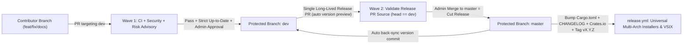

# Milestone 063: Two-Wave Release Train (`dev -> master`), Security CI Gates & Sensitive-Path Governance

## Document Metadata
* **Milestone ID:** MS-063
* **Target Version:** `v1.5.0`
* **Milestone Branch:** `milestone/063-two-wave-release-train-governance-and-security-gates`
* **Status:** COMPLETED
* **Lead Architect:** Release Engineering, Security Governance & Toolchain Maintainers
* **Normative Conformance:** RFC 2119 / RFC 8174 (`MUST`, `MUST NOT`, `REQUIRED`, `SHALL`, `SHALL NOT`, `SHOULD`, `SHOULD NOT`, `RECOMMENDED`, `MAY`, `OPTIONAL`)
* **Related Specifications:**
  * [GL-0001: Conventional Commits & Release Specification](../guidelines/authoring-commits.md)
  * [GL-0002: Trunk-Based & Milestone Branching Topology](../guidelines/branching-conventions.md)
  * [GL-0008: Milestone Planning & Delivery Specification](../guidelines/authoring-milestones.md)
  * [GL-0009: Test Engineering & Verification Matrices](../guidelines/authoring-test.md)
  * [GL-0011: Rust Language & Security Conventions](../guidelines/language-conventions.md)
  * [GL-0013: Pre-Merge Git-Diff Documentation Audit Protocol](../guidelines/documentation-update-protocol.md)
  * [MS-062: Cross-Platform CI/CD Overhaul & Release Automation](062-cicd-overhaul-cross-platform-bundling-and-release-automation.md)

---

## 1. Executive Summary & Threat Model

Following [MS-062](062-cicd-overhaul-cross-platform-bundling-and-release-automation.md) and the `v1.4.0` release cycle, running every check directly on `master` alongside ad-hoc `release-plz` PRs creates three operational problems:
1. **Duplicate Test Cycles:** Code is tested once on the `master` push, a second time on the generated release PR, and a third time when that release PR merges back to `master`.
2. **Release Drift on `solix-toolchain`:** Because `crates/solix-toolchain` sets `publish = false`, commits affecting CLI commands, asset embedding, or `solix_build.py` do not automatically bump or queue a release in `release-plz.toml`.
3. **Lack of Contributor Isolation, Skew Prevention, and Reviewer Risk Alerts:** Without strict two-branch isolation (`dev` -> `master`), out-of-date contributor PRs can merge semantic conflicts when two PRs land concurrently, direct PRs into `master` are not programmatically blocked, and edits to sensitive files (`.github/workflows/`, `docs/internals/guidelines/`, build scripts, or Cargo supply-chain manifests) carry elevated risk of accidental secret exposure or guardrail weakening without highlighting the risk to the admin reviewer.

This milestone establishes a **Two-Wave Release Train (`contributor -> dev -> master`)**, automated GitHub security scanning, non-blocking reviewer risk advisories for sensitive paths, admin-only PR acceptance via repository rulesets and `CODEOWNERS`, comprehensive test suites for every pipeline script and governance rule, an offline versioned **`solix wiki` documentation portal** bundled directly inside the `solix` toolchain binaries, and updated engineering guidelines plus contributor documentation.

---

## 2. Two-Wave Release Architecture

### 2.1 Wave 1 (`feature/*` -> `dev`): Strict Contributor Integration Gate
* **Branch Role:** `dev` is the sole integration branch for daily development, community contributions, and Dependabot updates. Direct pushes by contributors are prohibited.
* **Protected Branch Ruleset on `dev`:**
  * Require a pull request before merging (`required_approving_review_count >= 1`, admin/code-owner review only for now).
  * Dismiss stale approvals when new commits are pushed.
  * Require status checks to pass before merging: `Lint, Formatting & Documentation Gate`, all 3 OS `Test Matrix` jobs (`ubuntu-latest`, `macos-latest`, `windows-latest`), and CI security checks (`cargo-deny`, `cargo-audit`, `actionlint`, `zizmor`).
  * **Strict Up-to-Date Requirement (Anti-Skew):** Enable **"Require branches to be up to date before merging"** (`strict_required_status_checks_policy = true`). If Helper A merges into `dev` first, Helper B's previously-green PR is automatically blocked until updated with `dev` and re-tested against the combined tree.
* **Admin-Only Acceptance:** Restrict merge/bypass authority strictly to `@Jehudme` (repository owner/admin) and disable contributor force-pushes.

### 2.2 Wave 2 (`dev` -> `master`): Exclusive Release Train Gate
* **Protected Branch Ruleset on `master`:**
  * Block all direct pushes, deletions, and force-pushes.
  * Require a pull request before merging with admin approval and all required checks green.
  * Enforce mandatory status check **`Validate Release PR Source`**:
    * Rejects any PR targeting `master` from a fork (`head.repo.full_name != github.repository`).
    * Rejects any PR whose head branch is not the authorized integration/release source (`dev` or designated `release-plz-*` branch).
    * Contributors who accidentally open a PR directly to `master` receive an immediate, clear message directing them to retarget `dev`.
* **No Triple-Testing Overhead:** Heavy 3-OS test matrices run cleanly on Wave 1 (`dev` PRs) and on commit changes before entering `dev`. The `dev -> master` Release PR validates source eligibility, previewed release version, and changelog integrity without gratuitous triple re-runs; merging `dev -> master` executes release publication and back-syncs the version bump commit (`Cargo.toml` + `CHANGELOG.md`) cleanly onto `dev`.

### 2.3 Deterministic Version Selection & `solix-toolchain` Inclusion
1. **Conventional Commit Version Derivation:** Versions advance automatically from commits between the previous `vX.Y.Z` tag and `dev`:
   * Only `fix:`, `perf:`, `docs:`, `refactor:`, `test:`, `chore:` -> **Patch** (`X.Y.Z+1`).
   * Any `feat:` -> **Minor** (`X.Y+1.0`).
   * Any `feat!:` or `BREAKING CHANGE:` footer -> **Major** (`X+1.0.0`).
2. **Pre-Merge Version Visibility:** A lightweight preview job updates the open `dev -> master` Release PR summary with the exact computed next version (e.g., `Next Release Preview: v1.5.0`) and release notes diff before `@Jehudme` clicks Merge.
3. **Explicit Admin Override:** Maintainers **MAY** override the automatic SemVer bump cleanly prior to merging via a PR label (`release:patch`, `release:minor`, `release:major`) or manual `workflow_dispatch` version input.
4. **Toolchain Change Tracking:** Configure `release-plz.toml` (or unified workspace bump logic alongside `cliff.toml`) so changes in `crates/solix-toolchain/` (`publish = false`) still trigger workspace release versioning and installer builds instead of returning empty `prs`.

---

## 3. Security Checks, Sensitive-Path Alerts & Access Controls

### 3.1 `.github/CODEOWNERS` (Restricted Approval Without Total Ban)
High-risk files are **not banned** from community PRs (legitimate bug fixes and improvements remain welcome), **but** require explicit `@Jehudme` Code Owner sign-off under GitHub rulesets (`Require review from Code Owners`) plus highlighted security inspection:

| Risk Tier | Protected Paths | Why Restricted / Attack Vector |
| :--- | :--- | :--- |
| **`CI Workflows & Secrets`** | `.github/**` | Prevents sneaking malicious commands or `pull_request_target` triggers that could steal `RELEASE_TOKEN`, `CARGO_REGISTRY_TOKEN`, or `GITHUB_TOKEN`. |
| **`Governance & Guardrails`** | `docs/internals/guidelines/**`, `CONTRIBUTING.md`, `scripts/doc_sync_check.py`, `scripts/verify_docs.py`, `scripts/verify_doc_links.py` | Prevents weakening `GL-0011`, unsafe-code bans, pre-merge checks, or documentation audit rules. |
| **`Build & Supply Chain`** | `Cargo.toml`, `Cargo.lock`, `deny.toml`, `release-plz.toml`, `cliff.toml`, `scripts/**`, `**/build.rs`, `libraries/*/scripts/**`, `crates/solix-toolchain/assets/**` | Build scripts (`build.rs`, `.py`) execute arbitrary code during `cargo test`, `cargo build`, and release packaging. |
| **`Runtime Security & FFI`** | `crates/solix-common/src/project.rs`, `crates/solix-common/src/hash.rs`, `crates/solix-runtime/src/native/**`, `crates/solix-ffi/**` | Protects SHA-256 checksum checks, `.slxarc` ZIP extraction path traversal guards, and C-ABI FFI `unsafe` boundaries. |

### 3.2 Non-Blocking Reviewer Risk Advisory (`scripts/pr_risk_audit.py`)
* **Trigger & Safety Architecture:** Runs on PRs without disqualifying/failing valid PRs (exit code `0`).
  * **Fork-Safe Execution:** NEVER check out untrusted fork code in a privileged `pull_request_target` workflow. Read changed paths safely from GitHub's read-only PR file metadata API or isolated `pull_request` job, writing results to `$GITHUB_STEP_SUMMARY`, check annotations (`::warning file=...::...`), and (via safe two-stage `workflow_run` without untrusted code checkout) a single sticky PR comment + triage labels (`risk:ci-workflow`, `risk:guidelines`, `risk:supply-chain`, `risk:runtime-security`).
* **Reviewer Warning Content:** When any sensitive path above changes, the sticky advisory highlights:
  * Exact list of sensitive files grouped by tier.
  * Tailored human review checklist (e.g., for `.github/`: check token permissions, external action SHA pins, and `${{ github.event.* }}` injection; for `Cargo.toml`/`Cargo.lock`: inspect newly added crates and `build.rs` dependencies; for `docs/internals/guidelines/`: verify existing invariants are strengthened or clarified, not silently removed).

### 3.3 Additional Recommended GitHub Actions Security Gates
1. **Supply-Chain & License Enforcement (`cargo-deny` + `deny.toml`):** Enforce RustSec advisories, block yanked/unmaintained crates where configured, validate compatible licenses (`Apache-2.0`, `MIT`, `BSD-*`, `ISC`, `Zlib`), and block unapproved git/registry sources.
2. **CVE Vulnerability Audit (`cargo-audit`):** Run on PRs modifying `Cargo.toml`/`Cargo.lock` and on a weekly scheduled cron against RustSec.
3. **Workflow Static Security Analysis (`zizmor` + `actionlint`):** Scan all `.github/workflows/*.yml` files for YAML errors, command injection (`${{ github.event.pull_request.title }}` / `body`), overly broad `permissions:`, unpinned actions, and `pull_request_target` vulnerabilities.
4. **Third-Party Action SHA Pinning & Least-Privilege Tokens:** Pin every third-party GitHub Action to an immutable 40-character commit SHA (with human-readable version comment) and default all workflows to `permissions: contents: read` at the top level.
5. **Automated Dependency Maintenance (`.github/dependabot.yml`):** Configure weekly Dependabot security/version updates targeting **`dev`** for `cargo`, `github-actions`, and `npm` (`editors/vscode`).
6. **Repository-Level GitHub Security Controls:** Enable GitHub Secret Scanning, Push Protection, Dependabot alerts, and CodeQL static analysis on Rust and Python code (`crates/`, `scripts/`).

### 3.4 Milestone Authoring in GitHub & Documentation Source-of-Truth Policy
1. **Migrate Active Milestone Authoring to GitHub Milestones & Issue Forms:**
   * Instead of authoring day-to-day task lists and status updates only inside static `docs/internals/milestones/XXX-*.md` files, active planning **SHALL** use **GitHub Milestones** (`v1.5.0`, etc.) paired with structured `.github/ISSUE_TEMPLATE/` YAML forms (*Milestone Task / Feature Proposal*, *Bug Report*, *Security / Hardening Task*) enforcing priority labels (`P0`–`P3`), acceptance criteria, and Verification Matrix fields.
   * PRs link issues cleanly (`Closes #<issue>`) so GitHub automatically updates milestone completion percentages, assignee status, and release notes.
   * `docs/internals/milestones/001`–`063` remain preserved as historical architecture archive; only major multi-crate compiler/VM architecture proposals (`RFC` / `ADR`) need optional versioned markdown design docs in `docs/architecture/`.
2. **Keep `docs/wiki/`, `docs/features/`, and `docs/guide/` in Git (Do Not Move Out of Repo; Mirror One-Way If Needed):**
   * User documentation (`docs/wiki/`, `docs/features/`, `docs/guide/`, `docs/spec/`) **MUST NOT** be removed from the main Git repository into GitHub's standalone `.wiki.git` repo. Moving docs out of Git would break atomic Code + Docs PRs, disable `scripts/doc_sync_check.py` and `scripts/verify_docs.py` (`GL-0011`/`GL-0013`), lose versioned docs per release tag, and bypass `CODEOWNERS` / PR review.
   * **Multi-Version Caveat:** GitHub Wiki only renders one single snapshot (latest `master`/release) and cannot show a `v1.4.0` vs `v5.0.0` version switcher. Therefore:
     - Keeping `docs/` in Git ensures every `vX.Y.Z` tag retains its exact frozen documentation at `github.com/Jehudme/solix-language/tree/vX.Y.Z/docs`.
     - Any one-way GitHub Wiki sync **MUST** inject a version banner pointing older-version users to their tag's `/docs` directory (or versioned static site subfolders such as `/docs/v1.4.0/` on `gh-pages` / `https://solix-lang.org/docs` if deployed per release tag).

### 3.5 Versioned Offline Documentation Portal (`solix wiki`)
1. **Static HTML Build at Toolchain Packaging Time (`scripts/build_docs_site.py`):**
   * Pre-compile user-facing repository documentation (`docs/README.md`, `docs/guide/`, `docs/wiki/`, `docs/features/`, `docs/spec/`, excluding internal governance files in `docs/internals/`) into a self-contained static HTML portal in `crates/solix-toolchain/assets/docs/` with responsive light/dark styling, left sidebar navigation, table of contents, clean syntax highlighting, rendered GitHub-style callouts, and an offline `search_index.js` (`window.SOLIX_DOCS_INDEX = [...]`) so search works directly over `file://` without spawning an HTTP server or hitting browser `fetch()` CORS limits.
   * When bundled library sources are present (`libraries/solixlib`, `libraries/raylib`), optionally integrate or link generated API reference pages so standard library docs travel alongside language specs.
2. **Embedded Binary Materialization & `solix wiki` Subcommand:**
   * Update `crates/solix-toolchain/build.rs` and `src/assets.rs` (mirroring `bundled_packages` and `vscode` staging) to embed `assets/docs/**` when staged (`EMBEDDED_WIKI_DOCS`) and lazily materialize version-isolated files into `$SOLIX_HOME/cache/wiki/v<version>/` (or `~/.solix/cache/wiki/v<version>/`) with hash/marker deduplication.
   * Add `solix wiki` (`Commands::Wiki(WikiArgs)`) supporting `--no-open` (materialize and print the local `index.html` path cleanly), `--output <dir>` (export the static site to a custom folder), and optional `--topic <query>` / `--search <query>` deep-linking (`index.html?q=...`), reusing the cross-platform `open_in_browser` helper so users on `v1.4.0`, `v1.5.0`, or `v5.0.0` always open docs matching their installed binary offline.

---

## 4. Phased Implementation Plan & Task Matrix

### 4.1 P0: Critical Governance & Workflow Blockers
- [x] `[P0]` **`MS063-T01` (Provision Protected `dev` Branch & Ruleset Policies):** Create `dev` from `master`, document and apply GitHub Rulesets on both `dev` (require PR, strict up-to-date branch checks, admin/code-owner approval, no force-push) and `master` (require PR from `dev` / sanctioned release train, admin-only merge, require `Validate Release PR Source`, no direct pushes).
- [x] `[P0]` **`MS063-T02` (Implement Two-Wave CI & Release-Train Workflows):** Refactor [ci.yml](../../../.github/workflows/ci.yml) so full test/lint/security gates run on PRs targeting `dev`, add **`Validate Release PR Source`** on PRs targeting `master`, wire `dev -> master` Release PR version preview and post-merge tag/`crates.io`/back-sync flow, and ensure `crates/solix-toolchain` changes participate in version bumps cleanly.
- [x] `[P0]` **`MS063-T03` (Add `.github/CODEOWNERS` & Enforce Restricted Approval):** Create `.github/CODEOWNERS` covering `.github/`, `docs/internals/guidelines/`, `scripts/`, `Cargo.toml`, `Cargo.lock`, `deny.toml`, `**/build.rs`, `crates/solix-common/src/project.rs`, `hash.rs`, `crates/solix-runtime/src/native/`, and `crates/solix-ffi/`.

### 4.2 P1: Security Scanners, Risk Advisories & Test Suite
- [x] `[P1]` **`MS063-T04` (Build Non-Blocking Sensitive-Path Reviewer Advisory — `scripts/pr_risk_audit.py`):** Implement `scripts/pr_risk_audit.py` and fork-safe CI integration emitting `$GITHUB_STEP_SUMMARY`, file annotations, risk labels, and a single sticky PR review checklist whenever sensitive files are touched—without disqualifying valid PRs.
- [x] `[P1]` **`MS063-T05` (Add `cargo-deny`, `cargo-audit`, `zizmor`, `actionlint` & SHA-Pin Workflows):** Add `deny.toml` and `.github/dependabot.yml` (targeting `dev`), pin all GitHub Actions in `.github/workflows/*.yml` to full commit SHAs with top-level read-only permissions, and run `actionlint`, `zizmor`, `cargo-deny`, and `cargo-audit` in CI (plus optional CodeQL analysis).
- [x] `[P1]` **`MS063-T06` (Comprehensive Script, Security & Archive Path-Safety Test Suite):**
  * Add Python automated tests (`scripts/tests/` or CI unittest suite) testing `pr_risk_audit.py` (all 4 risk tiers + clean zero-exit non-blocking guarantee), release source-branch gate validation (rejecting forks and direct topic PRs to `master`, accepting `dev`), `doc_sync_check.py`, `verify_docs.py`, and `merge_bundled_packages.py`.
  * Add Rust tests in [project.rs](../../../crates/solix-common/src/project.rs) verifying `.slxarc` extraction rejects path traversal entries (`../`, absolute archive member paths) and tampered checksums cleanly, plus full regression coverage across `crates/`.

### 4.3 P2: Guidelines, Trigger Matrix & Contributor Onboarding Docs
- [x] `[P2]` **`MS063-T07` (Update Existing Guidelines for `dev -> master` & Author `GL-0014`):**
  * Author **`GL-0014`: Release Train, Sensitive-Path Governance & Reviewer Security Protocol** (`docs/internals/guidelines/pr-and-release-governance.md`) and register it in [guidelines README](../guidelines/README.md).
  * Update [GL-0001](../guidelines/authoring-commits.md) (Conventional Commit version impact & release overrides), [GL-0002](../guidelines/branching-conventions.md) (`dev` integration + `master` release trunk topology, up-to-date branch rule), [GL-0008](../guidelines/authoring-milestones.md) (deprecate file-only milestone authoring in favor of GitHub Milestones + Issue Forms while preserving historical archive + ADRs), and [GL-0013](../guidelines/documentation-update-protocol.md) (`--base dev` diff target + governance doc triggers).
  * Update [`scripts/doc_sync_check.py`](../../../scripts/doc_sync_check.py) `TRIGGER_MATRIX` to cover `.github/workflows/` and `scripts/` governance/workflow updates.
- [x] `[P2]` **`MS063-T08` (Author Root `CONTRIBUTING.md` & PR Template):** Add root `CONTRIBUTING.md` and `.github/pull_request_template.md` explaining step-by-step how contributors fork/branch from `dev`, run local formatting/Clippy/doc/test checks, follow Conventional Commits, open PRs targeting `dev` (not `master`), and handle review feedback on sensitive files.
- [x] `[P2]` **`MS063-T09` (GitHub Milestones & Issue Forms Standardization):** Author structured `.github/ISSUE_TEMPLATE/` YAML forms (`milestone_task.yml`, `bug_report.yml`, `feature_request.yml`, `config.yml`), standardize priority/tier labels (`P0`–`P3`, `release:*`, `risk:*`), and configure the active GitHub Milestone workflow (`gh` CLI / issue linking) to replace manual `XXX-*.md` milestone file authoring.
- [x] `[P3]` **`MS063-T10` (One-Way `docs/` -> GitHub Wiki Sync Workflow with Version Banner — Keeping Git as Single Source of Truth):** Keep `docs/wiki/`, `docs/features/`, `docs/guide/`, and `docs/spec/` inside the main Git repository (`doc_sync_check.py`-enforced) so every `vX.Y.Z` tag preserves exact versioned docs; add an optional read-only sync workflow triggered on `master` releases that mirrors `docs/wiki/`, `docs/features/`, and `docs/guide/` into GitHub Wiki with a release-version header linking older versions to `tree/<tag>/docs` (or future versioned `gh-pages` / `solix-lang.org/docs/<version>/` builds).

### 4.4 P2: Versioned Offline `solix wiki` Documentation Portal
- [x] `[P2]` **`MS063-T11` (Static Docs Generator & Toolchain Asset Embedding):**
  * Implement `scripts/build_docs_site.py` converting `docs/README.md`, `docs/guide/`, `docs/wiki/`, `docs/features/`, and `docs/spec/` (excluding `docs/internals/`) into a self-contained static HTML portal + offline `search_index.js` inside `crates/solix-toolchain/assets/docs/`.
  * Update `crates/solix-toolchain/build.rs` and `crates/solix-toolchain/src/assets.rs` to embed staged `assets/docs/**` (`EMBEDDED_WIKI_DOCS`) and materialize versioned files into `$SOLIX_HOME/cache/wiki/v<version>/`.
  * Wire `scripts/build_docs_site.py` into [ci.yml](../../../.github/workflows/ci.yml) and [release.yml](../../../.github/workflows/release.yml) prior to toolchain compilation/packaging so every distributed `solix` binary embeds its matching documentation snapshot.
- [x] `[P2]` **`MS063-T12` (`solix wiki` CLI Command, Specs & End-to-End Tests):**
  * Add `Commands::Wiki(WikiArgs)` (`--no-open`, `--output`, `--topic` / `--search`) in `crates/solix-toolchain/src/cli.rs` and `crates/solix-toolchain/src/commands/wiki.rs`, reusing `open_in_browser`.
  * Author `docs/spec/tools/cli/wiki.md` and update `docs/spec/tools/cli/README.md` + `docs/guide/01_getting_started.md` so `scripts/verify_docs.py` covers `wiki`.
  * Add Python tests validating HTML generation, internal link rewriting, `search_index.js` generation, and exclusion of `docs/internals/`, plus Rust integration tests verifying `solix wiki --no-open`, `--output`, and standalone embedded asset extraction.

---

## 5. Verification & Test Matrix (`GL-0009`)

1. **Governance Script Unit Suite:** Positive and negative automated tests verify `pr_risk_audit.py` exits `0` on all inputs while accurately classifying `.github/workflows/`, `docs/internals/guidelines/`, `Cargo.toml`/`build.rs`, and `crates/solix-runtime/src/native/`, and emitting zero alerts for ordinary feature/test edits.
2. **Release-Gate Negative Matrix:** Automated tests confirm `Validate Release PR Source` rejects PRs targeting `master` from `fix/*`, `feat/*`, or external forks (`head.repo.full_name != github.repository`), and passes only for `dev -> master` (or authorized internal release branches).
3. **Supply-Chain & Workflow Security:** `actionlint`, `zizmor`, `cargo deny check`, and `cargo audit` report zero unaddressed errors/vulnerabilities across all `.github/workflows/*.yml` and `Cargo.lock`.
4. **Archive Security Tests:** `cargo test --workspace --all-targets` includes malicious `.slxarc` Zip-Slip (`../escape`) rejection and SHA-256 tamper rejection tests on all 3 OS runners.
5. **Documentation & Zero-Drift Verification:** `python3 scripts/doc_sync_check.py --base origin/dev`, `python3 scripts/doc_sync_check.py --all-docs`, `python3 scripts/verify_docs.py`, and `python3 scripts/verify_doc_links.py` pass cleanly with zero `GL-0011` single-letter variable violations.
6. **GitHub Issue Templates & Wiki Mirror Dry-Run:** Validate `.github/ISSUE_TEMPLATE/*.yml` schemas cleanly and verify the `docs/` -> Wiki sync script builds deterministic Wiki filenames (`Home.md`, `_Sidebar.md`, rewritten relative links) in temporary directory tests without deleting any `docs/` source files.
7. **Live Ruleset Smoke Verification:** Verify on GitHub that a test PR targeting `dev` with a failing check or behind-`dev` base cannot be merged, a direct PR targeting `master` from a topic branch is blocked by `Validate Release PR Source`, and a PR touching `.github/workflows/` posts the reviewer warning advisory and requests `@Jehudme` CODEOWNER review.
8. **Offline `solix wiki` End-to-End Verification:** Build `crates/solix-toolchain/assets/docs/` via `scripts/build_docs_site.py`, verify generated HTML & `search_index.js` contain all user docs and zero `docs/internals/` files, compile `solix` with embedded docs, run `solix wiki --no-open` and `solix wiki --output <tmp>` cleanly against an isolated `SOLIX_HOME`, and verify `verify_docs.py` tracks `wiki`.

---

## 6. Definition of Done (DoD) Sign-Off Matrix

| DoD Requirement | Target Verification | Tool / Workflow | Sign-off Status |
| :--- | :--- | :--- | :---: |
| **Strict `dev` + `master` Rulesets Active** | Up-to-date checks required on `dev`; `master` accepts only release PR | GitHub Rulesets & `Validate Release PR Source` | [x] Verified |
| **Non-Blocking Sensitive-Path Advisories** | PR comment/summary warns reviewer on `.github/`, guidelines, `Cargo.*`, `build.rs`, security paths | `scripts/pr_risk_audit.py` + `.github/CODEOWNERS` | [x] Verified |
| **Supply-Chain & Action Security Gates** | Zero unresolved advisories, license issues, or workflow injection findings | `cargo-deny`, `cargo-audit`, `actionlint`, `zizmor`, Dependabot | [x] Verified |
| **100% Pipeline, Security & Zip-Slip Tests** | All Rust and Python workflow/governance/archive tests pass cleanly | `cargo test --workspace --all-targets` + Python suite | [x] Verified |
| **Versioned Offline `solix wiki` Bundled** | `scripts/build_docs_site.py` + `build.rs` embed static HTML + `search_index.js`; `solix wiki` extracts & opens offline | `scripts/build_docs_site.py` + `solix wiki --no-open` | [x] Verified |
| **GitHub Milestones & Issue Forms Active** | `.github/ISSUE_TEMPLATE/` live and `GL-0008` updated from static file authoring | `.github/ISSUE_TEMPLATE/`, `GL-0008` | [x] Verified |
| **Guidelines, `CONTRIBUTING.md` & Docs Source-of-Truth Synced** | `GL-0001`, `GL-0002`, `GL-0008`, `GL-0013`, `GL-0014`, `CONTRIBUTING.md` audited; `docs/` preserved in Git | `scripts/doc_sync_check.py`, `verify_docs.py`, `verify_doc_links.py` | [x] Verified |
