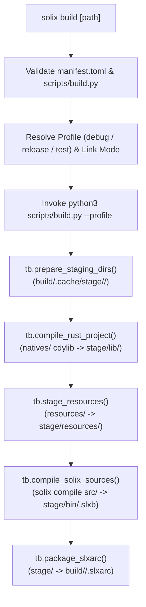

# `solix build` — Project Manifest & Container Build

The `build` subcommand orchestrates project building and packaging according to `manifest.toml`. It executes project build automation (`scripts/build.py`), compiles Rust native bridge extension crates, stages resources, compiles Solix source files, and produces a distributable archive container (`build/<profile>/<name>.slxarc`).

---

## Synopsis

```bash
solix build [path] [options]
```

---

## Positional Arguments

| Argument | Type | Default | Description |
|---|---|---|---|
| `[path]` | Path | `.` (Current Directory) | Project root directory containing `manifest.toml` and `scripts/build.py`. |

---

## Options & Flags

| Option | Shorthand | Type | Default | Description |
|---|---|---|---|---|
| `--profile <mode>` | | String | `"debug"` | Target build profile: `debug`, `release`, or `test`. |
| `--debug` | | Flag | `false` | Shorthand for debug build profile (`--profile debug`). |
| `--release` | | Flag | `false` | Shorthand for release build profile (`--profile release`). |
| `--test` | | Flag | `false` | Shorthand for test build profile (`--profile test`), including `tests/` sources in the compilation. |
| `--link <mode>` | | String | `"dynamic"` | Linking mode for dependencies and emission: `dynamic` (default) or `static`. |
| `--static` | | Flag | `false` | Shorthand for static linking mode (`--link static`). |
| `--pkg-dir <dir>` | | Path | `~/.solix/packages` | Root directory override for resolving package dependencies. |

---

## Build Automation Pipeline

When `solix build` is invoked:



### Staged Artifact Directory Structure

During the build lifecycle, artifacts are assembled deterministically:

```text
build/
├── .cache/
│   ├── cargo/                # Cargo target directory for native bridge crates
│   └── stage/
│       └── <profile>/
│           ├── manifest.toml # Packaged copy of project manifest
│           ├── bin/
│           │   └── <name>.slxb # Compiled Solix application bytecode
│           ├── lib/
│           │   ├── <name>_bridge.so # Native shared library (.so / .dll / .dylib)
│           │   └── (dependencies)
│           └── resources/    # Bundled data assets
└── <profile>/
    └── <name>.slxarc         # Final distribution archive
```

---

## Exit Codes

| Exit Code | Classification | Meaning |
|---|---|---|
| `0` | Success | Project built and `.slxarc` archive successfully created. |
| `1` | Error | Missing `manifest.toml`, missing `scripts/build.py`, native cargo compilation error, or Solix compilation error. |

---

## Examples

### 1. Default Debug Build
```bash
solix build
```

### 2. Optimized Release Build
```bash
solix build --release
```

### 3. Test Build
```bash
solix build --test
```

### 4. Build Project in Another Directory with Static Linking
```bash
solix build ../game_project --release --static
```
