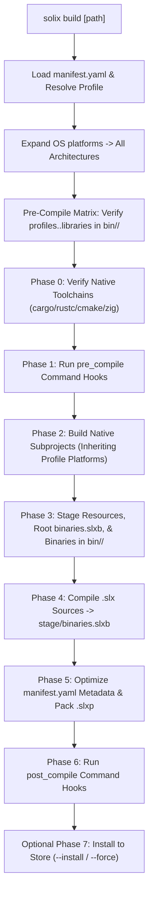

# `solix build` — Project Manifest & Container Build

The `build` subcommand orchestrates project building and packaging directly in Rust from `manifest.yaml` (with legacy `manifest.toml` compatibility). It runs `pre_compile` hooks, auto-detects Cargo (`Cargo.toml`) and CMake (`CMakeLists.txt`) native subprojects, compiles Solix source files, packages distributable `.slxp` containers (`build/<profile>/<name>.slxp`), and runs `post_compile` hooks.

---

## Synopsis

```bash
solix build [path] [options]
```

---

## Positional Arguments

| Argument | Type | Default | Description |
|---|---|---|---|
| `[path]` | Path | `.` (Current Directory) | Project root directory containing `manifest.yaml` (or `manifest.toml`). |

---

## Options & Flags

| Option | Shorthand | Type | Default | Description |
|---|---|---|---|---|
| `--profile <mode>` | | String | `"release"` | Target build profile (e.g., `release`, `debug`, `test`, or custom declared profile). |
| `--debug` | | Flag | `false` | Shorthand for `--profile debug`. |
| `--release` | | Flag | `false` | Shorthand for `--profile release`. |
| `--test` | | Flag | `false` | Shorthand for `--profile test`. |
| `--platform <platform>` | | String | None | Filters build and native compilation to a designated target platform or OS family (e.g. `linux`, `windows`, `macos`). |
| `--pkg-dir <dir>` | | Path | `~/.solix/packages` | Root directory override for resolving package dependencies. |
| `--install` | `-i` | Flag | `false` | Automatically installs the built `.slxp` package into the package store. |
| `--force` | `-f` | Flag | `false` | Overwrites existing installed package when paired with `--install`. |
| `--check-env` | `--verify-only` | Flag | `false` | Runs Phase 0 pre-flight environment and toolchain verification without compiling or packaging. |
| `--target <triple>` | | String | `None` | Compiles native projects for a single target triple or `"host"` (also reads `SOLIX_TARGET_TRIPLE`). |

---

## Build Automation Pipeline



### Modernized Package Container Architecture (`.slxp`)
* **Package Root Bytecode (`binaries.slxb`):** The primary compiled Solix bytecode is placed at the package root as `binaries.slxb`.
* **Standardized Binary Directory (`bin/<target>/`):** All native modules and pre-compiled external shared libraries targeting host or cross-compilation platforms are organized exclusively under `bin/<target_triple>/`. The legacy `lib/` directory is deprecated and eliminated.
* **Modern Container Emission:** Emits standard `.slxp` (Solix Package) format containing root `binaries.slxb` and target-tripled `bin/<target>/` native shared libraries.
* **Optimized Container Manifest Metadata:** Embedded `manifest.yaml` inside package archives retains pure declarative metadata for active profiles while stripping developer-only hooks (`pre_compile`, `post_compile`) and transient compiler internals.
* **Cross-Platform Tool Invocation:** Native build toolchains (`cargo`, `cmake`, `zig`) are located respecting host executable formats and `PATHEXT` on Windows, ensuring `.cmd` and `.bat` wrappers are cleanly dispatched without error 193.
* **Mandatory Containerized Docker Native Compilation:** All native library subprojects (Cargo and CMake backends) mandate Docker containerization across all compilation targets. Native builds execute hermetically inside standardized, target-specific cross container images (`ghcr.io/cross-rs/*` and `dockcross/*`), eliminating host cross-compiler toolchain installation requirements (`cmake`, `zig`, `mingw-w64`) and preventing host instruction set leaks (such as AVX2). Container runs automatically propagate host user and group permissions (`-u <uid>:<gid>`) on Unix to ensure all created artifacts match host filesystem ownership.
* **Target Container Image Mapping:** When cross-compiling, Solix maps target triples to their official images. Windows GNU and MSVC targets (`x86_64-pc-windows-gnu` and `x86_64-pc-windows-msvc`) map to canonical `ghcr.io/cross-rs/x86_64-pc-windows-gnu:edge` sysroots, while CMake native modules leverage target dockcross images.
* **Cargo Native Cross-Runner Mandate:** When compiling Cargo native crates, Solix invokes `cross` to execute builds inside the target container environment, eliminating host cross-toolchain dependencies while respecting crate-level `Cross.toml` configuration files via `CROSS_CONFIG`.
* **Containerized Target Directory Isolation:** When compiling native dependencies in containers, Solix automatically segregates cargo and cmake build caches (`build/.cache/cargo-docker` and `build/.cache/cmake-docker`) from host build caches, avoiding dynamic linker mismatches between host and container glibc environments.

### Dual-Mode Native Compilation & Platform Inheritance
* **Unified Platform Inheritance:** Native subprojects (`natives.<name>`) strictly inherit target platforms configured in `profiles.<profile>.platforms`. Separate platform overrides under `natives` are removed to guarantee unified multi-target builds.
* **CMake (`CMakeLists.txt`):** `solix build` configures CMake with `-DSOLIX_NATIVE_BUILD=ON` and sets `SOLIX_NATIVE_BUILD=1`. When built outside `solix build`, the same CMake project builds cleanly as a standalone embeddable library.
* **Cargo (`Cargo.toml`):** When `[features]` declares `solix-native`, `solix build` passes `--features solix-native` and sets `SOLIX_NATIVE_BUILD=1`.
* **External Pre-Compiled Libraries Verification Matrix (`libraries`):** When `profiles.<profile>.libraries` declares shared libraries (e.g. `[libcustom_math, ext_engine]`), `solix build` verifies that matching `.so`, `.dll`, or `.dylib` files exist in `bin/<target_triple>/` for all target architectures required by the active profile prior to compilation.
* **Strict Native Autoloading Convention (`__native_<name>`):** Shared libraries intended for automatic runtime registration and FFI symbol binding must follow the `__native_<name>.<extension>` (or `lib__native_<name>.<extension>`) naming prefix convention. Auxiliary dynamic dependencies without this prefix are packaged in `bin/<target_triple>/` for runtime linking without registering spurious native modules.
* **Native Dependency Platform Check:** When a profile requests target `platforms` (such as `[all]` or `[linux, windows]`), `solix build` verifies that every native-backed dependency `.slxp` bundles `.so`/`.dll`/`.dylib` binaries for all requested platforms, failing explicitly if any target platform is missing.

---

## Exit Codes

| Exit Code | Classification | Meaning |
|---|---|---|
| `0` | Success | Project built and `.slxp` package successfully created. |
| `1` | Error | Missing manifest, environment verification failure, hook error, native build error, or Solix compilation error. |

---

## Examples

### 1. Default Release Build
```bash
solix build
```

### 2. Debug Profile Build
```bash
solix build --debug
```

### 3. Host-Only Build & Auto-Install
```bash
solix build libraries/solixlib --profile release --target host --install --force
```
