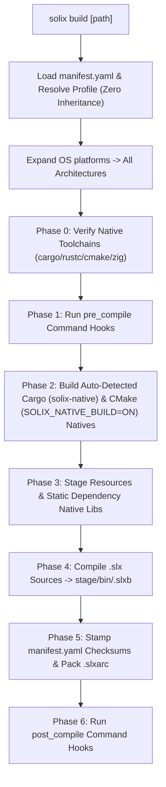

# `solix build` — Project Manifest & Container Build

The `build` subcommand orchestrates project building and packaging directly in Rust from `manifest.yaml` (with legacy `manifest.toml` compatibility). It runs `pre_compile` hooks, auto-detects Cargo (`Cargo.toml`) and CMake (`CMakeLists.txt`) native subprojects, compiles Solix source files, packages distributable `.slxarc` containers (`build/<profile>/<name>.slxarc`), and runs `post_compile` hooks.

---

## Synopsis

```bash
solix build [path] [options]
```

---

## Positional Arguments

| Argument | Type | Default | Description |
|---|---|---|---|
| `[path]` | Path | `.` (Current Directory) | Project root directory containing `manifest.yaml` (or `manifest.toml`). |

---

## Options & Flags

| Option | Shorthand | Type | Default | Description |
|---|---|---|---|---|
| `--profile <mode>` | | String | `"release"` | Target build profile (e.g., `release`, `debug`, `test`, or custom declared profile). |
| `--debug` | | Flag | `false` | Shorthand for `--profile debug`. |
| `--release` | | Flag | `false` | Shorthand for `--profile release`. |
| `--test` | | Flag | `false` | Shorthand for `--profile test`. |
| `--pkg-dir <dir>` | | Path | `~/.solix/packages` | Root directory override for resolving package dependencies. |
| `--install` | | Flag | `false` | Automatically installs the built `.slxarc` into the package store. |
| `--force` | | Flag | `false` | Overwrites existing installed package when paired with `--install`. |
| `--check-env` | `--verify-only` | Flag | `false` | Runs Phase 0 pre-flight environment and toolchain verification without compiling or packaging. |
| `--target <triple>` | | String | `None` | Compiles native projects for a single target triple or `"host"` (also reads `SOLIX_TARGET_TRIPLE`). |

---

## Build Automation Pipeline



### Dual-Mode Native Compilation Flags
* **CMake (`CMakeLists.txt`):** `solix build` configures CMake with `-DSOLIX_NATIVE_BUILD=ON` and sets `SOLIX_NATIVE_BUILD=1`. When built outside `solix build`, the same CMake project builds cleanly as a standalone embeddable library.
* **Cargo (`Cargo.toml`):** When `[features]` declares `solix-native`, `solix build` passes `--features solix-native` and sets `SOLIX_NATIVE_BUILD=1`.

---

## Exit Codes

| Exit Code | Classification | Meaning |
|---|---|---|
| `0` | Success | Project built and `.slxarc` archive successfully created. |
| `1` | Error | Missing manifest, environment verification failure, hook error, native build error, or Solix compilation error. |

---

## Examples

### 1. Default Release Build
```bash
solix build
```

### 2. Debug Profile Build
```bash
solix build --debug
```

### 3. Host-Only Build & Auto-Install
```bash
solix build libraries/solixlib --profile release --target host --install --force
```
