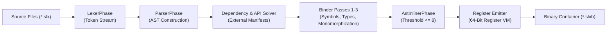

# `solix compile` — Source File Compilation

The `compile` subcommand compiles one or more Solix source files (`*.slx`) into an executable binary container (`*.slxb`), performing lexing, parsing, multi-pass type binding, semantic analysis, optimization, and 64-bit Register VM bytecode emission.

---

## Synopsis

```bash
solix compile <sources...> [options]
```

---

## Positional Arguments

| Argument | Type | Required | Description |
|---|---|---|---|
| `<sources...>` | Paths | **Yes** | One or more `.slx` source file paths or directories containing Solix source code. |

---

## Options & Flags

| Option | Shorthand | Type | Default | Description |
|---|---|---|---|---|
| `--output <file>` | `-o` | Path | `<name>.slxb` | Destination file path for the compiled `.slxb` binary container. |
| `--deps <pkg@ver>` | `-d` | String (Repeated) | `[]` | Package dependency requirements formatted as `<name>[-<profile>]@<version>` (e.g. `-d raylib-release@5.5.0`). |
| `--deps-file <path>` | `-l` | Path (Repeated) | `[]` | Paths to external `.slxb` binaries or `.slxarc` archives whose API interfaces should be extracted and linked (visible alias `--lib`). |
| `--name <name>` | `-n` | String | (Derived from sources) | Package or module identifier name. |
| `--version <semver>` | `-V` | String | `"0.1.0"` | Semantic version string embedded into binary container metadata. |
| `--description <desc>` | | String | `""` | Human-readable package description. |
| `--profile <mode>` | | String | `"release"` | Target compilation profile: `debug`, `release`, or `test`. |
| `--entry <symbol>` | `-e` | String | None | Explicit entry point function symbol (e.g. `-e Main::main`). |
| `--emit-api <file.slx>` | | Path | None | Synthesizes and writes the public interface API declarations to a `.slx` file. |
| `--no-builtins` | | Flag | `false` | Omits automatic ingestion of built-in standard library definitions (`blt.io`). |
| `--check` | | Flag | `false` | Executes lexical, grammatical, and semantic binder checks without emitting bytecode. |
| `--time` | | Flag | `false` | Prints wall-clock elapsed duration for each compiler pipeline phase. |
| `--metrics [<format>]` | | Optional String | None (`text` if flag only) | Prints compiler throughput metrics and phase duration breakdown formatted as `text` or `json`. |
| `--inline-threshold <N>` | | Integer | `8` | Maximum statement threshold for `AstInlinerPhase` function inlining. |
| `--link <mode>` | | String | `"dynamic"` | Linking mode for dependencies and emission: `dynamic` (default) or `static`. |
| `--static` | | Flag | `false` | Shorthand for static linking mode (`--link static`), merging dependencies into a single self-contained binary. |
| `--no-verify` | | Flag | `false` | Bypasses dependency cryptographic SHA-256 checksum verification (visible alias `--ignore-checksum`). |
| `--pkg-dir <dir>` | | Path | `~/.solix/packages` | Root directory override for resolving package dependencies. |
| `--install` | | Flag | `false` | Automatically installs the compiled binary container into the local package store upon success (visible alias `--sync`). |
| `--force-install` | `-f` | Flag | `false` | Overwrites existing package artifacts when `--install` is active. |

---

## Compiler Pipeline Architecture

When `solix compile` executes, sources pass through the unified compiler pipeline:



---

## Linking Modes

### Dynamic Linking (`--link dynamic`, Default)
External symbols from packages declared via `--deps` or `--lib` are resolved as external references. The emitted `.slxb` container records external module and symbol dependencies, resolving them dynamically at runtime via the `ClientModuleSolver`.

### Static Linking (`--link static` or `--static`)
External symbols and classes from dependencies are fully merged into the output `.slxb` container, followed by Dead-Code Elimination (DCE). The resulting container has zero runtime package store dependencies.

---

## Exit Codes

| Exit Code | Classification | Meaning |
|---|---|---|
| `0` | Success | Compilation completed and `.slxb` container emitted. |
| `1` | Error | Lexical, syntactic, binder type error, or file resolution failure. |

---

## Examples

### 1. Basic Compilation
```bash
solix compile src/main.slx -o bin/app.slxb
```

### 2. Multi-File Compilation with Dependencies
```bash
solix compile src/app.slx src/utils.slx -d raylib@1.0.0 -o bin/game.slxb
```

### 3. Syntax and Type Check Only
```bash
solix compile src/main.slx --check
```

### 4. Static Linking with Performance Telemetry
```bash
solix compile src/main.slx -d math_utils@0.2.0 --static --metrics
```
